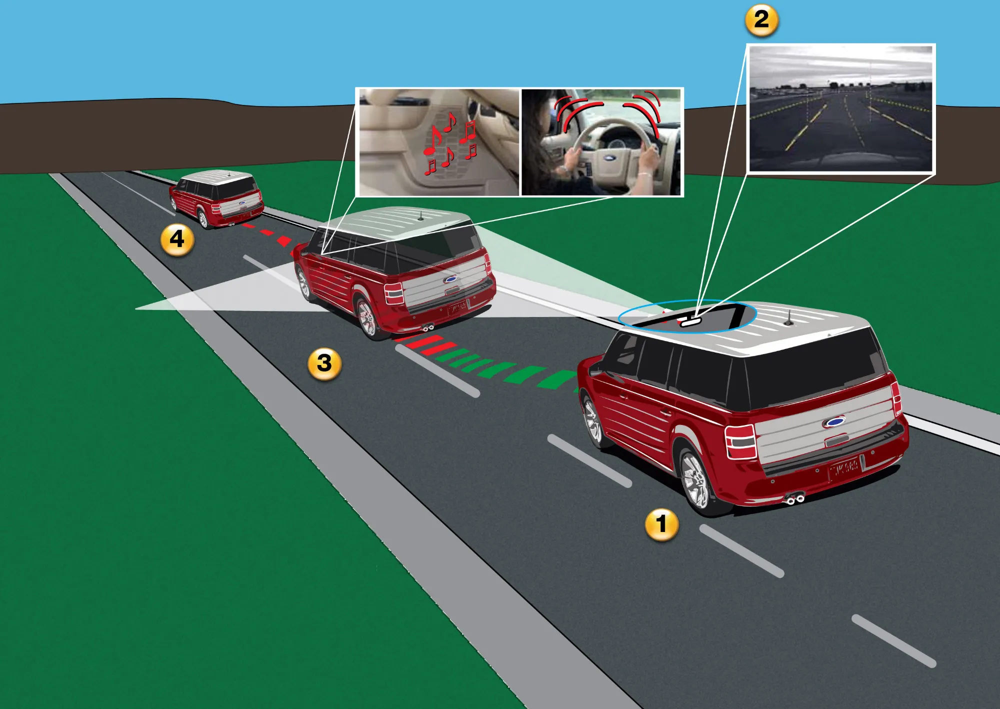

Electric car spec sheets are packed with acronyms: AEB, LKA, ACC, BSM. They all belong to the **ADAS** family, short for advanced driver assistance systems. Some only warn you, others brake or steer for you, and none of them makes the car self-driving. Knowing which is which keeps you from paying for a top trim that brings warnings where you expected assistance.

## The key difference: warning or acting

A **warning** system alerts you with a sound, a vibration or a light, and leaves everything to the driver. An **assistance** system steps in: it brakes, accelerates or corrects the steering. On the spec sheet, the wording gives it away. "Forward collision warning" only warns; "autonomous emergency braking" brakes.

## What each one does

| Acronym | Name | What it does | Acts or only warns? |
|---|---|---|---|
| AEB | Autonomous emergency braking | Brakes if it detects an imminent collision with a car, a pedestrian or a cyclist | Acts |
| FCW | Forward collision warning | Warns of a possible collision | Warns |
| LKA or LKAS | Lane keeping assist | Corrects the steering if the car drifts out of its lane without the turn signal on | Acts |
| LDW | Lane departure warning | Warns if the car crosses the line | Warns |
| ELKS | Emergency lane keeping system | Corrects the steering in risky situations, such as drifting into oncoming traffic | Acts |
| ACC | Adaptive cruise control | Holds the speed and the gap to the car ahead, and brakes if that car brakes | Acts |
| BSD or BSM | Blind spot monitor | Lights up a signal in the mirror if a vehicle is in the zone you cannot see | Warns |
| RCTA | Rear cross-traffic alert | Warns of cars approaching from the sides when backing out | Warns |
| ISA | Intelligent speed assistance | Reads road signs and warns you, or limits the speed, if you go over the limit | Depends on the model |
| DDAW | Driver drowsiness and attention warning | Detects signs of fatigue or distraction and asks you to take a break | Warns |

*Lane departure warning uses a camera that reads the road markings. Lane keeping assist goes one step further and corrects the steering. Illustration: Ford Motor Company, CC BY 2.0, via Wikimedia Commons.*

## Which ones EU law requires

Since July 7, 2024, the European Union's General Safety Regulation has required every new passenger car to come with, among other things, **autonomous emergency braking, an emergency lane keeping system, intelligent speed assistance, driver drowsiness and attention warning, reversing detection** and an **event data recorder**, a black box that logs crash data. The blind spot monitor is mandatory only for buses and trucks.

Latin America has no equivalent requirement for passenger cars, which explains why the same model often reaches the region with less equipment. Euro NCAP also penalizes cars that do not have these systems as standard: the **Kia EV3** lost its fifth star because, without the optional assistance pack, it scored **67% in Safety Assist**. We cover it in [its own story](/es/notas/kia-ev3-euro-ncap-4-o-5-estrellas/).

## Which ones are most worth having

If you have to pick one, the evidence favors **autonomous emergency braking**. According to the US Insurance Institute for Highway Safety (IIHS), cars with automatic braking had **50% fewer rear-end crashes** and 56% fewer rear-end crashes with injuries. The warning alone, without braking, cut them by 27%. For people who spend a lot of time on the highway, **adaptive cruise control** reduces fatigue on long trips, although it does not prevent crashes on its own. **Blind spot monitoring** helps most on multi-lane roads full of motorcycles, which is exactly the daily situation in Colombia's big cities.

## "Autopilot" is still Level 2

Systems like Tesla's Autopilot or the highway pilots from Chinese brands combine adaptive cruise control and lane keeping assist. On the automation scale of SAE, the engineering organization, they are **Level 2**: the car accelerates, brakes and steers, but the driver has to stay alert with hands ready at all times, and is legally responsible for whatever happens. No car on sale in Latin America is self-driving.

## Frequently asked questions

### What does ADAS stand for?

Advanced driver assistance systems. It is the umbrella term for all the electronic aids in this story.

### What is lane keep assist?

The lane keeping assist (LKA) system nudges the steering wheel to bring the car back to the center of the lane if it drifts out without the turn signal on.

### Can ADAS be turned off?

In most cars, yes, from the screen or with a button. In Europe, the rules require speed assistance to switch itself back on every time the car is started.

---

**Sources:** [SIMI: systems required by the EU General Safety Regulation](https://www.simi.ie/en/road-safety/gsr) · [IIHS: automatic braking reduces rear-end crashes](https://www.iihs.org/news/detail/front-crash-prevention-slashes-police-reported-rear-end-crashes) · [Fleet News: how European speed assistance works](https://www.fleetnews.co.uk/news/new-eu-vehicle-safety-regulation-and-what-it-means-for-uk-drivers) · [Euro NCAP: Kia EV3, 2025 rating](https://www.euroncap.com/en/results/kia/ev3/54845) · [Euro NCAP: Kia EV3 test datasheet](https://cdn.euroncap.com/media/87655/euroncap-2025-kia-ev3-datasheet.pdf)
