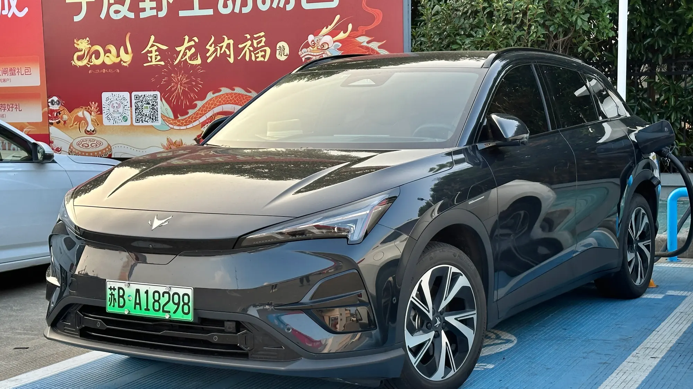

**Arcfox**, the high-end EV brand of China's **BAIC** group, began selling in Colombia in late August 2026. It arrived with three models, a compact SUV, a midsize SUV and a sedan, and with a detail not all its rivals offer: **six airbags and driver assistance** from the cheapest version up. It is imported by **Magma Automotive**.

## The essentials

- **T1:** compact SUV, COP 99,990,000.
- **T5:** midsize SUV, COP 144,990,000.
- **S5:** sedan, COP 139,990,000.
- **Batteries:** LFP in all three.
- **Showrooms:** Bogotá, Medellín, Cali and Bucaramanga.
- **Included:** portable charger for 110 and 220 V outlets.

## The three models

| | T1 | T5 | S5 |
|---|---|---|---|
| Price | COP 99,990,000 | COP 144,990,000 | COP 139,990,000 |
| Length | 4.34 m | 4.69 m | 4.82 m |
| Power | 94 hp | 248 hp | 248 hp |
| Battery | 42.4 kWh | 65 kWh | 65 kWh |
| NEDC range | 375 km (233 miles) | 475 km (295 miles) | 530 km (329 miles) |
| 0 to 100 km/h | 9 s | 7.5 s | 7 s |
| Fast charging | Up to 89 kW | Up to 167 kW | Up to 150 kW |
| Trunk | 459 liters | 400 liters | 430 liters |
| Airbags | 6 | 6 | 6 |

The ranges are on the **NEDC** cycle, which is optimistic. In real use, especially on the highway, expect considerably less. As our own prudent estimate, subtract 15% to 25%.

*The Arcfox T5, the brand's midsize SUV. Photo: JustAnotherCarDesigner, public domain (CC0), via Wikimedia Commons.*

## The T1, the most interesting on price

At COP 99.99 million, the **T1** competes with the **Kia EV2** (COP 89.99 million) and the **Chery E5** (from COP 79.99 million). It has a bigger trunk than both and comes standard with adaptive cruise control, lane keeping and autonomous emergency braking, which the Chery E5 only offers in its top trim. Its weak point is power: 94 hp falls short on long climbs with a loaded car, although, unlike a gasoline engine, an electric motor loses no strength at Bogotá's altitude.

## T5 and S5, against Tesla

The **T5** and **S5** target the same customer as the **Tesla Model Y** and **Model 3**, at similar prices. The T5 advertises a five-star rating from **C-NCAP**, the Chinese crash test program, although it has no Euro NCAP or Latin NCAP tests.

> Arcfox arrives with a good balance of equipment and price, but it is a new brand in the country. Before buying, ask about the workshop network in your city and the exact battery warranty: Arcfox has only confirmed it, at 8 years, for the S5.

## Frequently asked questions

### How much does an Arcfox cost in Colombia?

The T1 costs COP 99,990,000, the S5 COP 139,990,000 and the T5 COP 144,990,000, according to launch prices.

### Who imports Arcfox?

Magma Automotive.

### What range do they have?

Between 375 and 530 km (233 and 329 miles) on the NEDC cycle, depending on the model.

### Where can they be seen?

In showrooms in Bogotá, Medellín, Cali and Bucaramanga.

Compare the Kia EV2 and Chery E5 in the [Mejor Eléctrico comparison tool](/es/comparador/?a=kia-ev2-air-2026-co&b=chery-e5-luxury-2026-co).

---

**Sources:** [Autocosmos: Arcfox reaches Colombia](https://noticias.autocosmos.com.co/2026/08/27/arcfox-llega-a-colombia-con-los-electricos-t1-t5-y-s5-precios-y-caracteristicas) · [El Carro Colombiano: Arcfox in Colombia](https://www.elcarrocolombiano.com/lanzamientos/arcfox-colombia-carros-electricos-premium-t1-s5-t5-precios-datos/) · [El Espectador: the three models](https://www.elespectador.com/autos/arcfox-llega-a-colombia-con-tres-vehiculos-electricos-t1-t5-y-s5/)
