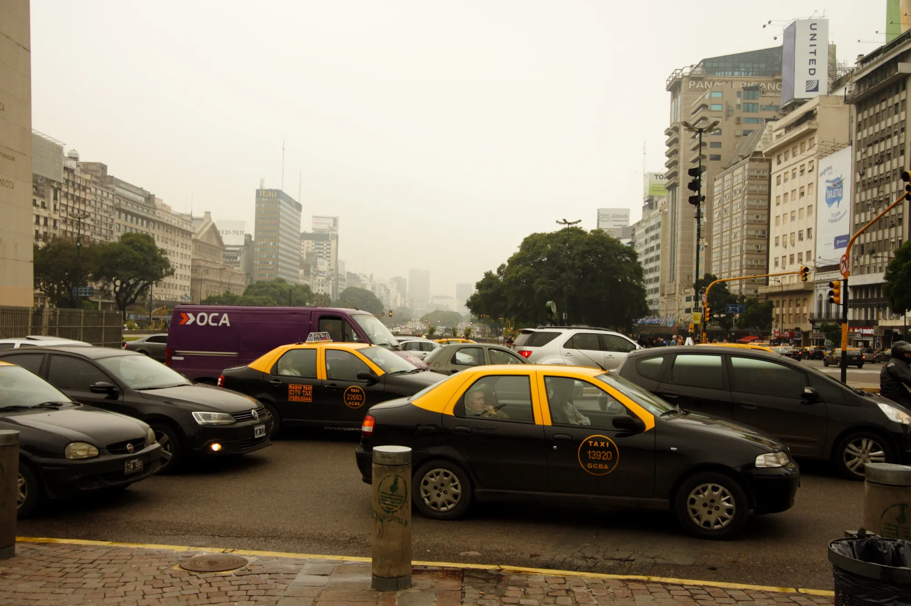

Argentina is the Latin American country where plug-in cars grew most in 2026: **873%** in the first half against the same period of 2025, according to the Latin American and Caribbean Energy Organization (Olade). The growth has a specific explanation, and it is not a change in buyers' tastes: it is an import policy.

## The quota of 50,000 tariff-free cars

Since 2025, the Argentine government has allowed **50,000 electrified vehicles a year to be imported tariff-free**, under Decree 49 of 2025. The quota is divided in tenders among manufacturers and importers, and it only applies to cars with an FOB value of **up to USD 16,000**. Between the 2025 and 2026 quotas, 100,000 units have already been awarded.

The price cap explains which cars arrive. At USD 16,000 FOB, it is mainly small and midsize Chinese EVs and hybrids that get in, while high-end models stay out and keep paying the full tariff.

## The figures

In the first half of 2026, **42,238 hybrid and electric cars** were registered, 339% more than a year earlier, and they are now **15.2% of the market** for cars and light vehicles. The total market, on the other hand, fell 11.1%. Within that figure, pure EVs numbered **3,877**, 9% of the segment; most are hybrids.

| Figure, first half of 2026 | Number |
|---|---|
| Hybrids and EVs registered | 42,238 |
| Annual growth | +339% |
| Market share | 15.2% |
| Pure EVs | 3,877 |

Source: Ámbito, with data from the first half of 2026.

*Avenida 9 de Julio, in Buenos Aires. In the first half of 2026, hybrids and EVs made up 15.2% of the Argentine market. Photo: Anastasiya Lvova, CC BY 3.0, via Wikimedia Commons.*

## The Dolphin Mini, Argentina's EV

Argentina's EV market has an owner. In June 2026, **865 EVs** were registered, and **481 were BYD Dolphin Minis**. They were followed by the BYD Yuan Pro (123), the BAIC EU5 (106) and the Chevrolet Spark EV (51). In September, the Dolphin Mini added 495 units, **57.2%** of all EVs that month.

Its list price starts at **USD 23,990** with the 30 kWh battery and 280 km (174 miles) of range, and reaches USD 24,990 with the 43.2 kWh battery and 380 km (236 miles). It is the same car sold in Colombia as the Seagull, though with different batteries and equipment. We compare it with its rivals in [our hatchback article](/es/notas/hatchback-electrico-latinoamerica-2026/).

## What to watch

Argentina's growth depends on a government measure renewed year by year. If the quota changes or disappears, sales could fall as fast as they rose. Concentration in a single model is also a risk: the market depends on BYD maintaining price and supply.

> The Argentine case shows that in Latin America, the tariff weighs more than any marketing campaign. Brazil did the opposite in 2026, as we report in [this article](/es/notas/brasil-arancel-carros-electricos-importados-35-por-ciento/).

## Frequently asked questions

### How many electric cars are sold in Argentina?

3,877 pure EVs in the first half of 2026, among 42,238 hybrids and EVs registered.

### What is the tariff-free EV quota in Argentina?

An annual permit to import 50,000 electrified vehicles tariff-free, with a cap of USD 16,000 FOB per unit.

### What is the best-selling EV in Argentina?

The BYD Dolphin Mini, with more than half of the EVs registered in September 2026.

---

**Sources:** [Forbes Perú: plug-in sales in Latin America, Olade data](https://forbes.pe/negocios/2026-09-22/latinoamerica-supera-el-millon-de-vehiculos-electricos-con-mas-de-la-mitad-en-brasil/) · [Ámbito: hybrids and EVs are now 15% of the market](https://www.ambito.com/autos/boom-electricos-e-hibridos-la-argentina-los-patentamientos-se-cuadruplican-y-ya-representan-el-15-del-mercado-n6304427) · [Ámbito: best-selling EVs in June 2026](https://www.ambito.com/autos/los-electricos-avanzan-el-pais-fuerte-dominio-ventas-y-un-lider-indiscutido-n6294766) · [Autotest: the Dolphin Mini in September 2026](https://autotest.com.ar/noticias/byd-dolphin-mini-cuanto-cuesta-y-que-ofrece-el-auto-electrico-mas-vendido-en-septiembre-2026/)
