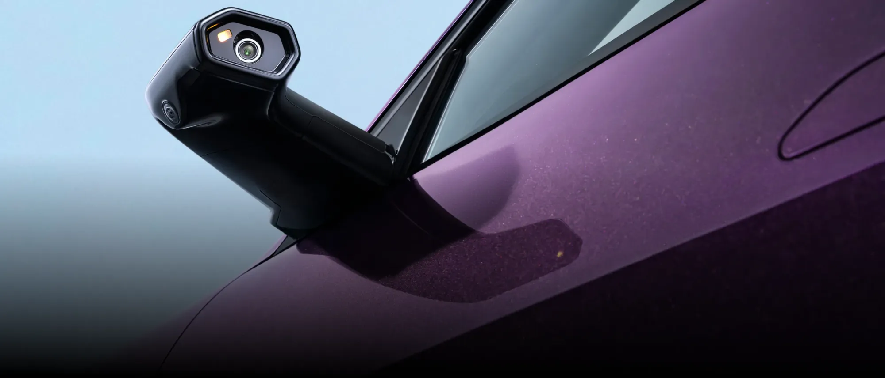

**Avatr**, the premium brand of China's **Changan** group, launched in Colombia on **October 29, 2026** with two SUVs: the **Avatr 07** and the **Avatr 11**. It is imported by **Grupo Vardí**, which also handles Changan and Deepal in the country, and it already has showrooms in Bella Suiza, in Bogotá, and on Avenida Las Vegas, in Medellín.

## The essentials

- **Avatr 07 RWD:** COP 199,990,000.
- **Avatr 07 AWD:** COP 224,990,000.
- **Avatr 11 AWD:** COP 254,990,000.
- **Reservation:** from COP 10,000,000, according to the brand's website.
- **Partners:** Changan is the main shareholder, CATL the second, and Huawei provides driver assistance and cabin technology.

These are the launch prices published by the specialist press, and they may change with the configuration.

## The models

| Item | 07 RWD | 07 AWD | 11 AWD |
|---|---|---|---|
| Powertrain | Range extender | Range extender | Fully electric |
| Power | 309.7 hp | 494.7 hp | 569.8 hp |
| Torque | 333 Nm | 595 Nm | 650 Nm |
| 0 to 100 km/h | 7.1 s | 5.5 s | 4.5 s |
| Battery | 39.05 kWh | 39.05 kWh | 116.79 kWh |
| Fast charging | 120 kW | 120 kW | 240 kW |
| Electric range (NEDC) | 207 km (129 miles) | 197 km (122 miles) | 625 km (388 miles) |
| Total range (NEDC) | 932 km (579 miles) | 900 km (559 miles) | 625 km (388 miles) |

Range is measured on the NEDC cycle, the most optimistic in use today, so it will be lower on the road and cannot be compared with WLTP or EPA figures from other cars.

## The 07 is not fully electric

The 07 has a 1.5 turbo gasoline engine that does not drive the wheels: it only generates electricity for the motors. That is why it can exceed 900 km (559 miles), but it also depends on gasoline on long trips. Before buying it, confirm whether this version gets the same tax benefits and the same exemption from pico y placa, the driving restrictions in Colombian cities, as a pure EV.

*The 07 replaces its mirrors with cameras and two 6.7-inch interior screens. Photo: Avatr Colombia.*

## What each one offers

In the 07, the feature that changes the cabin most is the 35.4-inch panoramic display, next to a 15.6-inch central screen. The AWD version adds adaptive air suspension and 25-speaker Meridian sound; the RWD uses a 16-speaker Pioneer system.

The 11 has 10.25-inch screens for the driver and front passenger, a 15.6-inch central screen, massaging front seats and the same Meridian sound.

The brand offers an 8-year or 160,000 km (99,000 mile) warranty on high-voltage components and 5 years or 120,000 km (75,000 miles) on the rest of the vehicle, with the exclusions in its terms. It remains to be seen how wide the service network will be, a point that matters for a new brand at these prices.

## Frequently asked questions

### What is Avatr?

The premium brand of China's Changan group, with CATL as a shareholder and Huawei as a technology partner. Its cars are built in Chongqing, China.

### How much does it cost in Colombia?

From COP 199,990,000 for the 07 RWD, COP 224,990,000 for the 07 AWD and COP 254,990,000 for the 11 AWD.

### Who imports it?

Grupo Vardí, which also represents Changan and Deepal in Colombia.

### How long is the wait?

According to Full Electric, the cars are built to order and arrive in about three months. The brand does not confirm this on its website.

Compare it with other luxury EVs in the [Mejor Eléctrico comparison tool](/es/comparador/?a=deepal-s05-620-premium-lidar-2027-cn&b=tesla-model-y-premium-awd-2026-eu).

---

**Sources:** [Avatr Colombia](https://avatrcolombia.co/) · [Avatr 07 spec sheet](https://avatrcolombia.co/docs/ficha-tecnica-avatr07.pdf) · [Avatr 11 spec sheet](https://avatrcolombia.co/docs/ficha-tecnica-avatr11.pdf) · [El Carro Colombiano: Avatr launch](https://www.elcarrocolombiano.com/lanzamientos/avatr-colombia-lanzamiento-07-11-precios-ficha-tecnica/) · [Full Electric: Avatr 07 and 11 prices](https://www.fullelectric.co/post/avatr-colombia-precios-avatr-07-avatr-11)
