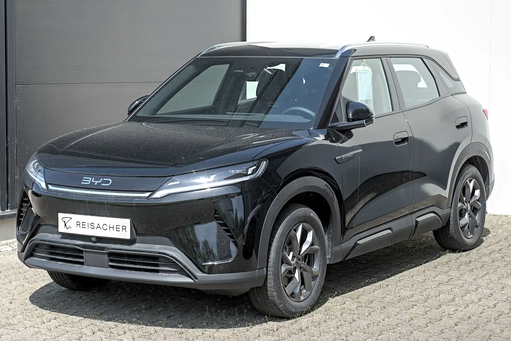

Colombia's best-selling EV in 2026 is the **Tesla Model Y**: in September it took 37.7% of EV registrations and was the best-selling car in the country across all technologies. That makes it the most popular choice, not necessarily the best for every buyer. A car used for 30 km (19 miles) a day in Bogotá does not need the same as one traveling to the coast every month.

## The best sellers, as a starting point

| Rank in September 2026 | Model | Registrations |
|---|---|---|
| 1 | Tesla Model Y | 2,220 |
| 2 | Chery E5 | 483 |
| 3 | BYD Yuan Up | 409 |
| 4 | MG S5 | 324 |
| 5 | Tesla Model 3 | 215 |

According to the bulletin from the trade groups Fenalco and Andi with data from RUNT, the national vehicle registry, published by Portafolio. Four of the five are SUVs, the format Colombian buyers prefer today.

## Profile 1: city, tight budget and home charging

If the car will stay in the city and charge in the garage, range stops being the problem. What matters is price, size and insurance cost. Hatchbacks and small SUVs fit here: the **BYD Seagull**, the **Renault Kwid E-Tech**, the **JMEV 3** or the **Kia EV2**, which costs COP 89.99 million and has standard autonomous braking and lane assist. The differences between them are in [our guide to electric hatchbacks](/es/notas/hatchback-electrico-latinoamerica-2026/).

The point to check is safety: several of the cheapest reach Colombia with fewer driver aids than their European versions.

*The European BYD Atto 2 is the Yuan Up sold in Colombia, the country's third best-selling EV in September 2026. Photo: Alexander Migl, CC BY-SA 4.0, via Wikimedia Commons.*

## Profile 2: family, with a mid-range budget

For four or five people with luggage, the Colombian market centers on Chinese compact SUVs at COP 80 to 100 million. The **Chery E5** starts at COP 79.99 million, although its entry trim has no driver aids. The **Geely EX5 SE**, at COP 92.9 million, and the **MG S5 EV**, at COP 94.99 million, have five Euro NCAP stars. The new **BYD Dolphin**, at COP 89.99 million, is the alternative for those who do not need an SUV.

Here it pays to compare the exact trim. Between the entry and top versions of the same SUV, driver aids, the panoramic roof and even the battery can change.

## Profile 3: frequent road trips

For anyone traveling often between cities, what matters most is WLTP range and fast charging power, because they define how many stops you make and how long they last. In this profile the **Tesla Model Y** and **Model 3** have an advantage that does not appear on the spec sheet: Tesla opened its own Superchargers in Bogotá and Medellín. The **Chevrolet Equinox EV**, with 552 km (343 miles) WLTP published, has the most range among those with a WLTP figure in Colombia.

Colombian geography changes the math: a route with long climbs, such as Bogotá to Medellín, uses more than the same distance on the flat. We explain this in [real range in Colombia](/es/notas/autonomia-real-carro-electrico-colombia-montana-autopista/).

## Profile 4: no parking of your own

If you cannot charge at home or at work, the question is not which car to buy, but where you will charge it. Colombia had about 520 public charging points for more than 77,000 EVs in mid-2026, and four out of ten stations are in Bogotá. Before choosing a model, look at which stations are nearby and at what times they fill up. In this profile, a plug-in hybrid or a [range extender](/es/notas/que-es-un-carro-electrico-de-rango-extendido/) may be a better decision than a pure EV.

> The four deciding questions: how many kilometers you drive a week, where you will charge, how many people you carry and what monthly payment you can afford. With those four answers, the list comes down to two or three models.

## Frequently asked questions

### What is the best-selling EV in Colombia?

The Tesla Model Y, with 2,220 registrations in September 2026 and 14,381 between January and September.

### What is the cheapest EV in Colombia?

The cheapest are microcars and small hatchbacks. In late 2025, Portafolio placed the Bestune Xiaoma among the most affordable, at about COP 47 million. Prices in this bracket change often with promotions, so compare the day's quote and the exact trim.

### Is it worth waiting for prices to fall?

The price war of 2025 and 2026 brought several models down, and there is no way of knowing whether they will keep falling. We analyze it in [the Tesla effect](/es/notas/guerra-de-precios-carros-electricos-efecto-tesla/).

---

**Sources:** [Portafolio: best-selling EVs in September 2026](https://www.portafolio.co/negocios/vehiculo/tesla-domina-los-electricos-mas-vendidos-en-colombia-concentro-41-3-de-las-matriculas-durante-septiembre-504120) · [Semana: Tesla Superchargers in Colombia](https://www.semana.com/vehiculos/articulo/mapa-lista-de-ciudades-con-supercargadores-de-tesla-en-colombia-y-cuanto-cuesta-usarlos/202633/) · [El Carro Colombiano: Kia EV2 in Colombia](https://www.elcarrocolombiano.com/lanzamientos/kia-ev2-colombia-precio-caracteristicas-suv-electrico/) · [Portafolio: the MG S5 EV in Colombia](https://www.portafolio.co/negocios/vehiculo/la-s5-ev-de-la-marca-mg-entro-a-romper-precios-en-el-mercado-489053) · [Portafolio: Geely EX5 SE](https://www.portafolio.co/negocios/vehiculo/nueva-suv-electrica-llega-a-colombia-este-es-el-precio-de-lanzamiento-y-las-caracteristicas-de-la-geely-ex5-se-497330) · [El Carro Colombiano: Chevrolet Equinox EV](https://www.elcarrocolombiano.com/lanzamientos/chevrolet-equinox-ev-colombia-precio-datos-respuesta-americana-a-byd/) · [Portafolio: the Bestune Xiaoma, among the cheapest](https://www.portafolio.co/negocios/vehiculo/el-carro-electrico-mas-barato-de-colombia-cuesta-apenas-45-millones-cual-es-483497) · [Minuto60: 520 charging points at 229 stations](https://minuto60.com/vida-moderna/esta-preparada-colombia-boom-los-vehiculos-electricos/13487) · [La República: charging points in Colombia](https://www.larepublica.co/economia/solo-hay-un-punto-de-carga-por-cada-337-carros-electricos-en-total-hay-229-electrolineras-4398785)
