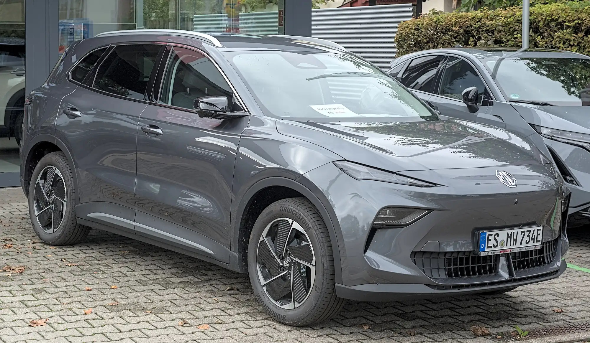

The question "what is the best electric SUV" has a different answer depending on what you value most. If it is proven safety, the **Tesla Model Y** was the top-rated small SUV in Euro NCAP's 2025 tests. If it is price, Colombia has Chinese SUVs with five European stars for less than COP 95 million. And if it is range, the gap between models is smaller than spec sheets suggest, because the figures are rarely measured on the same cycle.

## The electric SUVs with the strongest credentials

| SUV | Euro NCAP | Adults | Entry price in Colombia |
|---|---|---|---|
| Tesla Model Y | 5 stars, best small SUV of 2025 | 91% | From COP 119.99 million |
| MG S5 EV | 5 stars | 90% | From COP 94.99 million |
| Volvo EX30 | 5 stars | 88% | Launched in 2024 from COP 179.99 million |
| Geely EX5 | 5 stars | 86% | SE from COP 92.9 million |
| Kia EV3 | 4 stars as standard, 5 with the driver assistance pack | 83% | Light and Light+ trims |

Euro NCAP ratings; prices in Colombia as published by the specialist press. Each model has its own article with the details of the test.

The **smart #5** and the **Polestar 3** won Euro NCAP's large SUV and executive classes in 2025. They are a reference for the best you can ask for in safety, but before shopping for one, check whether the brand has an official importer in your country.

*The MG S5 EV has five Euro NCAP stars and sells in Colombia from COP 94.99 million. Photo: Alexander Migl, CC BY-SA 4.0, via Wikimedia Commons.*

## The best for each buyer

**If safety comes first: Tesla Model Y.** It has the highest driver assistance score in its Euro NCAP group, 92%, and it is the best-selling EV in Colombia, which means parts and workshops are easy to find. The downside is the price, which Tesla raised shortly after its Colombian launch.

**For the best price with five stars: MG S5 EV or Geely EX5.** Both have five Euro NCAP stars and sell for under COP 95 million in their entry versions. There is fine print on each. The EX5 had welds that came loose in the test's frontal crash, as we reported in [its article](/es/notas/geely-ex5-euro-ncap-5-estrellas/). And in 2026 the S5 EV was subject to a worldwide recall over a fire risk in the radiator fan, explained in [this article](/es/notas/mg-s5-ev-problemas-reportados/).

**For the city: Volvo EX30 or Kia EV3.** They are the most compact on the list and the easiest to park. The EX30 is the most expensive for its size. With the EV3, you need to check whether the version the dealer sells includes the driver assistance pack that earns the fifth Euro NCAP star.

**For road trips: compare range on the same cycle.** To compare two SUVs for highway driving, use only WLTP figures. The Geely EX5 Pro, for example, is rated at 490 km (304 miles) NEDC and 425 km (264 miles) WLTP: same car, measured on two cycles.

## What the spec sheet doesn't tell you

An electric SUV weighs more than a similarly sized gasoline one because of the battery. In Colombia, the Chery E5 lists a curb weight of 1,735 kg and the Chevrolet Equinox EV, 2,322 kg. That weight shows up in tire wear and on the suspension, so ask what a set of tires costs before you buy.

> The best electric SUV is the one with enough WLTP range for your weekly driving, a service network close to home and five stars in the exact version you are going to buy.

## Frequently asked questions

### What is the safest electric SUV?

Among the small SUVs Euro NCAP tested in 2025, the Tesla Model Y. Among large ones, the smart #5.

### What is the cheapest five-star electric SUV in Colombia?

The Geely EX5 SE, from COP 92.9 million, followed by the MG S5 EV, from COP 94.99 million. Both have five Euro NCAP stars, with the caveats of each test.

### Does an electric SUV use more energy than a hatchback?

Yes. It weighs more and has a larger frontal area, so it needs more energy per kilometer, especially on the highway.

---

**Sources:** [Euro NCAP: 2025 Best in Class winners](https://www.euroncap.com/articles/euro-ncap-names-best-in-class-cars-tested-in-2025) · [Carwow: scores of the safest cars of 2025](https://www.carwow.co.uk/news/10124/euro-ncap-safest-cars-2025) · [Euro NCAP: MG S5 EV test datasheet](https://cdn.euroncap.com/media/87623/euroncap-2025-mg-mgs5-ev-datasheet.pdf) · [Euro NCAP: Volvo EX30 test datasheet](https://cdn.euroncap.com/media/85377/euroncap-2024-volvo-ex30-datasheet.pdf) · [Euro NCAP: Geely EX5 test datasheet](https://cdn.euroncap.com/media/86298/euroncap-2025-geely-ex5-datasheet.pdf) · [Euro NCAP: Kia EV3](https://www.euroncap.com/en/results/kia/ev3/54845) · [Portafolio: the MG S5 EV in Colombia](https://www.portafolio.co/negocios/vehiculo/la-s5-ev-de-la-marca-mg-entro-a-romper-precios-en-el-mercado-489053) · [Xataka Colombia: Kia EV3 in Colombia](https://www.xataka.com.co/vehiculos/esta-colombia-vehiculo-electrico-kia-ev3-suv-que-puede-llegar-605-km-autonomia-caracteristicas-precio) · [Valora Analitik: Volvo EX30 in Colombia](https://www.valoraanalitik.com/volvo-ex-30-precios-caracteristicas-colombia-cuanto-vale/) · [Electrive: MG S5 EV recall](https://www.electrive.com/es/2026/07/20/mg-retira-del-mercado-el-s5-ev-debido-a-un-posible-riesgo-de-incendio/)
