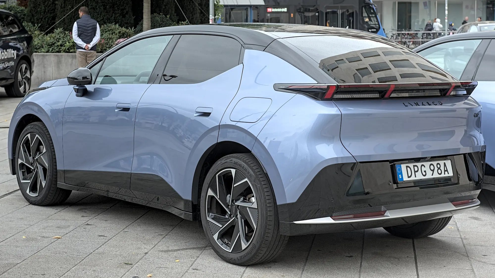

The **2026 Bogotá International Auto Show**, at the Corferias fairgrounds, will take place in mid-November and comes with **more than 15 brands that are new or returning** to the country, according to El Carro Colombiano's count. Almost all are Chinese, and almost all bring EVs, plug-in hybrids or range-extended cars.

## The essentials

- **Date:** mid-November 2026, at Corferias. The exact dates had not been published at the time of writing.
- **New or returning brands:** 16 on El Carro Colombiano's list.
- **Origin:** 15 belong to Chinese groups; the other is Cadillac, from General Motors.
- **Group with the most brands:** Chery, with Lepas, iCAUR, Jaecoo, Omoda and Soueast.

## The brands and their EVs

| Brand | Group | Importer | EVs mentioned by the brand |
|---|---|---|---|
| Arcfox | BAIC | Magma Automotive | T1, T5 and S5, on sale since August |
| Avatr | Changan | Grupo Vardí | 06, 06T and 12, among others |
| Cadillac | General Motors | GM Colmotores | Lyriq, Optiq and Vistiq |
| Denza | BYD | Motorysa | Z9 GT, plus plug-in hybrids |
| Hongqi | FAW | Cóndor Automotor | E-HS5, E-HS7 and E-HS9, unconfirmed |
| iCAUR | Chery | Grupo Vardí | V23, on sale since September |
| IM Motors | SAIC | Los Coches | IM6 |
| Jaecoo | Chery | To be announced | Jaecoo 5 |
| Leapmotor | Leapmotor and Stellantis | Astara | B03, B03X, B10 and C10, electric and range-extended |
| Lepas | Chery | To be announced | L4 and L6 |
| Lynk & Co | Geely | To be announced | 02 |

**BAIC**, **212** (from BAW), **Omoda**, **Rox Motor** and **Soueast** are also arriving, but with hybrids, range-extended versions or gasoline cars, not pure EVs.

*The Lynk & Co 02, the EV from the Geely brand that would reach Colombia. Photo: Alexander-93, CC BY-SA 4.0, cropped, via Wikimedia Commons.*

## Why so many brands are arriving now

Colombia's EV market grew **221.7%** between January and September 2026 and already accounts for 17.4% of monthly registrations. For Chinese brands, Colombia has become an attractive market because of its conditions for EVs: low or zero tariffs, 5% VAT and exemption from pico y placa, the driving restrictions in several cities.

## What to look at when buying a new brand

A brand that has just arrived may have a good product and good prices, but the risk lies in what comes after the purchase:

- **Service network.** Ask how many authorized workshops there are in your city.
- **Parts.** Ask how long a body part or a headlight takes.
- **Battery warranty.** It is usually 8 years, but the mileage limit varies from brand to brand.
- **Importer backing.** Several brands arrive with groups that already have experience, such as Vardí, Motorysa, Astara or GM. Others do not yet have an announced importer.

> More brands mean more price competition. The risk for buyers appears if one pulls out of the country: parts become hard to find and the car loses resale value.

## Frequently asked questions

### When is the 2026 Bogotá Auto Show?

In mid-November 2026, at Corferias. The exact dates had not been announced when this article was published.

### Which new brands are coming to Colombia?

Among others, Arcfox, Avatr, Cadillac, Denza, Hongqi, iCAUR, IM Motors, Jaecoo, Leapmotor, Lepas and Lynk & Co.

### Which ones are already on sale?

Arcfox, since August, and iCAUR, since September 2026.

Compare the EVs already sold in the country in the [Mejor Eléctrico comparison tool](/es/comparador/).

---

**Sources:** [El Carro Colombiano: more than 15 new brands for the 2026 Show](https://www.elcarrocolombiano.com/lanzamientos/carros-nuevas-marcas-vienen-colombia-salon-del-automovil-bogota-2026/) · [El Carro Colombiano: second-half launches](https://www.elcarrocolombiano.com/lanzamientos/carros-nuevos-marcas-lanzamientos-colombia-segundo-semestre-2026/) · [Infobae: EVs from January to September 2026](https://www.infobae.com/colombia/2026/10/10/crece-la-venta-de-vehiculos-electricos-en-colombia-cerca-de-40000-automotores-en-lo-corrido-del-2026/)
