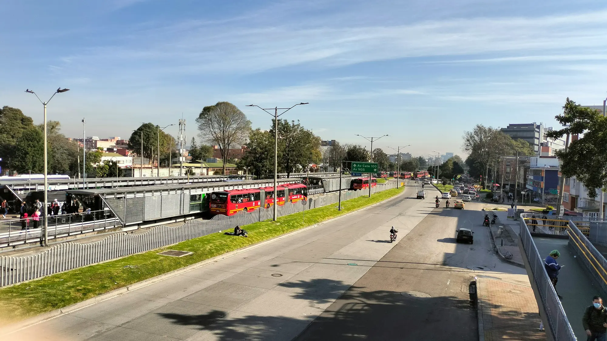

For many buyers in Bogotá, the exemption from pico y placa, the system that keeps cars off the road on certain days according to their license plate, weighs more than any tax discount. That is why the news landed hard in hybrid owners' groups: Mayor **Carlos Fernando Galán** confirmed that the exception for **hybrids and EVs** in the city's regulations is in force **until December 31, 2027**, and that the next administration will decide whether it continues.

But the news does not affect both groups equally.

## Hybrids: the exemption depends on City Hall

The exception for hybrids is a city decision, included in the pico y placa decrees. That is why it has an expiry date, and why it can be extended, cut back or eliminated. From 2028, hybrids **could be subject to pico y placa again** if the next mayor does not renew it.

There has already been a signal: on the **car-free day of February 5, 2026**, hybrids could not circulate in Bogotá. EVs could.

## EVs: protected by a national law

The case of EVs is different. **Law 1964 of 2019** says that electric and zero-emission vehicles **are not subject to the circulation restrictions** set by local authorities, including pico y placa and car-free days. The only exception is restrictions for security reasons.

That means a city government cannot remove their exemption by decree. Changing it would take a reform of the law in Congress.

*The exemptions aim to reward lower-emission cars, but their growth puts them under pressure. Photo: Jesska Forero on Unsplash.*

## Why it is being discussed now

The success of electrified cars is the problem. **Four out of ten new cars** sold in Colombia in the first half of 2026 were electric or hybrid, and Bogotá accounts for most of them. With more than 180,000 vehicles registered under the pico y placa exceptions, the measure is losing its ability to ease congestion.

## What the exemption is worth

| Option | Cost in Bogotá in 2026 |
|---|---|
| "Solidarity" pico y placa for one day | COP 70,294 |
| Fine for driving during pico y placa | More than COP 630,000, plus impoundment |

For anyone paying the solidarity fee several times a month today, the exemption is worth more than a million pesos a year.

## What to do if you own an EV or a hybrid

1. **Register your plate** on the exempt vehicles platform of the city's Mobility Department. The exemption is not automatic.
2. **Keep your SOAT, Colombia's mandatory accident insurance, and your technical inspection up to date**, because they are checked during the process.
3. **If you are about to buy a hybrid** with pico y placa in mind, bear in mind that the benefit could last only until 2027.

> If pico y placa is your main reason for changing cars, the difference between a hybrid and an EV is no longer only about consumption: it is about how long the benefit lasts.

## Frequently asked questions

### Will hybrids have pico y placa from 2028?

It has not been decided. The exemption expires on December 31, 2027, and the decision to extend it falls to Bogotá's next administration.

### Can EVs circulate on car-free days?

Yes. Law 1964 of 2019 exempts them from local circulation restrictions, including car-free days, except restrictions for security reasons.

### Does the exemption apply in other cities?

For EVs, the law is national. For hybrids, it depends on each city, so check the local decree.

Compare hybrids and EVs in the [Mejor Eléctrico comparison tool](/es/comparador/).

---

**Sources:** [Portafolio: exemption for hybrids and EVs until 2027](https://www.portafolio.co/economia/regiones/pico-y-placa-en-bogota-hibridos-y-electricos-tendran-exencion-hasta-503940) · [Cambio: hybrids could have pico y placa from 2028](https://cambiocolombia.com/pais/articulo/2026/10/los-carros-hibridos-tendran-pico-y-placa-en-bogota-desde-2028-lo-que-podria-cambiar-en-la-ciudad) · [El Carro Colombiano: February 2026 car-free day](https://www.elcarrocolombiano.com/movilidad/dia-sin-carro-en-bogota-fecha-oficial-y-el-error-que-le-puede-costar-mas-de-600-000/) · [Infobae: solidarity pico y placa and exceptions](https://www.infobae.com/colombia/2026/05/07/conductores-podran-quedar-exentos-del-pico-y-placa-en-bogota-sin-pagar-asi-funciona-el-beneficio-para-2026/) · [Portafolio: four out of ten cars are electrified](https://www.portafolio.co/negocios/vehiculo/cuatro-de-cada-10-vehiculos-nuevos-vendidos-en-colombia-ya-son-electricos-o-hibridos-en-499675) · [Law 1964 of 2019](https://www.alcaldiabogota.gov.co/sisjur/normas/Norma1.jsp?i=85510)
