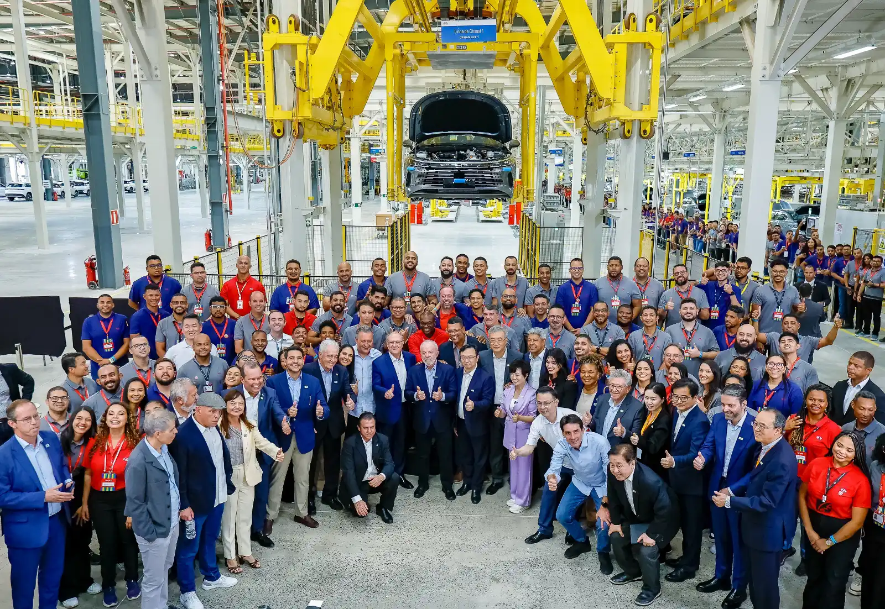

Since July 2026, an imported electric car in Brazil pays a **35% import tariff**. It is the last step of a schedule the government announced in November 2023: the rate started at 10% in January 2024 and rose in stages. The measure has one aim: to get the brands selling in Brazil, Latin America's largest EV market, to build their cars there.

## The full schedule

| Vehicle type | January 2024 | July 2024 | July 2025 | July 2026 |
|---|---|---|---|---|
| Electric | 10% | 18% | 25% | 35% |
| Plug-in hybrid | 12% | 20% | 28% | 35% |
| Hybrid | 12% | 25% | 30% | 35% |

Schedule approved by the Gecex-Camex committee, according to Eixos.

By raising the tariff on hybrids faster than on EVs, the government left pure electric cars with the lowest duty during the transition. Since July 2026, however, all three types pay the same.

## BYD's answer: assembly in Bahia

BYD is the most exposed brand, because it sells more EVs than anyone else in Brazil. Its response was to buy Ford's former plant in **Camaçari**, in the state of Bahia, and start production there in 2025. On **July 16, 2026**, the factory's 100,000th car rolled off the line, a **Dolphin Mini**. The plant also assembles the King sedan and the Song Pro SUV, employs about 5,500 people and has capacity for 150,000 cars a year, with room to double it.

There is fine print. According to InvestNews, the cars arrive in Camaçari as **semi-knocked-down kits**, with the body welded and painted in China, and only final assembly happens in Brazil. The stamping, welding and painting stages were still under construction in mid-2026, and series production in those areas was pushed back to the end of the year.

*The Camaçari plant employs about 5,500 people and assembles cars from kits imported from China. Photo: Lula Oficial, CC BY-SA 4.0, via Wikimedia Commons.*

## The tariff reaches the kits too

The government has been closing that shortcut gradually. Semi-knocked-down kits have paid 35% since July 2026, and from **January 1, 2027**, completely knocked-down kits will pay it as well; until December they pay 14%. In the meantime, a US$463 million quota allows kits to be imported duty-free. The government renewed it on June 23, 2026 for six months, over the objections of Anfavea, the association of established carmakers.

The pressure, then, is not just to sell cars made in Brazil but to make them with more Brazilian parts. BYD says it expects to reach about 50% local content by the end of the year.

## Why it matters beyond Brazil

BYD plans to use Camaçari as an export base for Latin America, starting with **Argentina** and **Mexico**. If that happens, some of the Dolphin Minis sold in the region could come from Bahia rather than China.

For Colombia, the direct effect is small for now, because almost every EV sold in the country comes from China. Brazil's decision matters more as a precedent: it is the first major market in the region to use tariffs to force EV brands to build at home.

## FAQ

### What is Brazil's tariff on electric cars?

35% since July 2026 for imported EVs, the same rate paid by hybrids and plug-in hybrids.

### Does BYD build cars in Brazil?

It has assembled the Dolphin Mini, the King and the Song Pro in Camaçari since 2025, from kits imported from China. Production with local stamping, welding and painting is planned for late 2026.

### Did the tariff hurt EV sales in Brazil?

It did not slow them in the first half of 2026: they grew 193% compared with the same period of 2025, according to Olade. The increase to 35% took effect afterward.

---

**Sources:** [Eixos: why Brazil is taxing EV imports again (in Portuguese)](https://eixos.com.br/por-que-o-brasil-vai-voltar-a-taxar-importacao-de-carros-eletricos/) · [InvestNews: BYD reaches 100,000 cars in Camaçari (in Portuguese)](https://investnews.com.br/negocios/byd-chega-a-100-mil-carros-em-camacari-mas-ainda-depende-de-kits-chineses-o-que-falta/) · [Autopapo: BYD opens Ford's former factory in Bahia (in Portuguese)](https://autopapo.com.br/noticia/byd-inaugura-fabrica-comprada-da-ford-na-bahia/) · [Forbes Peru: EV sales in Latin America, Olade data (in Spanish)](https://forbes.pe/negocios/2026-09-22/latinoamerica-supera-el-millon-de-vehiculos-electricos-con-mas-de-la-mitad-en-brasil/)
