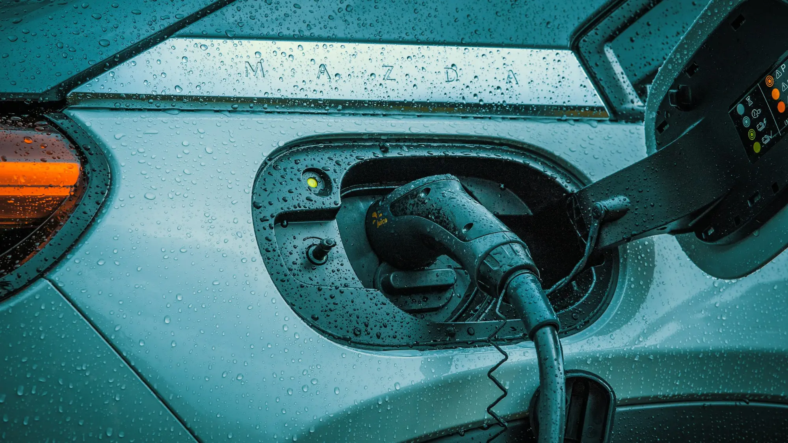

Tesla's arrival in late 2025 set off a price war, and according to a report based on figures from Fasecolda, Colombia's insurers' association, some cars fell by **up to COP 80 million** between 2025 and 2026. That has a direct effect on used cars: anyone who bought an EV in 2024 now competes with cheaper new models, and has to lower the price to sell.

For buyers it is an opportunity, as long as you check what really matters on a second-hand EV.

## 1. Battery state of health

This is the most important figure and the one most often skipped. Ask for a **state of health (SoH) report** done at the brand's dealer or with diagnostic equipment. It tells you what percentage of its original capacity the battery retains.

As a general reference, a two- or three-year-old car with good use should retain more than 90%. If the seller will not allow the test, be wary.

## 2. The battery warranty and whether it transfers

Most brands offer 8 years on the battery, with a mileage cap. Confirm with the dealer, using the VIN, how much time is left and whether the warranty passes to the new owner.

## 3. How it was charged

Ask whether the car was charged mainly at home or on fast chargers. Heavy use of fast charging speeds up wear. Some cars store that history and the dealer can look it up.

*Ask how the car was charged: daily fast charging wears the battery more. Photo: JUICE on Unsplash.*

## 4. Software updates

Many EVs improve range, charging or features with over-the-air updates. Check that the car's software is up to date and that it has not lost functions from being disconnected or imported through parallel channels.

## 5. The connector and cables

Check which connector it has (Type 1, Type 2, CCS or GB/T) and that the original charging cables are included. A new portable charging cable can cost quite a lot. We explain this in our [connector guide](/es/notas/conectores-carga-electricos-colombia-tipo-1-tipo-2-ccs-gbt/).

## 6. Tires, brakes and suspension

EVs weigh more than an equivalent gasoline car, and their instant torque wears tires faster. Brakes, on the other hand, are usually in good condition thanks to regenerative braking. If the discs are badly worn, ask why.

## 7. What does not transfer

This changes the math against a new car:

- **The VAT refund and income tax deduction** are for whoever bought the car new with a certificate from the UPME, Colombia's energy planning unit. You do not get them when buying used.
- **The 60% discount on Bogotá's vehicle tax** lasts five years from registration. If the car is already three years old, you have two left.
- **The maximum 1% rate, the discount on SOAT, Colombia's mandatory accident insurance, and the exemption from pico y placa driving restrictions** do stay with the car.

> Look up the car in RUNT, the national vehicle registry, before paying: confirm it has no liens, seizures or traffic fines, and that the engine technology appears as electric.

## Frequently asked questions

### Is a used car or a cheap new one better?

With the 2026 price drop, a new entry-level car can cost almost the same as a used mid-range one. The new one comes with a full warranty and the tax benefits. Run the numbers.

### How many kilometers is a lot for an EV?

Mileage matters less than battery condition. A high-mileage car charged at home can be better than a low-mileage one always charged on fast chargers.

### Where is the battery test done?

At the brand's dealer or at shops specializing in EVs with diagnostic equipment. Ask for the report in writing.

Compare the specs of the models you are looking at in the [Mejor Eléctrico comparison tool](/es/comparador/).

---

**Sources:** [Blu Radio: the cars with the biggest price drops according to Fasecolda](https://www.bluradio.com/motor/los-20-carros-byd-kia-y-mas-que-mas-han-bajado-de-precio-tras-exito-de-tesla-segun-fasecolda-so35) · [Valora Analitik: vehicle tax discounts in Bogotá](https://www.valoraanalitik.com/carros-electricos-en-bogota-tendran-hasta-70-de-descuento-en-impuesto-vehicular/) · [DIAN, Opinion 000673 of 2026](https://normograma.dian.gov.co/dian/compilacion/docs/oficio_dian_0673_2026.htm)
