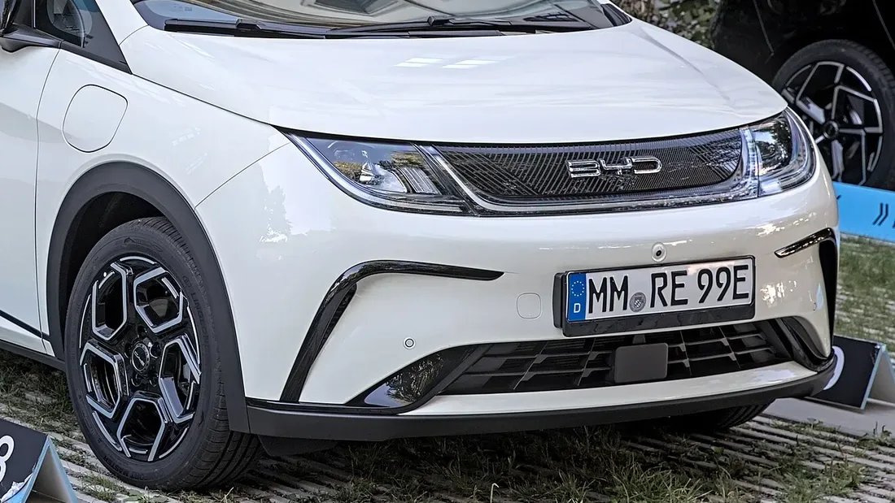

On December 17, 2024, **Latin NCAP**, the program that rates the safety of cars sold in Latin America, gave **five stars** to the **BYD Dolphin Plus**. It was the first time in the program's history that an electric car, and a Chinese manufacturer, earned the top rating. For Colombia there is a key nuance: Latin NCAP made clear that the result applies only to that version, which is sold in Brazil.

## Key facts

- **Rating:** 5 stars, published December 17, 2024.
- **Version tested:** Dolphin Plus, with seven airbags, electronic stability control and driver assistance systems as standard.
- **Adult occupant protection:** 92.60%.
- **Child occupant protection:** 93.17%.
- **Pedestrians and vulnerable road users:** 77.03%.
- **Driver assistance:** 85.17%.

## What Latin NCAP tested

Latin NCAP ran frontal, side, side pole and whiplash tests. It also assessed pedestrian protection, electronic stability control, autonomous emergency braking in the city, on the highway and for vulnerable road users, lane keeping, the speed assistant and blind-spot detection.

In the frontal crash, the structure and the footwell remained stable. Side impact protection and child protection were good. In the pole impact, chest protection was marginal.

*The front of the Dolphin. The front structure is the same on the Brazilian Dolphin Plus and on the Dolphin sold in Colombia. Photo: Alexander-93, CC BY-SA 4.0, cropped, via Wikimedia Commons.*

## The weak spots

The lowest of the four scores was for **pedestrians**, at 77.03%. Latin NCAP noted that pedestrian protection could be better, although combined with autonomous emergency braking the result was good. In driver assistance, **lane keeping** and the **speed assistant** scored no points.

## Why it doesn't apply to the Colombian Dolphin

| | Dolphin Plus tested (Brazil) | Dolphin in Colombia |
|---|---|---|
| Airbags | 7 | 6 |
| Advanced driver assistance | Yes, standard | No |
| Front structure | Same | Same |

The Dolphin sold in Colombia shares the base structure, so its behavior in the frontal crash and in the footwell area should be the same. But it has one airbag fewer and no advanced driver assistance, which count in the driver assistance and vulnerable road user areas.

> Latin NCAP recommends buying the versions that have the tested equipment. In the Dolphin's case, that equipment is not available in Colombia. That is why it is not correct to advertise the Colombian Dolphin as a five-star car.

Stephan Brodziak, president of Latin NCAP, also warned that the result **does not mean all electric cars, or all Chinese cars, are safer**: each model has to be assessed on its own.

## Frequently asked questions

### Does the BYD Dolphin have five stars from Latin NCAP?

The Brazilian Dolphin Plus version does. The Dolphin sold in Colombia was not tested and has less equipment.

### Did the BYD Seagull also get five stars?

Not from Latin NCAP. Some outlets confused the Seagull with the Dolphin Plus. The Seagull has five Euro NCAP stars in its European version, the Dolphin Surf, as we reported in [this article](/es/notas/byd-seagull-dolphin-surf-euro-ncap-5-estrellas/).

### What is the difference between Latin NCAP and Euro NCAP?

They are independent programs with similar protocols. Latin NCAP tests cars as they are sold in Latin America, which often come with less equipment than their European versions.

Compare the Dolphin with other electric city cars in the [Mejor Eléctrico comparison tool](/es/comparador/).

---

**Sources:** [Latin NCAP: BYD Dolphin Plus, five stars](https://www.latinncap.com/es/area-de-prensa/noticia/867617e084abbd/byd-dolphin-plus-primer-fabricante-chino-y-primer-auto-electrico-en-lograr-cinco-estrellas-en-latin-ncap) · [El Carro Colombiano: the result and the Colombian Dolphin](https://www.elcarrocolombiano.com/industria/byd-tiene-al-primer-carro-chino-y-electrico-con-5-estrellas-de-seguridad-en-latin-ncap/) · [Xataka México: test details](https://www.xataka.com.mx/automovil/uno-autos-populares-byd-mexico-fue-sometido-a-pruebas-impacto-latin-ncap-resultado-sorprendente)
