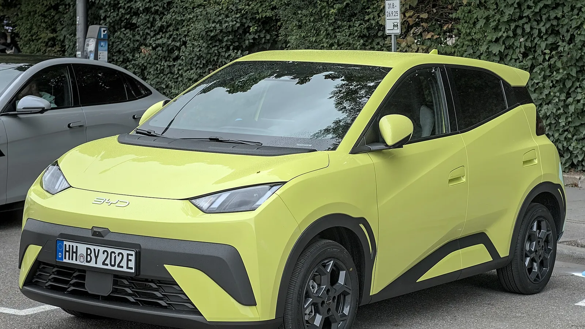

The **BYD Seagull**, one of the cheapest electric cars in Colombia, is sold in Europe as the **Dolphin Surf**. In Europe, **Euro NCAP** gave it **five stars** in September 2025, a rare result for a car that is only 3.99 meters long. It is good news, but it does not carry over directly to the Colombian Seagull, because the safety equipment is not the same.

## Key facts

- **Rating:** 5 stars, published in September 2025.
- **Tested version:** Dolphin Surf Comfort, 1,390 kg. The rating covers every European version.
- **Adult occupant protection:** 82%.
- **Child occupant protection:** 86%.
- **Vulnerable road users:** 76%.
- **Safety assist:** 77%.

## The crash tests

| Test | Result |
|---|---|
| Frontal, mobile barrier | Stable passenger compartment, good knee and leg protection |
| Frontal, full-width rigid wall | Good for the driver, marginal chest protection for the rear passenger |
| Side impact against another vehicle and against a pole | Maximum score |
| Far-side occupant movement | Poor, no center airbag |
| Whiplash | Good |

The standout result is that such a small car scored the maximum in both side impact tests. Its weak spot is the lack of an airbag between the front seats, so in a side impact the occupant on the opposite side moves too far.

*The Dolphin Surf is 3.99 meters long, one of the smallest cars with a five-star Euro NCAP rating. Photo: Alexander-93, CC BY-SA 4.0, via Wikimedia Commons.*

## Driver assistance: what made the difference

The European version has autonomous emergency braking that performed well against other cars (8 out of 9), cyclists (7.6 out of 8) and motorcyclists (6 out of 6). With pedestrians it was adequate (5.8 out of 9), and it does not react to pedestrians behind the car. It also has lane keeping, a camera-based driver monitor and a speed assistant.

Without that equipment, the Dolphin Surf would not have reached the 70% safety assist minimum that Euro NCAP requires for five stars.

## How the Colombian Seagull differs

| | European Dolphin Surf | Seagull in Colombia |
|---|---|---|
| Airbags | Front, side and curtain | 4 in the GL; 6 in the GS |
| Autonomous emergency braking | Yes | No |
| Lane keeping | Yes | No |
| Driver monitor | Yes | No |

When BYD launched the Seagull in Colombia in April 2024, it offered two versions: the **300 GL**, with four airbags, and the **400 GS**, with six. Neither had the advanced driver assistance systems of the European model.

> The structure is the same, so crash protection should be similar. But the five-star rating also rewards systems the Colombian Seagull does not have. It is not accurate to say the Seagull sold in Colombia is a five-star car.

## Frequently asked questions

### Does the BYD Seagull have five stars?

Its European version, the Dolphin Surf, does, from Euro NCAP. The Colombian Seagull has not been tested and comes with less equipment.

### How many airbags does the Seagull have in Colombia?

Four in the 300 GL and six in the 400 GS, according to the 2024 launch. Check the current equipment with the dealer.

### Did the Seagull really get five stars from Latin NCAP?

No. In December 2024 some outlets reported it that way, but the car Latin NCAP tested was the **BYD Dolphin Plus**, a larger model sold in Brazil. We explain it in our [story on that test](/es/notas/byd-dolphin-plus-latin-ncap-5-estrellas/). Latin NCAP has not published a test of the Seagull or the Dolphin Mini.

Compare the two Seagull versions in the [Mejor Eléctrico comparison tool](/es/comparador/?a=byd-seagull-gl-300-2026-co&b=byd-seagull-gs-400-2026-co).

---

**Sources:** [Euro NCAP: BYD Dolphin Surf test datasheet](https://cdn.euroncap.com/media/89338/euroncap-2025-byd-dolphin-surf-datasheet.pdf) · [The Driven: five stars for the Dolphin Surf](https://thedriven.io/2025/09/10/byds-smallest-electric-car-gets-5-stars-for-safety/) · [El Carro Colombiano: Seagull launch in Colombia](https://www.elcarrocolombiano.com/lanzamientos/byd-seagull-colombia-precio-carro-electrico-para-todos/)
