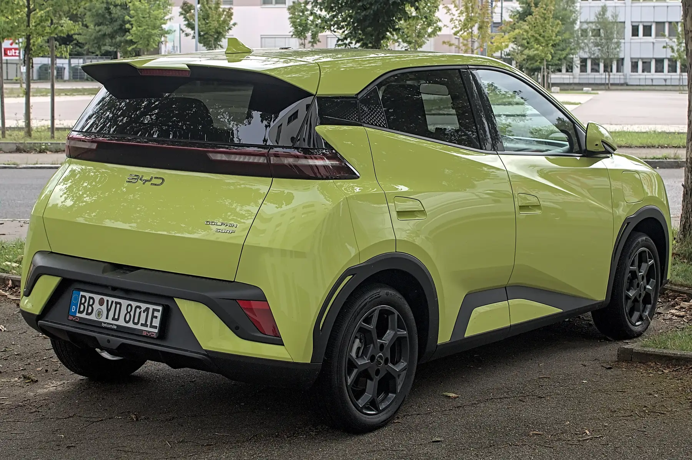

The **BYD Seagull** is BYD's entry EV in Colombia, and it is sold in two trims: **GL** and **GS**. Both have the same motor and body; the battery, range, fast charging and part of the safety equipment change. During the BYD Fest of August 2026 it was offered from **COP 69.99 million**.

If you came here looking for a "Seagull Lite" or "Seagull Go": those are not trim names BYD publishes for Colombia. The Colombian trims are GL and GS.

## GL or GS: what changes

| Item | Seagull GL | Seagull GS |
|---|---|---|
| Battery | 30.08 kWh, LFP | 38 kWh, LFP |
| Range | 300 km (186 miles) NEDC | 380 km (236 miles) NEDC |
| Maximum fast charging | 30 kW | 40 kW |
| AC charging | 5.6 kW | 5.6 kW |
| Airbags | 4 | 6 |
| Camera | Rear | 360-degree |
| Weight | 1,165 kg | 1,245 kg |

Data from BYD Colombia's spec sheet and El Carro Colombiano. Range is NEDC, a more optimistic cycle than WLTP: in real use, especially on the highway, expect less.

## What they share

| Item | GL and GS |
|---|---|
| Motor | 74 hp and 135 Nm, front-wheel drive |
| Length | 3,780 mm |
| Width | 1,715 mm |
| Height | 1,580 mm |
| Wheelbase | 2,500 mm |
| Trunk | 230 L |
| Seats | 5 |
| Equipment | Apple CarPlay, Android Auto, parking sensors, NFC key, 10.1-inch rotating screen and V2L |

At 3.78 meters long, the Seagull is easy to park in cities with little space. The flip side is the 230-liter trunk, which holds the weekly shop, not luggage for a family trip.

*At 3.78 meters long, the Seagull fits in almost any parking space, but its trunk holds 230 liters. In the photo, the European Dolphin Surf. Photo: Alexander-93, CC BY-SA 4.0, via Wikimedia Commons.*

## How long it takes to charge

With a wall charger at home, at 5.6 kW, the GL's battery fills in about six hours and the GS's in about seven, starting from nearly empty. This is an approximate calculation: it divides capacity by power, and charging losses add some time. At a fast charging station, the 30 or 40 kW maximums are low against SUVs charging at over 100 kW, although the small battery partly makes up for it: there is less energy to replace.

V2L lets you use the car as a power source for external devices, useful on an outing or in a blackout. We explain it in [this article](/es/notas/v2l-carro-electrico-planta-electrica/).

## Which one to pick

The **GS** costs more, but adds 80 km (50 miles) of NEDC range, a third more fast charging power, two more airbags and a 360-degree camera. For anyone leaving the city even occasionally, the battery difference counts. The **GL** is enough for strictly urban use with home charging.

A safety point: the European version, the Dolphin Surf, has five Euro NCAP stars, but it has driver aids the Colombian Seagull lacks. We explain this in [this article](/es/notas/byd-seagull-dolphin-surf-euro-ncap-5-estrellas/).

## What is coming: a bigger Seagull

In July 2026, BYD registered a new-generation Seagull in China, **42.5 cm longer** (4,205 mm) with 150 mm more wheelbase, a 95 kW (127 hp) motor against the current 55 kW (74 hp) and the option of a LiDAR sensor for more advanced driver aids. BYD has not announced an arrival date for Latin America.

## Frequently asked questions

### How much range does the BYD Seagull have?

300 km (186 miles) NEDC for the GL and 380 km (236 miles) NEDC for the GS.

### How big is the BYD Seagull?

3,780 mm long, 1,715 mm wide and 1,580 mm high, with a 2,500 mm wheelbase and a 230-liter trunk.

### What fast charging power does the Seagull accept?

Up to 30 kW for the GL and 40 kW for the GS. On AC, 5.6 kW.

---

**Sources:** [El Carro Colombiano: BYD Seagull at BYD Fest 2026](https://www.elcarrocolombiano.com/recomendados/byd-seagull-nuevo-precio-colombia-byd-fest-2026/) · [BYD Colombia: Seagull spec sheet](https://bydauto.com.co/7ff4ca2d229ddd4fd33205ed1f468676.pdf) · [CnEVPost: BYD files new-generation Seagull](https://cnevpost.com/2026/07/11/byd-files-all-new-seagull/)
