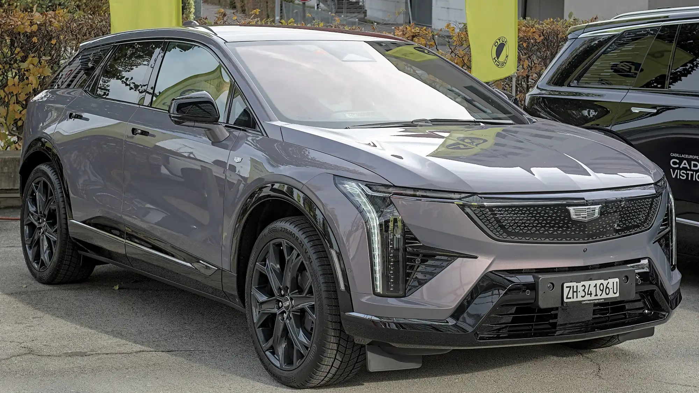

**Cadillac**, General Motors' luxury brand, is returning to Colombia after more than three decades away. It will do so on an unusual condition: **it will sell only electric cars**. **GM Colmotores**, the company's Colombian subsidiary, will run the operation, and the brand appears on the list of those debuting around the Bogotá Auto Show in November 2026.

## The essentials

- **Importer:** GM Colmotores.
- **Arrival:** planned for 2026, with no exact date announced.
- **Models mentioned:** Lyriq, Optiq and Vistiq. The May announcement also mentioned the Celestiq sedan.
- **Combustion engines:** none will be offered.
- **Prices:** not announced.

## The models

| Model | Type | What is known |
|---|---|---|
| Lyriq | Midsize SUV | All-wheel-drive version with two motors and up to 500 hp. In Colombia it would come with dual motors. Up to 505 km (314 miles) of range on the EPA cycle |
| Optiq | Compact SUV | Two motors, 300 hp and an 85 kWh battery. Up to 486 km (302 miles) EPA |
| Vistiq | Three-row SUV | Mentioned on the Show list, with no data for Colombia |
| Celestiq | Ultra-luxury sedan | 655 hp and 0 to 100 km/h in 3.7 seconds. Built in the United States |

Range on the **EPA** cycle is the toughest of those brands publish, more so than the European WLTP. In that sense, the Lyriq's 505 km (314 miles) is a conservative figure.

*The Optiq, Cadillac's smallest electric SUV. Photo: Alexander Migl, CC BY-SA 4.0, cropped, via Wikimedia Commons.*

## Who it competes with

Cadillac will compete with the German premium brands, with Volvo and, soon, with the Chinese luxury brands also debuting in the country, such as **Avatr** and **Denza**. Unlike those Chinese brands, Cadillac arrives with an importer already operating in the country, GM Colmotores, although the brand has not said whether it will use Chevrolet's workshop network.

A luxury brand returning without a single gasoline model shows how far the market has moved: in September 2026, EVs were 17.4% of new cars sold in Colombia.

## Frequently asked questions

### Is Cadillac returning to Colombia?

Yes. GM Colmotores will bring it back in 2026, after more than 30 years without an official presence.

### Which models will it sell?

Only EVs: the Lyriq, the Optiq and others such as the Vistiq. No gasoline models will come.

### How much will a Cadillac cost in Colombia?

Prices have not been announced.

Compare luxury electric SUVs in the [Mejor Eléctrico comparison tool](/es/comparador/?a=volvo-ex30-p8-awd-2026-eu&b=kia-ev9-99-8-kwh-awd-gt-line-2026-eu).

---

**Sources:** [El Carro Colombiano: Cadillac returns to Colombia](https://www.elcarrocolombiano.com/industria/cadillac-regresa-colombia-carros-electricos-lyriq-optiq-celestiq/) · [El Heraldo: Cadillac's return](https://www.elheraldo.co/economia/2026/05/12/marca-de-lujo-regresa-a-colombia-tras-32-anos-de-ausencia-su-enfoque-seran-los-modelos-electricos-de-alta-gama/) · [El Carro Colombiano: new brands at the 2026 Show](https://www.elcarrocolombiano.com/lanzamientos/carros-nuevas-marcas-vienen-colombia-salon-del-automovil-bogota-2026/) · [Infobae: EVs in September 2026](https://www.infobae.com/colombia/2026/10/10/crece-la-venta-de-vehiculos-electricos-en-colombia-cerca-de-40000-automotores-en-lo-corrido-del-2026/)
