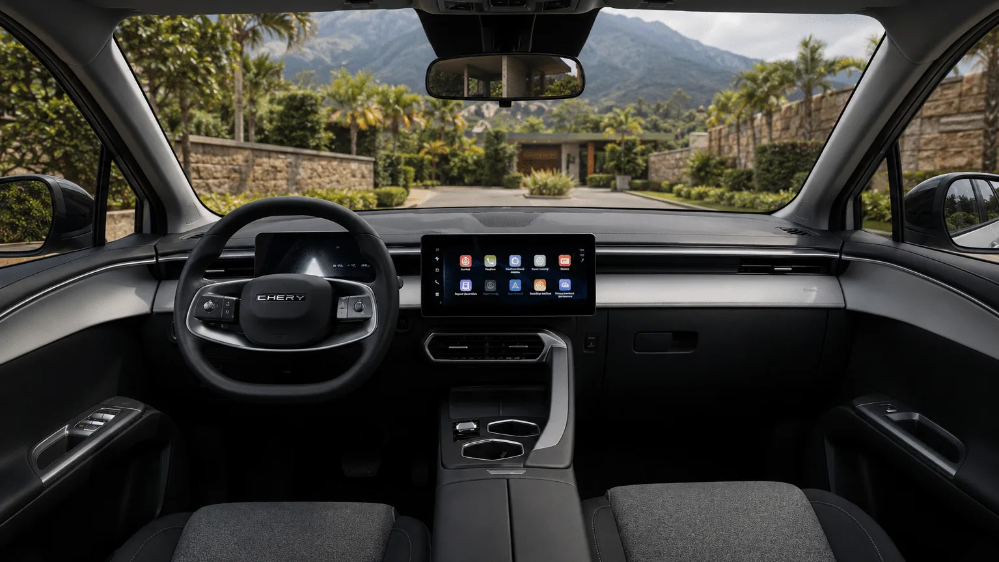

The **Chery E5** is the 2026 phenomenon among mid-priced EVs. It went on sale in May from **COP 79,990,000** and by September was already the **second best-selling EV in Colombia**, with 483 registrations, behind only the Tesla Model Y. It is a 4.54-meter SUV, the size of the most popular compact SUVs, at a city car price.

## The essentials

- **Price:** from COP 79,990,000 in the Comfort trim, as of May 2026.
- **Battery:** 50.6 kWh LFP, from Gotion.
- **Range:** 350 km (217 miles) WLTP, 422 km (262 miles) NEDC.
- **Motor:** up to 208 hp and 288 Nm.
- **Fast charging:** from 30% to 80% in 30 minutes, up to 110 kW.
- **Warranty:** 8 years or 200,000 km (124,000 miles).

## Two very different trims

The difference between the entry trim and the top one is large, and it is worth being clear on it before going to the dealer:

| | Comfort | Luxury |
|---|---|---|
| Central screen | 12.3 inches | 12.3 inches |
| Wireless Android Auto and CarPlay | Yes | Yes |
| Airbags | 7 | 7 |
| Advanced driver assistance | No | 19, including autonomous braking, lane keeping, blind spot and adaptive cruise |
| Camera | Rear | 540° |

The **Comfort has no advanced driver assistance**. For many buyers, that justifies paying the difference for the Luxury.

*The Comfort trim has a 12.3-inch central screen and an 8-inch digital instrument cluster. Photo: Chery Colombia.*

## Range and charging

The figure to look at is **350 km (217 miles) WLTP**. The 422 km (262 miles) is on the more optimistic NEDC cycle. In real life, in the city it should approach the WLTP figure; on the highway at constant speed, it will fall below it.

At home, the **6.6 kW** onboard charger needs about **eight hours** for a full charge. That is enough for overnight charging, but slower than rivals with 11 kW.

## Specs

| Item | Value |
|---|---|
| Length | 4.54 m |
| Width | 1.83 m |
| Height | 1.58 m |
| Wheelbase | 2.63 m |
| Curb weight | 1,735 kg |
| Power | Up to 208 hp |
| Torque | 288 Nm |
| 0 to 100 km/h | 7.1 seconds |
| Battery | 50.6 kWh, LFP |
| Range | 350 km (217 miles) WLTP / 422 km (262 miles) NEDC |
| AC charging | 6.6 kW, about 8 hours |
| DC charging | 30% to 80% in 30 minutes, up to 110 kW |
| Trunk | 442 liters, plus 32 liters up front |
| Tires | 215/60 R17 |
| Warranty | 8 years or 200,000 km (124,000 miles) |

## Why it sells so well

The E5 offers **family SUV space** at a lower price than many urban EVs. Its 442-liter trunk is bigger than those of several rivals at its price, and the 200,000 km (124,000 mile) warranty is among the longest on the market.

> The point to check: Chery's service network in your city. With a fleet growing this fast, workshop capacity will be key.

## Frequently asked questions

### How much does the Chery E5 cost in Colombia?

From COP 79,990,000 in the Comfort trim, according to the May 2026 price.

### How much range does it have?

350 km (217 miles) on the WLTP cycle and 422 km (262 miles) on the NEDC cycle.

### Does the entry trim have autonomous braking?

No. Advanced driver assistance only comes in the Luxury trim.

Compare it with the Kia EV2 or the Tesla Model Y in the [Mejor Eléctrico comparison tool](/es/comparador/).

---

**Sources:** [El Carro Colombiano: Chery E5, first contact](https://www.elcarrocolombiano.com/resenas/chery-e5-primer-contacto-suv-electrica-precio-colombia/) · [Portafolio: the Chery E5 from COP 74.9 million](https://www.portafolio.co/negocios/vehiculo/desde-74-9-millones-la-suv-chery-e5-electrica-492089) · [Portafolio: best-selling EVs in September](https://www.portafolio.co/negocios/vehiculo/tesla-domina-los-electricos-mas-vendidos-en-colombia-concentro-41-3-de-las-matriculas-durante-septiembre-504120)
