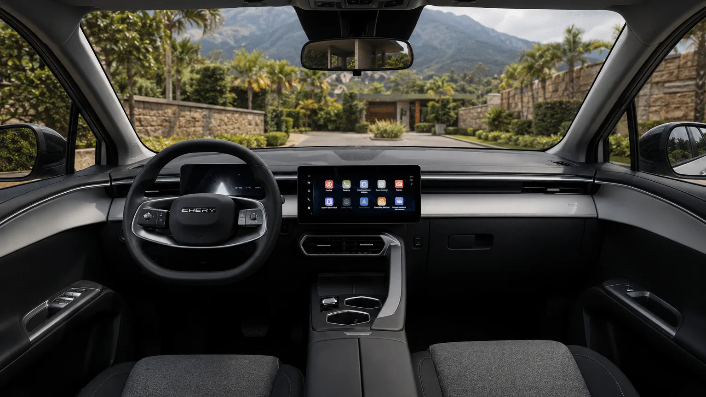

The **Chery E5** is sold in Colombia in two trims, **Comfort** and **Luxury**, and mechanically they are the same car. They share motor, battery, range, charging and dimensions. What separates them is equipment: the Luxury adds the driver assistance package, the blind spot monitor and the 540-degree camera, among other items. In the April 2026 pre-sale, the price difference was **COP 11 million**.

## What they share

| Item | Comfort and Luxury |
|---|---|
| Motor | 208 hp and 288 Nm, front-wheel drive |
| 0 to 100 km/h | 7.1 seconds |
| Top speed | 171 km/h (106 mph) |
| Battery | 50.6 kWh, lithium iron phosphate (LFP) |
| Range | 350 km (217 miles) WLTP, 422 km (262 miles) NEDC |
| Fast charging | Up to 110 kW, from 30% to 80% in 30 minutes |
| AC charging | 6.6 kW |
| Length, width and height | 4,540, 1,830 and 1,580 mm |
| Ground clearance | 154 mm |
| Trunk | 442 L, plus 32 L up front |
| Curb weight | 1,735 kg |
| Airbags | 7 |
| Warranty | 8 years or 200,000 km (124,000 miles) |

Data from Chery Colombia's spec sheet and El Carro Colombiano's tests. The official spec sheet does not separate the mechanicals by trim.

The **171 km/h (106 mph)** top speed is far above the limits on Colombian highways. In an EV, driving fast on the highway also uses a lot of battery, so that figure matters less than range.

## What the Luxury adds

| Item | Comfort | Luxury |
|---|---|---|
| Autonomous emergency braking | No | Yes |
| Adaptive cruise | No | Yes |
| Lane keeping assist | No | Yes |
| Blind spot monitor | No | Yes |
| Rear cross-traffic alert | No | Yes |
| 540-degree camera | No | Yes |
| Heated, massaging driver's seat | No | Yes |
| Wireless phone charger | No data in the sources | Yes |

*The dashboard of the Colombian Chery E5. The Luxury adds the driver assistance package, blind spot monitor and 540-degree camera. Photo: Chery Colombia.*

## Price: what the difference costs

In the April 2026 pre-sale, Chery announced the Comfort at **COP 74.99 million** for the first 200 units and the Luxury at **COP 85.99 million**. The Comfort then settled at a list price of COP 79.99 million. The Luxury therefore costs between COP 6 and 11 million more depending on the price reference, and almost all of that difference goes on active safety.

## Which one to pick

**The Comfort** makes sense for people who drive mainly in the city, at low speed, and want the cheapest electric SUV of its size. It has the same 442-liter trunk and the same 350 km (217 miles) WLTP as the Luxury, which is what counts most in daily use.

**The Luxury** is the trim to choose for people who use urban highways or the open road. Autonomous braking is the aid with the most evidence of reducing crashes: according to the US Insurance Institute for Highway Safety, cars that have it have half as many rear-end crashes. At a price close to the Luxury's, the [Kia EV2](/es/notas/kia-ev2-colombia-precio-autonomia-ficha/) and the [new BYD Dolphin](/es/notas/nuevo-byd-dolphin-colombia-precio-equipo/) also have standard driver aids, although they are smaller.

One more point: the five-star Euro NCAP rating that is often cited belongs to the **Omoda E5**, a different car, as we explain in [this article](/es/notas/chery-e5-omoda-e5-euro-ncap-estrellas/).

## Frequently asked questions

### What is the Chery E5's top speed?

171 km/h (106 mph) in both trims.

### What is the difference between the Chery E5 Comfort and Luxury?

Equipment. The Luxury adds autonomous braking, adaptive cruise, lane assist, blind spot monitor, a 540-degree camera and a heated, massaging driver's seat. Motor, battery and range are the same.

### How much does the Chery E5 cost in Colombia?

The Comfort has a list price of COP 79.99 million. In the April 2026 pre-sale, the Luxury was announced at COP 85.99 million.

---

**Sources:** [Chery Colombia: E5 spec sheet](https://www.chery.com.co/wp-content/uploads/2026/04/FICHATECNICA_E5_2026_v3.pdf) · [El Carro Colombiano: first contact with the Chery E5](https://www.elcarrocolombiano.com/resenas/chery-e5-primer-contacto-suv-electrica-precio-colombia/) · [El Carro Colombiano: E5 Luxury deliveries begin](https://www.elcarrocolombiano.com/novedades/chery-e5-luxury-inicio-entregas-colombia-precio/) · [Valora Analitik: Chery E5 pre-sale and prices](https://www.valoraanalitik.com/?p=572159) · [IIHS: autonomous braking reduces rear-end crashes](https://www.iihs.org/news/detail/front-crash-prevention-slashes-police-reported-rear-end-crashes)
