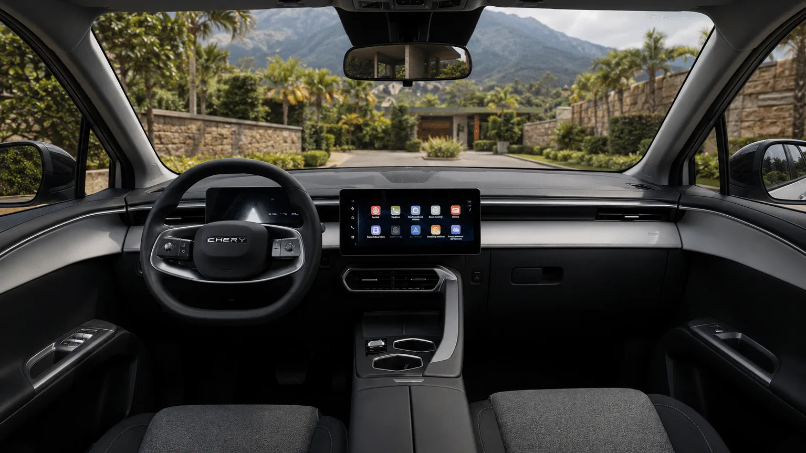

In September 2026 the **Chery E5** was the second best-selling electric car in Colombia, and social media posts claim it has **five Euro NCAP stars**. The rating exists, but two caveats change how it should be read: it does not come from a test of an electric car built from scratch, and it does not apply to the car sold in Colombia.

## Key facts

- **Rating:** 5 stars, published in December 2022 for the gasoline **Omoda 5**.
- **Extension to the EV:** in November 2024, Euro NCAP applied the same rating to the **Omoda 5 EV**, sold in Europe as the Omoda E5.
- **Adult occupant protection:** 87%.
- **Child occupant protection:** 87%.
- **Vulnerable road users:** 68%.
- **Safety assist:** 88%.

## Where the five stars come from

In 2022 Euro NCAP crashed a **gasoline Omoda 5 1.6T**. When the electric version arrived, the brand ran additional frontal and side pole tests to check the battery and the structure, and Euro NCAP extended the 2022 rating to the EV. This is a normal procedure when two versions share a body, but it means the published percentages belong to the gasoline car.

## What the test found

| Test | Result |
|---|---|
| Frontal, mobile barrier | Stable passenger compartment, good knee and leg protection. Marginal protection for occupants of other sizes |
| Frontal, full-width rigid wall | Good or adequate for the driver and the rear passenger |
| Side impact against another vehicle | Good, but the curtain airbag did not deploy properly, which lowered the head score |
| Side pole impact | Marginal rib protection |
| Whiplash | Good |

The weakest point was **pedestrian** protection, at 68%: pelvis protection was poor across most of the front end, and the windshield pillars and base were stiff. In safety assist, autonomous emergency braking and lane keeping scored high.

*The dashboard of the Colombian Chery E5. The driver assistance systems Euro NCAP tested only come on the Luxury trim. Photo: Chery Colombia.*

## Why it does not apply to the Colombian Chery E5

The E5 sold in Colombia is not the same as the European Omoda E5. The front end, the battery and the dimensions are different. Safety equipment also depends heavily on the trim:

| | Comfort | Luxury |
|---|---|---|
| Airbags | 7 | 7 |
| Advanced driver assistance, such as autonomous braking and lane keeping | No | Yes, 19 systems |

The entry-level **Comfort** trim has no advanced driver assistance, the equipment that earned the tested Omoda its 88% in that area. Neither Euro NCAP nor Latin NCAP has tested the Colombian Chery E5.

> If someone tells you the Chery E5 is a five-star car, the accurate answer is that it has a European relative with five stars, a rating that comes from a 2022 gasoline version.

## Frequently asked questions

### Does the Chery E5 have five Euro NCAP stars?

Not directly. The European Omoda E5 has five stars through an extension of the 2022 rating of the gasoline Omoda 5. The Colombian Chery E5 is a different car and has not been tested.

### Which Chery E5 trim has autonomous emergency braking?

Only the Luxury. The Comfort has no advanced driver assistance systems.

### What was the Omoda 5's weak point in the test?

Pedestrian protection, at 68%, and the curtain airbag, which did not deploy properly in the side impact.

Compare the two Chery E5 trims in the [Mejor Eléctrico comparison tool](/es/comparador/?a=chery-e5-comfort-2026-co&b=chery-e5-luxury-2026-co).

---

**Sources:** [Euro NCAP: Omoda 5 test datasheet](https://cdn.euroncap.com/media/83860/euroncap-2022-chery-omoda5-datasheet.pdf) · [Wheels Alive: Omoda press release on the E5, November 2024](https://www.wheels-alive.co.uk/electric-omoda-e5-gains-euro-ncap-five-star-safety-rating) · [Portafolio: EV sales in September 2026](https://www.portafolio.co/negocios/vehiculo/tesla-domina-los-electricos-mas-vendidos-en-colombia-concentro-41-3-de-las-matriculas-durante-septiembre-504120)
