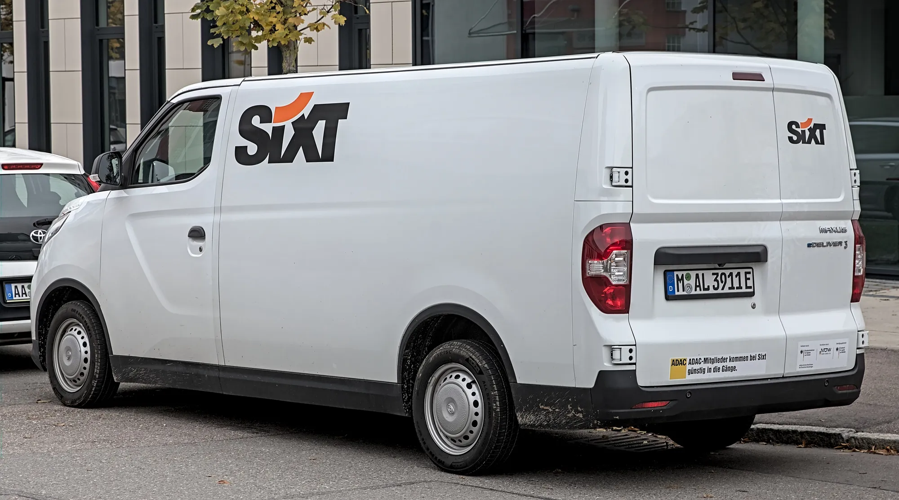

Chile sold **9,978 plug-in cars** between January and June 2026, 165.4% more than a year earlier, according to the National Automotive Association of Chile (ANAC). They make up **6.5% of the market** for light and medium vehicles. Pure EVs numbered 5,425, and the rest were split between plug-in hybrids (3,811) and plug-in range-extended EVs (742), which grew more than 2,400%.

The figure worrying the sector lies elsewhere: while sales double, public charger installation has fallen by more than half.

## First-half figures

| Technology | January to June 2026 | Growth |
|---|---|---|
| Pure EVs | 5,425 | +113.8% |
| Plug-in hybrids | 3,811 | +219.4% |
| Plug-in range extenders | 742 | More than +2,400% |
| Total plug-ins | 9,978 | +165.4% |
| Non-plug-in hybrids | 20,344 | +84.3% |

Source: ANAC.

The buyer profile has changed fast. Three years ago, companies bought about 70% of EVs. Today, seven out of ten buyers are individuals, mostly between 35 and 55 years old.

## The best-selling EVs

| Rank | Model | Units, first half of 2026 |
|---|---|---|
| 1 | Tesla Model Y | 865 |
| 2 | Tesla Model 3 | 709 |
| 3 | Volvo EX30 | 377 |
| 4 | Maxus eDeliver 3 | 289 |
| 5 | Renault Kwid E-Tech | 254 |
| 6 | BYD Yuan Plus | 244 |
| 7 | BYD Dolphin Mini | 210 |
| 8 | Geely EX2 | 209 |

Source: Autocosmos Chile with ANAC data.

Tesla takes 29% of the country's pure EVs, with 1,575 units in the half, a concentration similar to Colombia's. Unlike other markets in the region, an electric van, the Maxus eDeliver 3, appears among Chile's best sellers: delivery companies are also buying EVs.

*The Maxus eDeliver 3 is among Chile's best-selling EVs: delivery companies are also switching to electricity. Photo: Alexander Migl, CC BY-SA 4.0, via Wikimedia Commons.*

## The charging network loses pace

Chile had **2,245 public charging points** in June 2026. In the first half, 143 new ones were installed, 54.7% fewer than the 316 of the same period of 2025. Almost all the drop came from slow AC chargers, which went from 190 new units to 20. DC fast chargers held steady at 123, and now make up 86% of what is new.

Private charging also slowed: 656 new chargers in the half, against 1,754 in all of 2025. For ANAC, infrastructure expansion is not keeping up with sales growth.

## The 2030 target looks distant

Chile's National Electromobility Strategy aims for 20% of new cars sold in 2030 to be plug-ins. On the current trend, ANAC projects 15.7%. Reaching the target would take about 74,000 sales a year in a market of 370,000 vehicles; the base scenario estimates about 58,000.

> Chile is an example that selling EVs and building places to charge them are two different curves. If the second falls behind, the first ends up slowing down.

## Frequently asked questions

### How many electric cars are sold in Chile?

5,425 pure EVs between January and June 2026, and 9,978 counting plug-in hybrids and range extenders.

### What is the best-selling EV in Chile?

The Tesla Model Y, with 865 units in the first half of 2026.

### How many charging points are there in Chile?

2,245 public points in June 2026, according to ANAC.

---

**Sources:** [El Mostrador: zero and low-emission sales through June 2026, ANAC data](https://www.elmostrador.cl/agenda-pais/movilidad/2026/08/03/electromovilidad-acelera-en-chile-ventas-se-duplican-pero-desafio-para-cumplir-meta-2030-sigue/) · [La Tercera: sales double but infrastructure cools](https://www.latercera.com/pulso/noticia/ventas-de-vehiculos-de-cero-y-bajas-emisiones-se-duplican-a-junio-pero-se-enfria-la-infraestructura-para-carga/) · [Autocosmos Chile: best-selling green cars of the first half of 2026](https://noticias.autocosmos.cl/2026/08/03/top-10-los-autos-ecologicos-mas-vendidos-en-chile-en-el-primer-semestre-de-2026)
