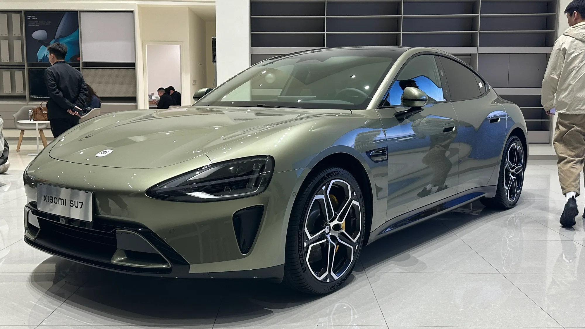

**Hidden** or flush door handles have become a hallmark of electric cars, from Tesla to many Chinese brands. They look clean and slightly improve aerodynamics. The problem is what happens when the car loses power, for example after a crash: there have been cases of people who could not get out and of rescuers who could not get in.

## Key points

- **From January 1, 2027**, cars sold in China must have a mechanical release on both the inside and the outside.
- **On the outside**, the handle must leave room to slip a hand in and operate the release from any angle.
- **On the inside**, the release must be visible from the occupant's seat.
- **In August 2026**, China ordered more than **4 million** cars recalled over this risk, including nearly **3 million Teslas**.

## Why China made the decision

China's Ministry of Industry and Information Technology cited two problems: some exterior handles are hard to use, and above all, **doors cannot be opened after a crash** when the electrical system fails.

The case that weighed most was a March 2025 crash of a Xiaomi sedan in which three people died and, according to reports, rescuers struggled to open the doors. In the United States, the road safety agency NHTSA is investigating reports from Tesla owners who had to break windows to get into their cars, and a Bloomberg investigation documented 140 cases of people trapped in the brand's vehicles.

*The Xiaomi SU7, one of the models with hidden handles included in the August recall. Photo: JustAnotherCarDesigner, public domain (CC0), via Wikimedia Commons.*

## The August recall

On August 22, 2026, China's State Administration for Market Regulation announced the recall. These were the brands with published figures:

| Brand | Cars affected |
|---|---|
| Tesla (Model 3, Model Y, Model S and Model X) | About 2.98 million |
| Xiaomi | More than 390,000 |
| Leapmotor | More than 370,000 |
| Geely and Xpeng | Some models, no figure published |

Tesla will address the risk with **software updates**, according to the regulator's notice.

## What about Colombia?

Colombia has no rule on door handles, and cars sold there are not part of the Chinese recall. But many of the EVs sold in the country come from China, including Teslas from the Shanghai factory, so the design change required by the Chinese rule could also reach models imported from 2027 onward, unless brands build separate versions for export.

> If your car has electric door handles, look up in the owner's manual where the mechanical emergency release is on each door, including the rear ones, and show it to the people who ride with you.

## Frequently asked questions

### Why is China banning hidden door handles?

Because they can make it impossible to open the doors after a crash if the electrical system fails.

### When does it take effect?

From January 1, 2027, for cars sold in China.

### Are Teslas sold in Colombia part of the recall?

No. The recall covers cars sold in China.

### How do I open a Tesla without power?

The front doors have a mechanical emergency lever. Check your model's manual to find it, because on some rear doors it is hidden.

Compare the EVs sold in Colombia in the [Mejor Eléctrico comparison tool](/es/comparador/).

---

**Sources:** [El Carro Colombiano: China bans hidden door handles from 2027](https://www.elcarrocolombiano.com/industria/china-prohibe-manijas-ocultas-normativa-seguridad-2027/) · [Contexto Tucumán: the August 2026 recall](https://www.contextotucuman.com/nota/410052/tesla-retira-casi-tres-millones-de-unidades-de-china-por-una-falla-que-genera-riesgos-de-seguridad.html) · [Motor1: the Chinese rule](https://es.motor1.com/news/786251/china-prohibe-manetas-escondidas-carroceriia/)
