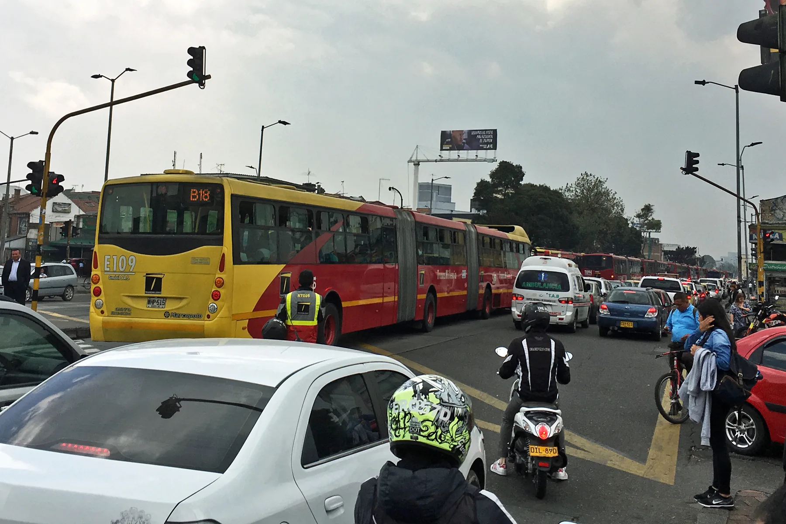

The board of the **Banco de la República**, Colombia's central bank, raised its monetary policy rate to **12.25%** on September 30, 2026, from the 12% at which it had held it in July. The decision was not unanimous: four members voted to raise it 25 basis points, two to hold it and one to raise it 50. The reason is inflation, which stood at **6.24%**, more than double the 3% target.

For anyone thinking of buying an EV on credit, the question is when and how much of that increase reaches their payment.

## How the central bank's rate reaches your loan

The Banco de la República's rate is the price at which banks get money in the short term. When it rises, banks tend to charge more for new loans, although the effect is neither immediate nor one to one. Loans already signed at a **fixed rate** do not change. **Variable-rate** loans, tied to an indicator such as the IBR benchmark, do adjust.

In October, the usury rate still fell, to 28.59% effective annual, because it is calculated from loans already disbursed. The effect of the increase would show in the following months. We explain this in [the article on October's usury rate](/es/notas/tasa-de-usura-octubre-2026-credito-vehiculo/).

## How much one point moves the payment

To put it in perspective, we calculated a **COP 72 million loan over 60 months**, 80% of an EV worth about COP 90 million:

| Effective annual rate | Monthly payment | Total interest |
|---|---|---|
| 12.5% | COP 1,595,473 | COP 23.7 million |
| 13.5% | COP 1,628,118 | COP 25.7 million |
| 15.25% | COP 1,685,508 | COP 29.1 million |

Our own calculation, with no insurance or other charges. One more point on the rate costs about COP 33,000 a month and about COP 2.0 million over the whole loan.

*Fixed-rate loans already signed do not change with the central bank's decision; variable-rate ones do. Photo: Mariordo (Mario Roberto Durán Ortiz), CC BY-SA 4.0, via Wikimedia Commons.*

## What may come next

The Banco de la República describes its stance as restrictive monetary policy, aimed at bringing inflation down in 2027. Its next decisions will depend, according to the board, on the effects of El Niño, the recovery after the earthquake and fiscal policy. A study cited by Portafolio warned that if inflation reached 6.87%, the central bank's rate could close 2026 at 12.5%.

Nobody can say whether green loan rates will rise, or by how much. Banks compete for EV buyers with special rates, and that competition may cushion part of the increase.

## What to do if you plan to finance

**Prefer a fixed rate.** With restrictive monetary policy and high inflation, a fixed rate protects the payment throughout the loan.

**If you already have approval, check how long it is valid.** Loan approvals have an expiry date, and if yours expires, the rate on the new one may be higher.

**Take advantage of subsidized rate offers.** Brands offering low or 0% rates depend less on the central bank, because they absorb part of the cost themselves. That is the case with [Tesla's 0% financing](/es/notas/tesla-financiacion-0-por-ciento-colombia/) until December 31.

**Plan extra payments on principal.** If rates stay high, each payment saves more interest. The math is in [how much paying down principal saves](/es/notas/abonar-a-capital-credito-carro-electrico-ley-1555/).

## Frequently asked questions

### What is the Banco de la República's rate in October 2026?

12.25%, since the decision of September 30, 2026.

### Does my car loan payment go up if the Banco de la República raises the rate?

Only if your loan is at a variable rate. If it is fixed, the payment does not change.

### Is it worth waiting for rates to fall before buying?

There is no way to know when they will fall. With inflation at 6.24%, the board signaled it would keep a restrictive policy for some time.

---

**Sources:** [Vanguardia: the Banco de la República raises its rate to 12.25%](https://www.vanguardia.com/economia/2026/09/30/tasa-de-interes-subio-al-1225-tras-decision-de-la-junta-directiva-del-banco-de-la-republica/) · [Portafolio: rate scenario if inflation reaches 6.87%](https://www.portafolio.co/economia/gobierno/una-inflacion-de-6-87-elevaria-las-tasas-del-banco-de-la-republica-a-12-50-al-cierre-de-2026-advierte-estudio-504862) · [Portafolio: usury rate for October 2026](https://www.portafolio.co/economia/finanzas/tasa-de-usura-baja-en-octubre-y-establece-nuevo-limite-para-el-cobro-de-intereses-a-los-bancos-503770) · [Banco de la República: board statements](https://banrep.gov.co/es/comunicados-junta?page=1)
