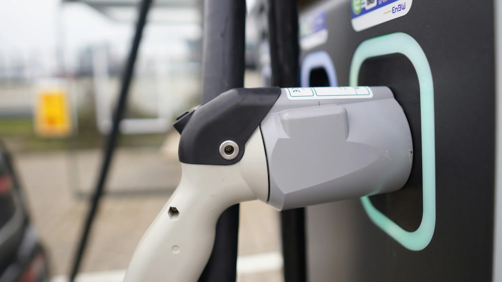

Lines at charging stations are already a frequent topic on social media. The numbers explain why: according to Colombia's Ministry of Mines and Energy, the country has **about 520 charging points at 229 public stations**. With 77,215 EVs recorded in RUNT, the national vehicle registry, as of May 2026, that makes **one charging point per 148 cars**.

Tens of thousands more EVs have been registered since then, so the ratio is worse today.

## Where the chargers are

The network is highly concentrated:

- **Four out of ten** stations are in Bogotá.
- Antioquia and Valle del Cauca come next.
- **Enel** is the largest operator, with charging hubs in Bogotá. **Terpel and EPM** account for about 40% of the country's public stations.
- Voltex, Terpel's network, has more than 57 stations in several departments, including some on highways.

Outside the big cities, fast-charging points along road corridors remain scarce. That limits long trips and explains why most owners use their cars mainly in the city.

## How far there is to go

The Ministry of Mines estimates the country will need **about 20,000 public charging points by 2030**. Going from 520 to 20,000 in four years requires multiplying the network almost 40 times.

*Installing a fast-charging point costs about COP 300 million, according to one operator. Photo: Sophie Jonas on Unsplash.*

## Who is investing

| Company | Plan announced in 2026 |
|---|---|
| Evinka | 150 new stations across Medellín, Bogotá, Barranquilla and Bucaramanga; 40 of them in Medellín |
| Inpel | 400 public charging stations in the country |
| Ergenia | Going from 1 to 10 stations in Medellín and passing 50 in the country before the end of 2026 |
| Shopping centers | Projects such as Carrera, in Bogotá, with 15 fast and semi-fast points |

Evinka estimates each charging point costs it **about COP 300 million**, and that the procedure for increasing grid connection capacity can take **up to eight months** in Colombia.

## What changed in the regulations

- **Faster grid connection:** **Resolution 40334 of 2026** from the Ministry of Mines, published on July 28, handed the definition of the procedure for connecting public charging stations to the grid to CREG, Colombia's energy regulator. The goal is to shorten the wait.
- **Common connectors:** the Ministry proposed requiring at least one Type 2 connector at level 2 and 3 stations, and a CCS Combo 2 at fast-charging ones. We explain this in our [connector guide](/es/notas/conectores-carga-electricos-colombia-tipo-1-tipo-2-ccs-gbt/).

> For anyone buying today: if you cannot charge at home or at work, first look at how many stations are nearby and whether they are busy at the hours you would charge.

## Frequently asked questions

### How many charging stations are there in Colombia?

About 229 public stations with around 520 charging points, according to 2026 figures from the Ministry of Mines and Energy.

### How do I find a charging station?

Operators have apps with maps and real-time availability, such as Terpel's for Voltex. There are also independent apps that bring several networks together.

### Can you take an EV on the road in Colombia?

Yes, on the main corridors, but it takes planning your stops and checking that the connectors are compatible with your car.

Check each model's charging power in the [Mejor Eléctrico comparison tool](/es/comparador/).

---

**Sources:** [La República: one charging point per 148 EVs](https://www.larepublica.co/economia/solo-hay-un-punto-de-carga-por-cada-337-carros-electricos-en-total-hay-229-electrolineras-4398785) · [Minuto60: 520 points at 229 stations](https://minuto60.com/vida-moderna/esta-preparada-colombia-boom-los-vehiculos-electricos/13487) · [Pulzo: target of 20,000 points by 2030](https://www.pulzo.com/carros/problema-40000-carros-electricos-colombia-falta-electrolineras-PP5165279A) · [El Colombiano: Ergenia and Resolution 40334](https://www.elcolombiano.com/negocios/ergenia-electrolineras-medellin-carros-electricos-expansion-KH39588525) · [El Colombiano: Evinka's plan](https://www.elcolombiano.com/negocios/evinka-tech-electrolineras-colombia-corredor-medellin-bogota-inversion-BC35627372) · [ABC Economía: cost per charging point](https://abceconomia.co/?p=47587) · [La República: Inpel's plan](https://www.larepublica.co/empresas/entrevista-con-maria-juliana-arango-gerente-general-de-inpel-4434987) · [Blu Radio: Terpel's Voltex network](https://www.bluradio.com/motor/lista-de-electrolineras-voltex-terpel-en-colombia-so35)
