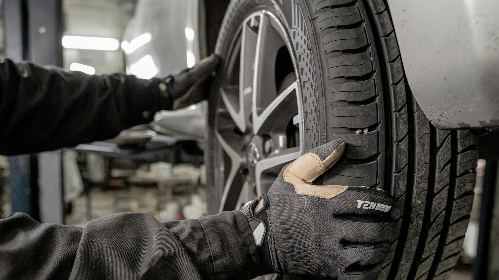

In 2026, hybrids and EVs passed half of a month's registrations in Colombia for the first time. The fleet is growing fast, but the shops prepared to repair these cars are not growing at the same pace. The problem is not only one of knowledge: it is one of **safety**, because an EV works with voltages that can kill.

## The essentials

- **Battery voltage:** between 200 and 800 volts, against 12 volts for a gasoline car's battery.
- **Risks of a bad repair:** electric shocks, burns, lithium cell fires and damage to electronic modules.
- **What Cesvi recommends:** a marked high-voltage zone, a quarantine area for damaged cars, protective equipment and insulated tools.
- **Parts:** in Europe, a part for an EV can take about three weeks, against three days for a gasoline car.

## Why an EV is different in the shop

The traction battery is built into the floor of the car and connects through high-voltage cables running along the body. According to Cesvi Colombia, a vehicle repair research center, an apparently minor knock to the floor or the side rails can damage the battery casing or misalign its mounting points. If the shop does not check it, the damage can appear later, as a fault or, at worst, a fire.

The same risk applies to **hybrids**, which also have high-voltage batteries and cables.

*Technicians working with high voltage must wear class 00 dielectric gloves, a face shield and insulating footwear. Photo: Jimmy Nilsson Masth on Unsplash.*

## What a prepared shop should have

According to the Cesvi recommendations reported by Portafolio:

| Requirement | What it is for |
|---|---|
| Marked high-voltage zone | Keeping untrained people from touching the car while it is energized |
| Quarantine area | Isolating a crashed car in case the battery heats up or catches fire |
| Class 00 insulating gloves, face shield, insulating footwear and flame-resistant clothing | Protecting the technician from shocks and burns |
| Insulated tools, category III multimeter and insulation tester | Verifying the system is de-energized before working |
| Approved equipment for calibrating driver aids | Getting autonomous braking and cameras right after a crash |

## The cost of not being prepared

In Europe, according to ONMOTOR, a fault in the inverter, the charging control module or a high-voltage connector can exceed **EUR 3,000** out of warranty, and in some areas there is only one dealer per brand authorized for high-voltage work, with waits of up to three weeks. In Colombia, with more than 15 new brands arriving in 2026, each brand's workshop network is a key fact to check before buying.

> Before leaving your EV at a shop outside the dealer network, ask whether they have technicians certified in high voltage and a marked zone for these cars. If they cannot answer, look for another.

## Frequently asked questions

### Can any shop repair an EV?

For basic maintenance, such as tires or brakes, many can. For any work touching the battery, the orange cables or the power electronics, only shops with technicians trained in high voltage.

### Why is it dangerous?

Because the batteries work at between 200 and 800 volts. A mistake can cause a shock, burns or a fire.

### What should I do if I crash my EV?

Ask for the battery and its mounts to be checked even if the knock seems minor, especially if it was to the underside of the car.

Compare each brand's service network and warranty before buying, and check the models in the [Mejor Eléctrico comparison tool](/es/comparador/).

---

**Sources:** [Portafolio: the challenge for shops with batteries of up to 800 volts](https://www.portafolio.co/sostenibilidad/baterias-de-hasta-800-voltios-el-reto-de-los-talleres-para-reparar-carros-electricos-e-hibridos-en-colombia-504460) · [Infobae: hybrids and EVs pass half of registrations](https://www.infobae.com/colombia/2026/10/10/crece-la-venta-de-vehiculos-electricos-en-colombia-cerca-de-40000-automotores-en-lo-corrido-del-2026/) · [ONMOTOR: real problems with EVs in 2026](https://onmotor.es/problemas-reales-en-los-coches-electricos-en-2026/)
