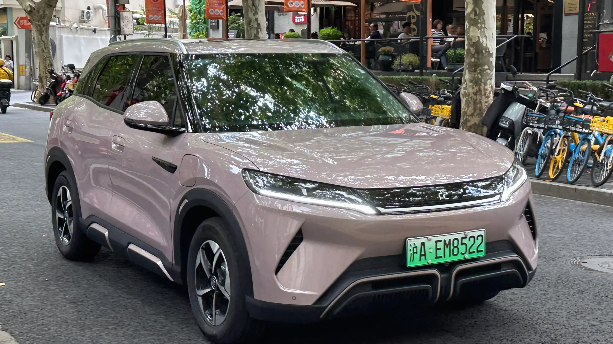

Colombia's EV market keeps breaking records. In **September 2026, 5,895 electric cars were registered**, growth of **217.3%** against the 1,858 of September 2025. That means EVs now account for **17.4% of all new cars** sold in the country, according to the report by the trade groups Fenalco and Andi with data from RUNT, the national vehicle registry.

## The month's and the year's figures

| Indicator | September 2026 | January to September 2026 |
|---|---|---|
| EVs registered | 5,895 | 39,784 |
| Annual growth | 217.3% | 221.7% |
| Electric SUVs | 4,883 | 31,210 |

The year-to-date total is already **more than triple** the 12,366 EVs registered between January and September 2025. September was also the best month of the year, above July (4,870) and August (4,542).

## SUVs rule

Eight out of ten EVs sold in 2026 are SUVs. The figure confirms that Colombians are not looking for a small city car, but for an electric replacement for the family SUV.

## September's best-selling models

| Rank | Model | Registrations | Share |
|---|---|---|---|
| 1 | Tesla Model Y | 2,220 | 37.7% |
| 2 | Chery E5 | 483 | 8.2% |
| 3 | BYD Yuan Up | 409 | 6.9% |
| 4 | MG S5 | 324 | 5.5% |
| 5 | Tesla Model 3 | 215 | 3.6% |

The month's surprise is the **Chery E5**, which reached the market in May and is already the second best-selling EV. For the year to date, the top five are the Tesla Model Y (14,381), BYD Yuan Up (3,908), Tesla Model 3 (2,161), BYD Seagull (1,909) and Chery Icar (1,882).

*The BYD Yuan Up, third in September with 409 units and second for the year to date. Photo: JustAnotherCarDesigner, public domain (CC0), via Wikimedia Commons.*

## Where they sell

| City | September | Year to date |
|---|---|---|
| Bogotá | 2,964 | 20,707 |
| Medellín | 1,472 | 10,380 |
| Cali | 538 | 3,246 |

Bogotá accounts for more than half of the year's registrations. That is no coincidence: it combines the largest number of charging stations, a 60% discount on vehicle tax and the exemption from pico y placa, the city's driving restrictions, where the paid "solidarity" exemption costs COP 70,294 a day.

## What is behind the jump

- **Lower prices.** Tesla's arrival, with entry prices near COP 115 million, forced other brands to adjust. We cover it in our article on [the price war](/es/notas/guerra-de-precios-carros-electricos-efecto-tesla/).
- **Cheaper loans.** EV rates run from 12% to 16.6% effective annual, against 23.5% to 26.5% for combustion cars.
- **Tax benefits** confirmed for individuals in 2026 by the DIAN, Colombia's tax authority.

The bottleneck is infrastructure: the country has about 520 public charging points, a ratio we analyze in [this article](/es/notas/electrolineras-colombia-deficit-puntos-de-carga-2026/).

## Frequently asked questions

### What is the best-selling EV in Colombia in 2026?

The Tesla Model Y, with 14,381 units between January and September. In June it was also the best-selling car in the country across all technologies.

### Which brand sells the most EVs?

Tesla, with 41.6% of the year to date, followed by BYD with 20.7% and Chery with 6.3%.

### How many EVs are there in Colombia?

RUNT recorded 77,215 electric vehicles as of May 2026.

Compare the best sellers in the [Mejor Eléctrico comparison tool](/es/comparador/).

---

**Sources:** [Portafolio: best-selling EVs in September 2026](https://www.portafolio.co/negocios/vehiculo/tesla-domina-los-electricos-mas-vendidos-en-colombia-concentro-41-3-de-las-matriculas-durante-septiembre-504120) · [Portafolio: EV loan rates](https://www.portafolio.co/negocios/vehiculo/carros-electricos-ganan-terreno-en-colombia-por-tasas-bajas-iva-reducido-y-alivios-tributarios-493822) · [La República: charging points in Colombia](https://www.larepublica.co/economia/solo-hay-un-punto-de-carga-por-cada-337-carros-electricos-en-total-hay-229-electrolineras-4398785) · [Infobae: solidarity pico y placa 2026](https://www.infobae.com/colombia/2026/05/07/conductores-podran-quedar-exentos-del-pico-y-placa-en-bogota-sin-pagar-asi-funciona-el-beneficio-para-2026/)
