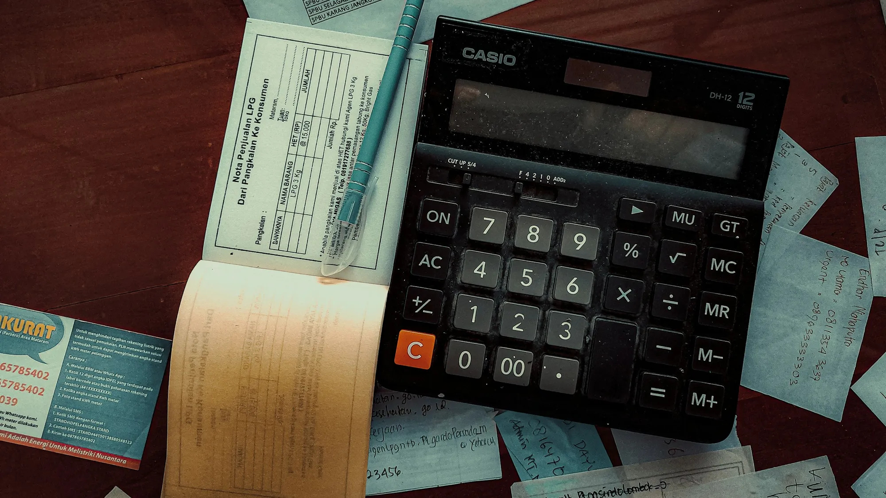

On a COP 100 million car, the 5% VAT paid on the invoice comes to about **COP 4.76 million**. Colombia's Law 1715 of 2014 allows you to recover it, and the DIAN, the national tax authority, confirmed this for individuals in its **Opinion 000673 of January 16, 2026**. The problem is not the right, but the process: there are few appointments, strict rules for sending files and little tolerance for mistakes.

## Before you start: the UPME certificate

Everything begins with the certificate from the Mining and Energy Planning Unit (UPME), which accredits the car as an efficient energy management measure. Without it, the DIAN rejects the request. Requests to the UPME grew so much in 2026 that the agency had to speed up its times, so it is best to apply as soon as you have the invoice.

## The documents

According to the DIAN and accountants who have handled the process, this is the basic package. Confirm the current list with the DIAN before the appointment:

1. **Form 010**, the refund or offset request.
2. **UPME certificate** for the vehicle.
3. **List of invoices** for the car purchase.
4. **Sworn statement** declaring, among other things, that the VAT requested was not used as an increase in cost, as an income tax deduction or as a deductible tax.
5. Copy of your updated RUT, the Colombian taxpayer registry, and ID document.

*The amount to claim is the VAT shown on the car's invoice, not a percentage of the total price. Photo: FIN on Unsplash.*

## Step by step

1. **Book the appointment** in the DIAN's scheduling system, under the refund request for electric or hybrid vehicles at your local office. It must be the office for your tax address: an appointment in another city will not work.
2. **Prepare separate PDFs**, numbered in order and with clear names.
3. **Send everything in a single email**, from the address registered in the RUT, to the mailbox the DIAN indicates for your office and process, **on the exact date and at the exact time of the appointment**.
4. **Save the automatic reply** and the filing number.

In Bogotá, during 2026, the DIAN changed the channel several times: it suspended video service for this process, disabled general mailboxes and moved to receiving documents only by email and only at the time of an appointment. Always check the instructions that come with the appointment confirmation.

## The mistakes that stall requests most

- **Sending outside the appointment time.** The DIAN returns emails arriving earlier or later, even on the same day.
- **Using an email different from the one in the RUT.** Some mailboxes reject senders they do not recognize.
- **Sending everything in one PDF** or in several emails.
- **Looking for appointments at just any time.** The DIAN reported that it releases weekly slots at random times of day. You need to check several times.

> If the appointment does not appear or an email bounces, keep a record: a formal complaint (PQR) with screenshots serves as evidence if you later need to ask for a review.

## Frequently asked questions

### How much will I get back?

The VAT you paid on the car purchase, as shown on the invoice. If the car cost COP 100 million with VAT included, that is about COP 4.76 million.

### How long does the DIAN take to return the money?

The legal term for refunds depends on the type of request and on the DIAN not asking for additional information. Allow several weeks after filing.

### Can I do it myself or do I need an accountant?

You can do it yourself. An accountant helps mainly with the sworn statement and the relationship between the refund and the income tax deduction.

### Does it apply if I bought a hybrid?

According to the DIAN, yes, for HEV and PHEV hybrids with a UPME certificate.

To find out what the income tax deduction is also worth, read [our calculation with the DIAN's limits](/es/notas/deduccion-renta-carro-electrico-ley-1715/).

*This article is for information only and does not replace advice from an accountant.*

---

**Sources:** [DIAN, Opinion 000673 of 2026](https://normograma.dian.gov.co/dian/compilacion/docs/oficio_dian_0673_2026.htm) · [INCP: how to request the VAT refund](https://incp.org.co/publicaciones/infoincp-publicaciones/impuestos/2026/02/como-solicitar-la-devolucion-del-iva-en-la-compra-de-vehiculos-electricos-e-hibridos/) · [Portafolio: the UPME speeds up certificates](https://www.portafolio.co/negocios/vehiculo/solicitudes-para-certificados-de-vehiculos-electricos-e-hibridos-crecen-16-800-upme-acelera-este-proceso-493805) · [DIAN appointment scheduling](https://agendamiento.dian.gov.co)
