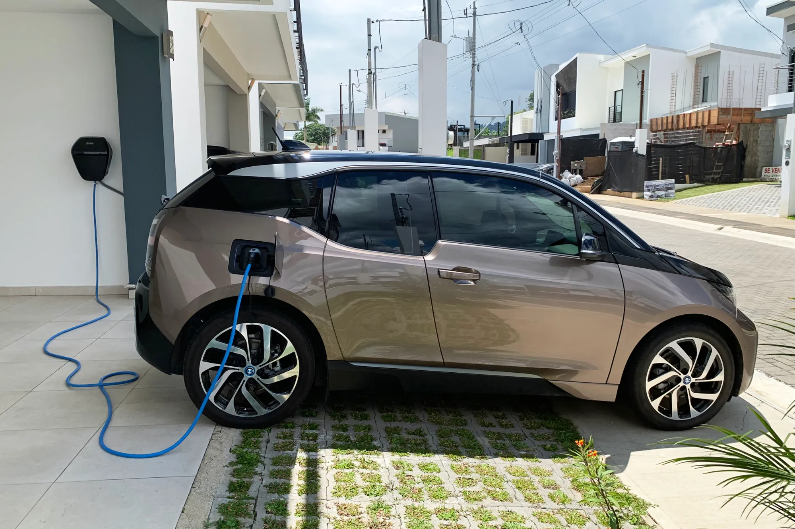

An EV charge costs what the kWh going into the battery are worth, and that price changes a lot depending on where you plug in. In Bogotá, at Enel's August 2026 tariff, a kWh at home in *estrato* 4, one of Colombia's socioeconomic utility tiers, costs **COP 863.6**. At a Tesla Supercharger, **COP 1,300**. The same charge comes out 50% more expensive on the street.

## The formula

**Cost of the charge = kWh needed × price per kWh**

The kWh needed are not the battery's total capacity. Almost nobody charges from 0% to 100%. A typical charge goes from 10% or 20% to 80%, which on a 60 kWh battery is between 36 and 42 kWh. To that you must add losses: part of the energy goes as heat in the charger and the battery, so the home meter records slightly more than goes into the car.

## What it costs in Colombia

For a 42 kWh charge, from 10% to 80% of a 60 kWh battery:

| Where | Price per kWh | Cost of the charge |
|---|---|---|
| Home, tier 4 in Bogotá (Enel, August 2026) | COP 863.6 | About COP 36,300 |
| Tesla Supercharger in Bogotá or Medellín | COP 1,300 | About COP 54,600 |

The home tariff changes every month and depends on the tier: tiers 1 to 3 have a subsidy on part of their consumption, and tiers 5 and 6 pay an additional contribution. The math by tier is in [how much it costs to charge an EV at home](/es/notas/cuanto-cuesta-cargar-un-electrico-en-casa/).

We found no public, up-to-date table of the country's other operators' tariffs. Some networks have also had free charging periods: in 2024, for example, Enel X did not charge at its public points. Check the tariff in the operator's app before plugging in.

*At home you pay only for the energy. In Bogotá, tier 4, a kWh cost COP 863.6 in August 2026. Photo: Mariordo (Mario Roberto Durán Ortiz), CC BY-SA 4.0, via Wikimedia Commons.*

## What it costs in Mexico and Chile

In **Mexico**, the residential tariff from CFE, the state power company, runs from about **1.8 to 3.5 Mexican pesos per kWh**, depending on household consumption and whether you pay the subsidized or high-consumption tariff. At an average of 2.65 pesos, filling a BYD Dolphin Mini's 38.8 kWh battery costs about **103 pesos**. The point to watch is the tariff: if the car raises household consumption a lot, the home can end up on the high-consumption DAC tariff, the most expensive in the range.

In **Chile**, an executive from the Maxus brand cited by La Tercera used **130 Chilean pesos per kWh at home** and **250 at a station** as a reference. With those figures, a full charge of an 88.5 kWh battery costs about 11,500 pesos at home and 22,100 on the street. The article has no date, so it is best taken as an order of magnitude and not a current tariff.

## Why a charging station is more expensive

The price per kWh at a fast charging station does not pay only for the energy. It also covers the charger, the grid connection and the space where it is installed, and the operator recovers that investment kWh by kWh. At home, by contrast, you pay only for the energy, because the charger already belongs to the owner.

That is why an EV's saving depends so much on where you charge. In Colombia, with home charging, the cost per kilometer is around COP 130 for a car using 15 kWh per 100 km. With fast charging at a Supercharger, it rises to about COP 195.

> If you are going to buy an EV without being able to charge at home, do the math with the tariff of your nearest station, not the home one. That is the figure you will pay.

## Frequently asked questions

### How much does it cost to charge an EV in Colombia?

At home, in Bogotá tier 4, about COP 864 per kWh at the August 2026 tariff. A charge from 10% to 80% of a 60 kWh battery comes to about COP 36,300. At a Tesla Supercharger, about COP 54,600.

### How much does a full charge cost?

It depends on battery size. Multiply the battery's kWh by the price per kWh and add a margin for charging losses.

### Is charging free at shopping centers?

Some have offered it as a promotion, but it is not a rule. Check the operator's app before going.

---

**Sources:** [Enel Colombia: August 2026 tariffs](https://www.enel.com.co/content/dam/enel-co/español/personas/1-17-1/2026/pliego%20tarifario%20digital%20_agosto_2026.pdf) · [Semana: Tesla Superchargers in Colombia and their price](https://www.semana.com/vehiculos/articulo/mapa-lista-de-ciudades-con-supercargadores-de-tesla-en-colombia-y-cuanto-cuesta-usarlos/202633/) · [Motorpasión México: cost of charging in Mexico in 2026](https://www.motorpasion.com.mx/industria/cuanto-cuesta-cargar-auto-electrico-mexico-2026) · [La Tercera: charging at home or at a station in Chile](https://www.latercera.com/mtonline/noticia/cuanto-cuesta-recargar-un-auto-electrico-es-mas-barato-hacerlo-en-casa-o-en-una-electrolinera/VFLHTHA4YVFHZKRNBX3VL5GNAQ/) · [Noticias Caracol: free charging at Enel X public points, 2024](https://www.noticiascaracol.com/economia/cuanto-cuesta-cargar-los-carros-electricos-en-bogota-y-donde-puede-le-contamos-so35)
