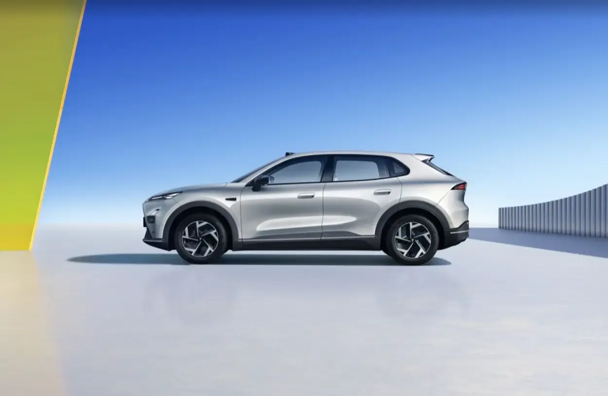
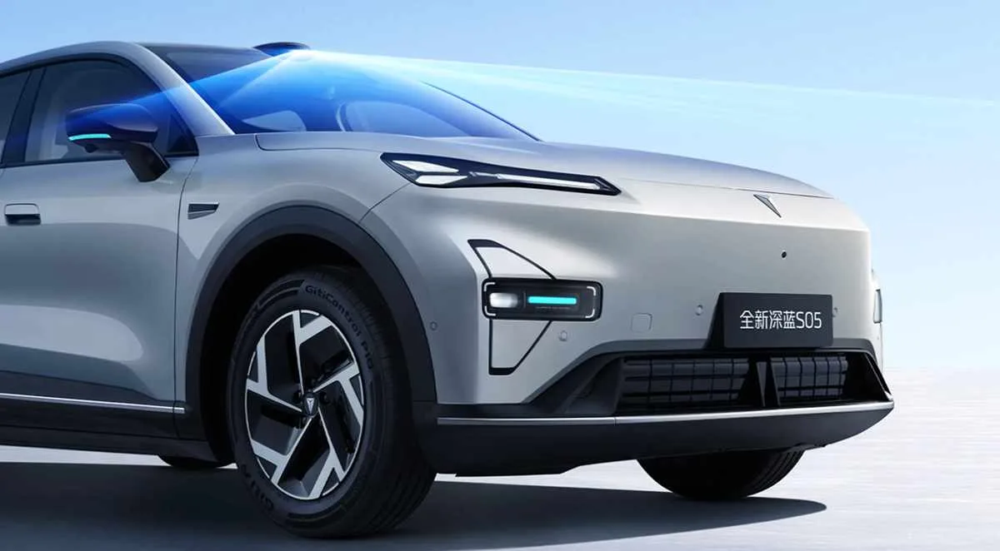
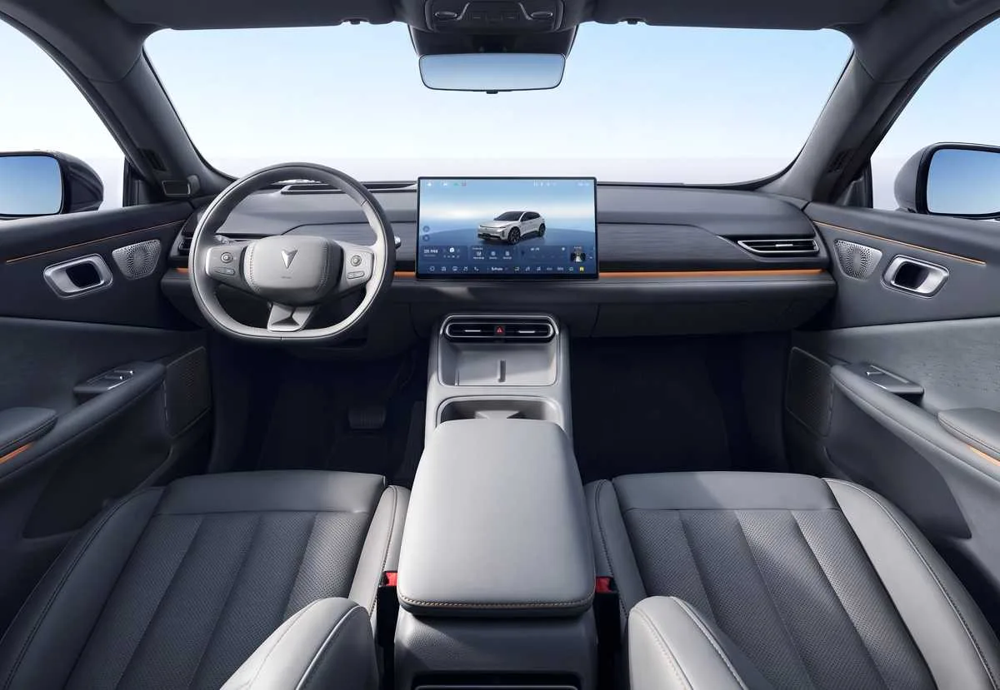
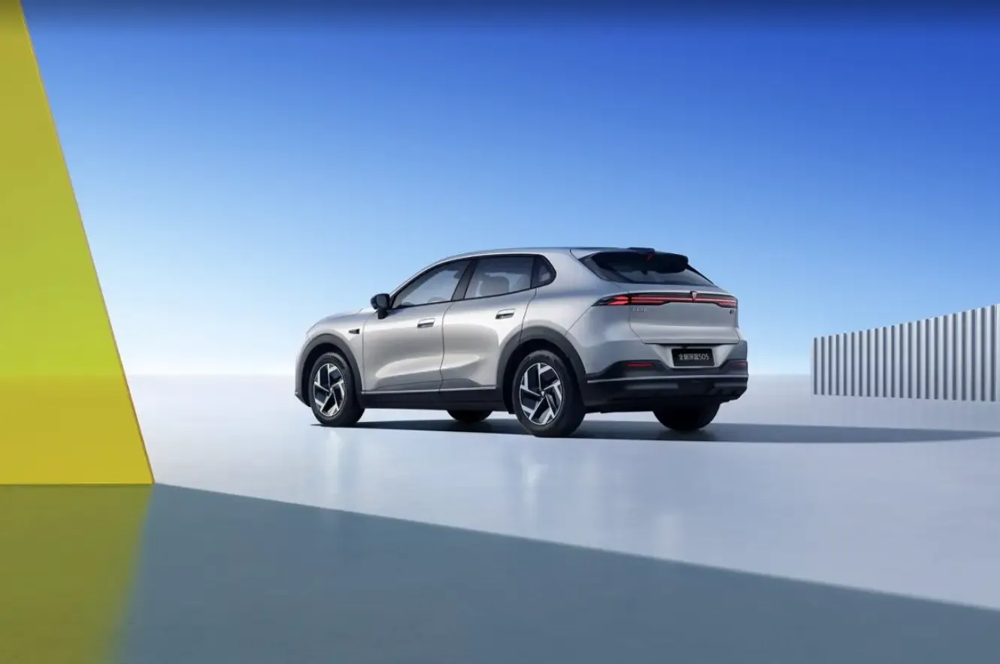

The Deepal S05 is the brand's best-selling car and one of the Chinese EVs that has expanded fastest outside its home market. After barely a couple of years on sale, it has just received its first major update: it adds a **LiDAR sensor**, raises its range to as much as **620 km (385 miles)** and gets a redesigned cabin, without touching the formula that made it popular.

Pre-sales opened on July 30, 2026, and the official launch in China took place on August 6. Here is everything known about the model, and what is still to be confirmed for Colombia and Latin America.

## What's new in the 2027 Deepal S05

This is a facelift, not a new generation. The platform and proportions stay the same, but Deepal strengthened the areas that matter most when buying an EV:

- **Assisted driving:** the LiDAR sensor arrives, until now reserved for more expensive models.
- **Range:** two batteries, rated at 520 km (323 miles) and 620 km (385 miles) on the Chinese CLTC cycle.
- **Charging:** every version goes from 30 to 80% in 15 minutes or less.
- **Design:** a cleaner front end, new headlights and 18-inch wheels.
- **Cabin:** a redesigned dashboard, a 15.6-inch swiveling screen and more storage spaces.

*In profile it keeps the proportions of the previous model: 4.62 meters long, on 18-inch wheels. Photo: Deepal.*

On the outside it keeps the closed grille and frameless doors. The headlights, bumper and door handles change; the handles are now mechanical and semi-flush. It comes in four colors: white, silver, black and gray.

## What LiDAR is and what it does on the S05

LiDAR is a sensor that measures distances with pulses of laser light and builds a three-dimensional map of the car's surroundings. Compared with a camera, it has a clear advantage: it doesn't depend on ambient light, so it detects obstacles at night or against the sun with much greater precision.

On the S05 it sits above the windshield and is part of a suite of 27 sensors:

- 1 LiDAR
- 3 millimeter-wave radars
- 12 ultrasonic sensors
- 11 high-definition cameras, two of them 8-megapixel front cameras

*The LiDAR sits above the windshield and scans what's ahead of the car. Photo: Deepal.*

All that information is processed by two Horizon J6M chips with 256 TOPS of computing power. The result, according to the brand, is more than 90 assistance functions for city driving, highways and parking.

The scope needs to be clear: this is **assisted** driving, not autonomous driving. The driver remains responsible and must keep their attention on the road. These functions are also calibrated for China's roads and maps, and there is no guarantee they will arrive in the same form in other markets.

## Range, battery and charging

The electric version keeps a 272 hp rear motor, which takes it from 0 to 100 km/h in 6.28 seconds. The batteries come from CATL and use lithium iron phosphate (LFP) chemistry:

| Battery | Capacity | CLTC range |
|---|---|---|
| Standard | 56.12 kWh | 520 km (323 miles) |
| Extended | 68.82 kWh | 620 km (385 miles) |

Two clarifications to read those figures correctly:

1. **The CLTC cycle is optimistic.** It is China's official test and usually gives higher results than Europe's WLTP. For reference, the S05 already sold in Europe is rated at 485 km (301 miles) WLTP with the large battery.
2. **Fast charging is from 30 to 80%.** Deepal quotes 15 minutes for that window with 3C charging, but that requires a high-power DC charger. On a home charger, times are very different.

## There will also be a range-extender version

The S05 will continue to offer an extended-range electric variant (EREV): the wheels are always driven by an electric motor, and a 1.5-liter gasoline engine works only as a generator to recharge the battery on the move.

Here the published figures don't fully agree. The battery is about 28.4 kWh, but electric-only range appears as 190 km (118 miles) in some sources and 215 km (134 miles) in others, and total range goes from around 1,100 km (684 miles) to 1,310 km (814 miles). The difference is probably due to the test cycle used, and the official spec sheet for each market will settle it.

This matters for Colombia, where this powertrain is the model's best seller.

## Interior: swiveling screen and more space

The cabin is the other big change. The dashboard adopts a cleaner layout, with exposed air vents and 256-color ambient lighting.

*The cabin gets a new dashboard, exposed air vents and a center screen that swivels toward the driver or the passenger. Photo: Deepal.*

- **Center screen** of 15.6 inches with 2.5K resolution, which swivels 15 degrees toward the driver or the passenger.
- **Head-up display** (AR-HUD) equivalent to 50 inches, with augmented reality navigation.
- **Deepal OS 4.2**, running on a 3-nanometer automotive chip.
- **37 storage compartments** spread around the cabin.
- **492-liter trunk** with a double floor, plus a 159-liter front trunk on the electric version.
- **Optional audio** with 18 speakers and 1,280 watts.

## Price and trims in China

The lineup has five trims, combining battery and equipment:

- 520 Smart
- 520 Premium
- 620 Premium
- 520 Premium LiDAR
- 620 Premium LiDAR

*The rear keeps the full-width light bar. Photo: Deepal.*

The launch price ranges from **CNY 115,900 to 144,900**, about **US$16,900 to US$21,300**. It is a limited-time promotional price and applies only in China.

It doesn't work as a direct reference for other countries: shipping, tariffs, taxes and the importer's margin have to be added to the Chinese price. LiDAR is also only available on the two best-equipped trims.

## Deepal S05 EV specs

| Spec | Value |
|---|---|
| Length | 4,620 mm |
| Width | 1,900 mm |
| Height | 1,600 mm |
| Wheelbase | 2,880 mm |
| Motor | Electric, rear |
| Power | 272 hp |
| 0 to 100 km/h | 6.28 seconds |
| Batteries | 56.12 or 68.82 kWh (LFP, CATL) |
| CLTC range | 520 or 620 km (323 or 385 miles) |
| Fast charging | 30 to 80% in 15 minutes |
| Trunk | 492 liters, plus 159 liters up front |
| Wheels | 18 inches |

## When it arrives in Colombia and Latin America

There is no confirmed date or price yet. Everything announced so far applies to the Chinese market.

What is known is that the S05 is a global model. It reached Europe in late 2025 and the UK in March 2026, and in China it sold 64,716 units in the first half of 2026, 56% more than a year earlier. Almost half of the Deepal cars sold in China are an S05.

In Colombia, the current model is already on sale and is the brand's most important car. In July 2026 alone it posted 215 registrations: 159 for the range-extender version and 56 for the electric one.

For Europe, specialist media expect the update to arrive in 2027. A similar timeline for Latin America is a reasonable guess, but the brand has not confirmed it.

> If you are thinking about buying an S05 today, the key question for the dealer is when the update arrives and whether the LiDAR trims will be part of the local lineup.

## FAQ

### How much range does the Deepal S05 with LiDAR have?

Up to 620 km (385 miles) on the Chinese CLTC cycle, with the 68.82 kWh battery. With the 56.12 kWh battery it is 520 km (323 miles). On the European WLTP cycle the figures will be lower.

### How much does the 2027 Deepal S05 cost?

In China, between CNY 115,900 and 144,900, about US$16,900 to US$21,300, as a promotional launch price. No price has been announced for Colombia.

### Do all trims have LiDAR?

No. Of the five trims, only two include it: 520 Premium LiDAR and 620 Premium LiDAR.

### Can the Deepal S05 drive itself?

No. Its systems are for assisted driving: they help the driver but do not replace them.

---

**Sources:** [Car News China](https://carnewschina.com/2026/08/07/refreshed-deepal-s05-with-lidar-launched-in-china-starting-from-16900-usd/), [Forococheseléctricos](https://forococheselectricos.com/noticias/nuevo-deepal-s05-lidar-diseno-620-km-autonomia-20260722-41625.html) and [El Carro Colombiano](https://www.elcarrocolombiano.com/autos-del-mundo/deepal-s05-2027-nueva-actualizacion-tecnologia-lidar-autonomia/).
