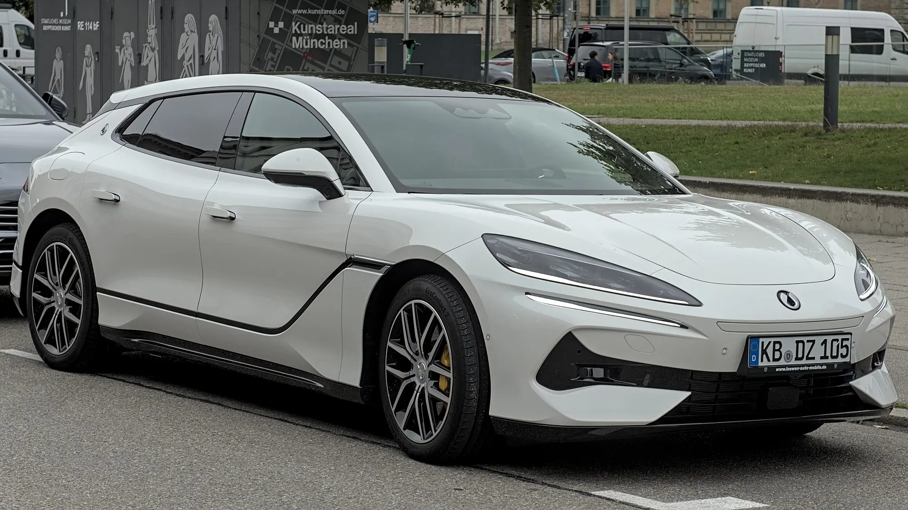

BYD, the second best-selling EV brand in Colombia, is preparing the arrival of its luxury brand, **Denza**. It will be imported by **Motorysa**, the same group that distributes BYD in the country. Denza Colombia's official social media account opened on September 28, 2026, and the brand appears on the list of those that would debut around the Bogotá Auto Show in November.

## The essentials

- **Importer:** Motorysa.
- **Arrival date:** unconfirmed; expected around the November Show.
- **Models:** not confirmed. The Z9 GT is the most mentioned.
- **Prices:** not announced.
- **Expected rivals:** Zeekr, Voyah, Smart, Xpeng and Avatr, plus the German premium brands.

## The candidates

Denza has not said which models it will bring. This is its global range:

| Model | Type | Key figure |
|---|---|---|
| Z9 GT | Electric or plug-in hybrid shooting brake | In Europe it promises 600 km (373 miles) WLTP and 0 to 100 km/h in 2.7 seconds |
| N8 / N8L | Large SUV | Up to 1,003 km (623 miles) CLTC in the N8 |
| N9 | Six-seat SUV | Plug-in hybrid with three electric motors |
| D9 | Seven-seat luxury van | Electric version with up to 520 km (323 miles) WLTP |
| B5 and B8 | Body-on-frame SUVs | Plug-in hybrids with over 1,000 km (621 miles) NEDC |

Be careful with the range figures: **CLTC** and **NEDC** numbers are more optimistic than **WLTP** ones. We explain why in our [article on how to read range figures](/es/notas/autonomia-electricos-cltc-nedc-wltp-como-leerla/).

*The Z9 GT has sporty wagon bodywork, uncommon among EVs. Photo: Alexander-93, CC BY-SA 4.0, cropped, via Wikimedia Commons.*

## Why BYD is bringing a luxury brand

In Colombia, BYD competes mainly on price with models such as the Yuan Up, the Seagull and the Dolphin. But the upper end of the EV market grew with Tesla's arrival, and BYD has less presence there. Denza lets it enter that segment without changing BYD's affordable brand image.

With Denza, BYD repeats in Colombia what it did in China: a separate brand to compete in the luxury segment, without the BYD name on the grille.

## Frequently asked questions

### What is Denza?

It is BYD's luxury brand. It was born in 2010 as a joint venture with Mercedes-Benz and today belongs to BYD.

### When does Denza reach Colombia?

There is no confirmed date. It is expected around the Bogotá Auto Show in November 2026.

### Which models will it bring?

They are not confirmed. The Z9 GT is the most mentioned.

### Who imports it?

Motorysa, the same distributor as BYD in Colombia.

Until then, compare the BYD models on sale in the [Mejor Eléctrico comparison tool](/es/comparador/?a=byd-seal-82-5-kwh-awd-excellence-2026-eu&b=byd-sealion-7-82-5-kwh-awd-design-2026-eu).

---

**Sources:** [El Carro Colombiano: Denza in Colombia](https://www.elcarrocolombiano.com/industria/denza-marca-premium-byd-colombia-modelos-lanzamiento/) · [El Carro Colombiano: new brands at the 2026 Show](https://www.elcarrocolombiano.com/lanzamientos/carros-nuevas-marcas-vienen-colombia-salon-del-automovil-bogota-2026/)
