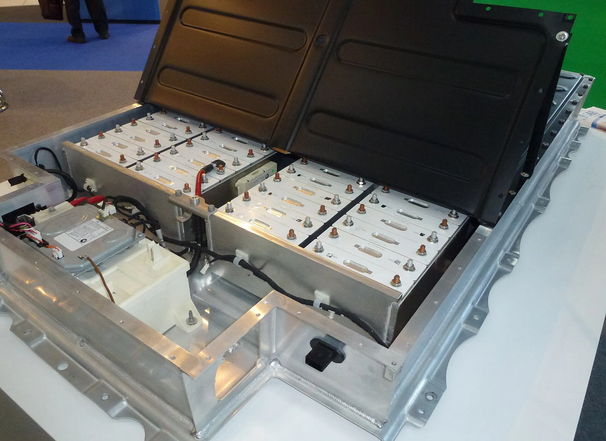

No: on the available data, electric cars catch fire **less** often than gasoline or diesel cars. The opposite perception comes from the fact that an EV fire makes the news while a gasoline car fire almost never does, and that when a battery burns, the fire behaves differently and is harder to put out. Both things are true at once.

## What the Swedish data shows

The Swedish Civil Contingencies Agency (MSB) records vehicle fires by vehicle type. For 2022, according to its figures as published by the Australian outlet The Driven:

| Type of car | Fires in 2022 | Approximate fleet | Rate |
|---|---|---|---|
| Electric | 23 | 611,000 | 0.004% |
| Gasoline and diesel | About 3,400 | 4.4 million | 0.08% |

At those rates, a combustion car was about **20 times more likely** to catch fire than an EV. EV fires held at around 20 a year for three years, while the electric fleet nearly doubled.

The figure has limits: it covers one country and one year, it compares per vehicle rather than per kilometer driven, and the combustion fleet is probably older than the electric one, which also plays a role. Even with those caveats, the gap is large.

*The battery of a BMW i3. When a lithium-ion cell overheats, it can spread the heat to its neighbors. Photo: RudolfSimon, CC BY-SA 3.0, via Wikimedia Commons.*

## Why a battery fire is different

When a lithium-ion cell is damaged or overheats, it can go into what is called thermal runaway: the cell generates its own heat and spreads it to neighboring cells. The fire can last hours and reignite after being put out, as a Purdue professor explained to E&E News after the Hurricane Ian fires. That is why manufacturers provide rescue sheets, and Euro NCAP assesses that information in its tests.

Lithium iron phosphate (LFP) batteries, increasingly common in mid-priced EVs, are generally considered more heat-stable than nickel-based ones. We explain the differences in [this article](/es/notas/bateria-carro-electrico-lfp-nmc-sodio-diferencias/).

## The cases you should take seriously

There are situations where the risk goes up, and the recalls themselves document them:

- **Manufacturing defects.** In 2026, Volkswagen and Cupra recalled EVs over a battery defect with a fire risk, and MG recalled 9,806 S5 EVs over a fan that could overheat in extreme cold. We covered them in our articles on [Volkswagen and Cupra](/es/notas/volkswagen-cupra-llamado-revision-baterias-incendio/) and on the [MG S5 EV](/es/notas/mg-s5-ev-problemas-reportados/).
- **Saltwater flooding.** After Hurricane Ian in 2022, firefighters in one Florida district put out six fires in EVs that had been submerged in seawater. We explain it in [electric cars and floods](/es/notas/carro-electrico-lluvia-inundacion/).
- **Severe crashes that damage the battery**, and repairs done at shops without the right training, as we reported in [this article](/es/notas/talleres-reparacion-electricos-800-voltios-colombia/).

## What owners can do

Respond to any recall on your model; in Colombia, the Superintendence of Industry and Commerce (SIC) publishes active safety campaigns. Charge with certified cables and chargers, installed by a licensed electrician. And if the car takes a hard hit underneath, where the battery sits, have it inspected even if it seems to work fine.

## Frequently asked questions

### Is it true that electric cars catch fire more often?

No. In Sweden in 2022, the fire rate for combustion cars was about 20 times higher than for EVs.

### Why is an electric car fire so hard to put out?

Because battery cells can generate their own heat and spread it to one another. The fire can last hours and reignite.

### Which battery is safer against fire?

Lithium iron phosphate (LFP) batteries are generally considered more heat-stable than nickel manganese cobalt ones.

---

**Sources:** [The Driven: Swedish MSB data on vehicle fires](https://thedriven.io/2023/05/16/petrol-and-diesel-cars-20-times-more-likely-to-catch-fire-than-evs/) · [E&E News: the EVs that caught fire after Hurricane Ian](https://www.eenews.net/articles/why-6-flooded-evs-burst-into-flames-after-hurricane-ian/) · [Electrive: MG S5 EV recall](https://www.electrive.com/es/2026/07/20/mg-retira-del-mercado-el-s5-ev-debido-a-un-posible-riesgo-de-incendio/) · [Infobae and EFE: Volkswagen and Cupra recall](https://www.infobae.com/america/agencias/2026/10/16/grupo-volkswagen-llama-a-revision-a-modelos-id-y-de-marca-cupra-por-problemas-en-baterias/) · [Wikipedia: rescue assessment in Euro NCAP](https://en.wikipedia.org/wiki/Euro_NCAP)
