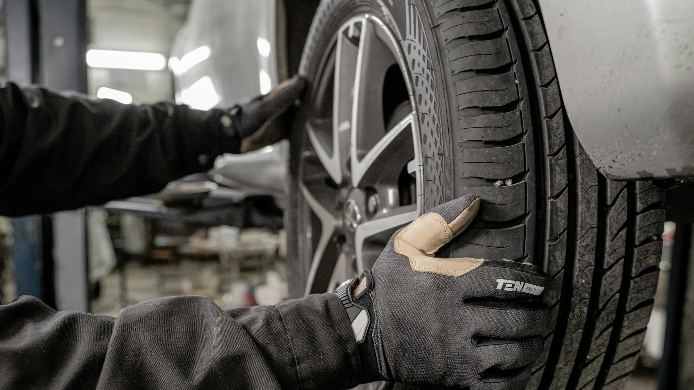

A gasoline engine has hundreds of moving parts; an electric motor has a handful. That gap shows up at the shop: several jobs you pay for today every 5,000 or 10,000 km simply stop existing. But "less maintenance" is not "no maintenance", and some items cost more.

## What goes away

- Engine oil and oil filter changes.
- Spark plugs, ignition leads and coils.
- Timing belt and engine water pump.
- Fuel filter, injectors and exhaust system.
- The clutch, on most models.
- The emissions test at Colombia's technical and mechanical inspection.

## What still gets checked

| Component | What is done | Typical interval |
|---|---|---|
| Brakes | Inspection and cleaning; replacements are less frequent thanks to regenerative braking | At every service |
| Tires | Rotation, alignment and balancing | Roughly every 10,000 km |
| Battery system coolant | Level check and replacement per the manual | Varies widely by brand |
| Cabin air filter | Replacement | Roughly once a year |
| Brake fluid | Replacement | Roughly every two years |
| 12-volt battery | Load test | Once a year |
| Software | Updates and high-voltage system diagnostics | At every dealer visit |

Intervals change from one manufacturer to the next. The one that counts is in your car's manual, and sticking to it is usually a condition for keeping the battery warranty.

*Tires are the consumable that wears fastest on an EV, because of the extra weight and the instant torque. Photo: Jimmy Nilsson Masth on Unsplash.*

## Where an EV costs more

- **Tires.** An EV weighs between 200 and 400 kg more than its gasoline equivalent, and its torque arrives all at once. Tires wear out sooner, and many models use specific low-noise, low-rolling-resistance tires that cost more.
- **Comprehensive insurance.** Premiums tend to be higher, because any repair that involves the battery or the sensors is expensive. Get a quote before you buy.
- **Workshops.** Working on the high-voltage system requires trained technicians. Outside the big cities, the supply of specialized shops is still thin.

> Before you buy, ask the dealer what the service plan costs for the first five years and where the nearest authorized workshop to your home is.

## Frequently asked questions

### How often does an EV need servicing?

Most brands ask for one service a year or every 10,000 to 20,000 km. Check your model's manual.

### Can any mechanic work on an EV?

For tires, suspension or brakes, any reputable shop will do. For the battery, the motor or the high-voltage system, you need certified staff.

### Does the 12-volt battery also need replacing?

Yes. EVs carry a small 12-volt battery that powers the lights and onboard systems. If it fails, the car won't start even if the main battery is charged.

Compare warranties and specs for each model in the [Mejor Eléctrico comparator](/es/comparador/).

---

**Sources:** [Law 1964 of 2019 (Colombia), technical inspection of electric vehicles](https://www.alcaldiabogota.gov.co/sisjur/normas/Norma1.jsp?i=85510) · [Portafolio: benefits and costs of EVs](https://www.portafolio.co/negocios/vehiculo/carros-electricos-ganan-terreno-en-colombia-por-tasas-bajas-iva-reducido-y-alivios-tributarios-493822)
