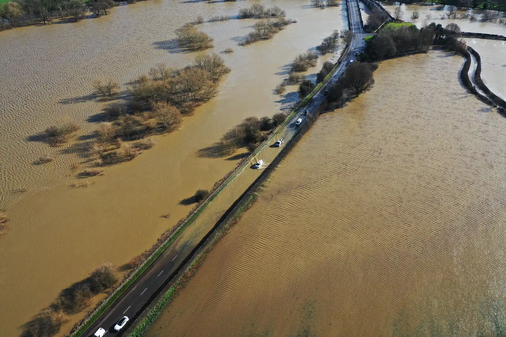

Driving an electric car in the rain, washing it with a hose or charging it at an outdoor station while it pours is not dangerous. The battery and the high-voltage connectors are sealed, and chargers are built to work outdoors. The risk comes with deep water: driving through a flooded street or, worse, the car ending up submerged, particularly in seawater.

## How much water an EV can handle

Some manufacturers publish the depth of water their cars can wade through, measured from the bottom of the tire. According to SlashGear:

| Model | Maximum published depth |
|---|---|
| Tesla (brand-wide figure) | 32 inches, about 81 cm |
| Nissan Leaf (tested) | 27.5 inches, about 70 cm |
| Ford F-150 Lightning | 24 inches, about 61 cm |
| Audi Q8 e-tron | 11.8 inches, about 30 cm |

These figures depend on the car's ride height, its components and modifications such as lowered suspension. They describe technical capability, not a recommendation: the UK's Automobile Association advises against driving through moving water deeper than about 10 centimeters, whatever the car. Flowing water can sweep a vehicle away at far shallower depths than it seems, and a flooded street hides potholes and open manholes.

*The UK's Automobile Association advises against driving through moving water deeper than about 10 centimeters, whatever the car. Photo: TCExplorer, CC BY-SA 2.0, via Wikimedia Commons.*

## Salt water, the most serious risk

The most cited case is Hurricane Ian, in Florida, in 2022. In the days that followed, firefighters in a district near Naples put out **six fires in electric cars** that had been under seawater. A Purdue University professor told E&E News that salt water, which is highly conductive, can create a short circuit between the battery terminals, and that the fire can burn for hours and reignite. Florida saw similar cases after Hurricanes Idalia, in 2023, and Helene, in 2024.

Fresh water also causes damage, but salt water is the most dangerous because it conducts electricity far better. For Latin America this is a concrete warning in coastal cities exposed to storm swells or hurricanes, such as those on Colombia's Caribbean coast or along the Gulf of Mexico.

## What to do if your EV has been underwater

1. **Do not turn it on or plug it in to charge.** Even if it seems to work, there may be water inside the battery.
2. **If possible, move it out of the flood zone** and park it outdoors, away from houses and other cars, in case it catches fire later.
3. **Notify your insurer and the dealer** so the car is inspected at a shop equipped for electric vehicles before you use it again.
4. **Watch for smoke, smells or noises** coming from underneath, even days later. If you notice any, move away and call the fire department.

During flood events in Florida, authorities asked residents to move devices with lithium-ion batteries, cars included, out of areas the sea could reach.

> A battery that has been submerged cannot be assessed by eye. The car starting up does not mean it is fine.

## Frequently asked questions

### Can you drive an electric car in the rain?

Yes. The battery and the high-voltage system are sealed, and rain poses no risk beyond what it poses to a gasoline car.

### Can you charge an electric car when it rains?

Yes, at chargers designed for outdoor use and with cables in good condition. Avoid handling damaged or submerged connectors.

### What happens if an electric car is flooded?

The battery can be damaged and, with salt water, there is a fire risk, even days later. Do not turn it on or charge it, and have it inspected.

---

**Sources:** [SlashGear: is it safe to drive an EV through water?](https://www.slashgear.com/1712474/electric-cars-drive-flood-water-safety-concerns/) · [E&E News: why six flooded EVs burst into flames after Hurricane Ian](https://www.eenews.net/articles/why-6-flooded-evs-burst-into-flames-after-hurricane-ian/)
