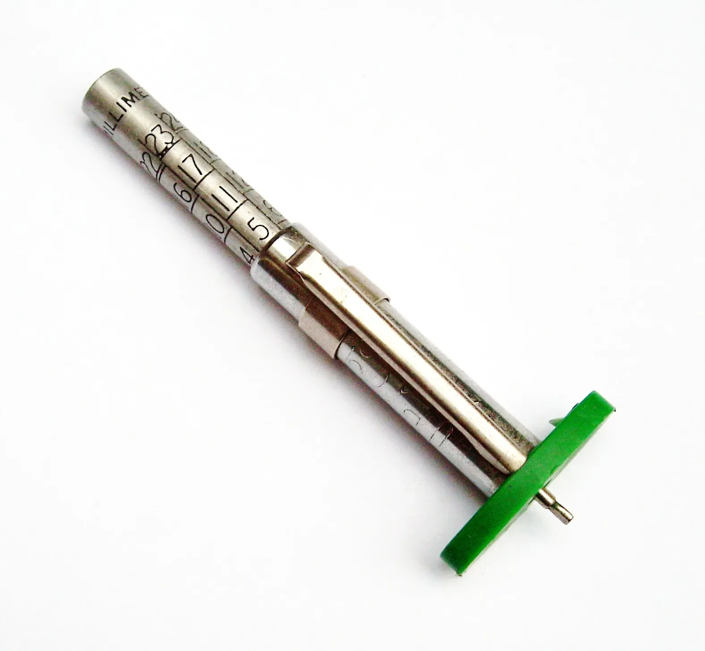

An electric car skips the oil changes, but not the tires. Quite the opposite: according to Michelin, quoted by British magazine Move Electric, an EV can wear out its tires **up to 20% faster** than a gasoline or diesel car. In the maintenance budget, tires are one of the few costs that go up with an electric car.

## Why they wear faster

**Weight.** The battery makes an electric car considerably heavier than an equivalent combustion car. Move Electric gives the example of a gasoline family car of about 1,400 kg against about 2,000 kg for its electric equivalent. According to the firm Emissions Analytics, tire wear rises by around **20% for every additional 450 kg**.

**Instant torque.** An electric motor delivers all of its force the moment you press the accelerator. The tires work harder to avoid spinning at every launch, especially if the driver accelerates hard.

**Cornering and braking.** More mass means more lateral force in corners and more load under braking, even though the motor handles much of the braking through [regenerative braking](/es/notas/freno-regenerativo-como-funciona/).

*A tread depth gauge lets you check wear at home. Photo: Simon Speed, CC0, via Wikimedia Commons.*

## What is different about EV tires

Almost every major brand now sells tires designed specifically for electric cars. They are built with three goals: lower rolling resistance, to use less battery; stronger sidewalls, to carry the weight; and less noise, because in a car without a combustion engine tire noise is easier to hear. Continental, Michelin and Pirelli claim their EV tires practically eliminate the 20% wear gap, although those comparisons are usually made against standard tires rather than the best on the market.

They tend to cost more. So when it is time to replace them, compare two things: the price of the tire and how long it lasts. A cheaper tire that lasts half as long ends up costing more, and a low-rolling-resistance tire can save some range.

## How to make them last longer

Most of the extra wear comes down to your right foot and to maintenance:

1. **Accelerate and brake smoothly.** Hard launches, very tempting in an EV, are what wear tires most.
2. **Use Eco mode**, which softens the accelerator response.
3. **Anticipate stops** and let regeneration do the work.
4. **Check tire pressure** every month, using the figure the manufacturer specifies for the car's weight.
5. **Get alignment and balancing** as often as the manual says, and rotate the tires if the manufacturer recommends it.

> When buying a used EV, inspect the tires carefully. A low-mileage car with badly worn tires tells you how the previous owner drove it.

## Frequently asked questions

### Do electric cars wear out tires faster?

Yes. Michelin acknowledges they can wear them up to 20% faster, because of the weight and the instant torque.

### Do you need special tires on an electric car?

It is not mandatory, but EV tires are made to carry more weight, roll with less resistance and make less noise. Always stick to the size and load index the manufacturer specifies.

### How long do electric car tires last?

It depends on the car, the tire and how you drive. The useful comparison is with the same type of tire: on an EV, expect somewhat shorter life than on an equivalent gasoline car.

---

**Sources:** [Move Electric: do electric cars wear out tyres faster?](https://www.moveelectric.com/e-cars/do-electric-cars-wear-out-tyres-faster)
