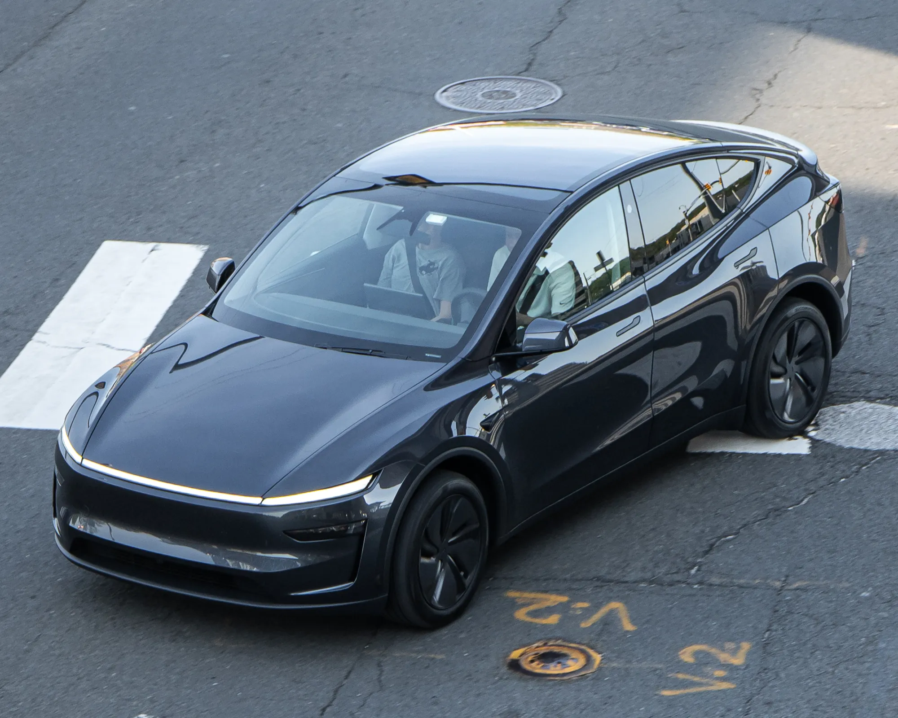

Colombia registered **39,784 electric cars** between January and September 2026, 221.7% more than in the same period of 2025. In September they were **17.4% of the country's new cars**, almost one in six. This guide brings together what you need to know before buying one: prices, benefits, charging, safety and running costs.

## How much an EV costs in Colombia

The range goes from urban microcars at about COP 47 million to luxury SUVs at more than COP 250 million. Most sales are concentrated between COP 80 and 120 million:

| Model | Published entry price |
|---|---|
| Chery E5 Comfort | COP 79.99 million |
| Kia EV2 Air | COP 89.99 million |
| New BYD Dolphin | COP 89.99 million |
| Geely EX5 SE | COP 92.9 million |
| MG S5 EV | COP 94.99 million |
| Tesla Model 3 | COP 115.99 million |
| Tesla Model Y | COP 120.99 million |

Launch or list prices reported by the press and the brands in 2026; promotions often move them. The price war that began with Tesla's arrival in November 2025 brought several models down. We explain it in [the Tesla effect](/es/notas/guerra-de-precios-carros-electricos-efecto-tesla/), and [why EVs are expensive](/es/notas/por-que-los-carros-electricos-son-tan-caros/) covers where the price comes from.

## The benefits of an EV

EVs pay **5% VAT** instead of 19%, enter with no tariff, pay a vehicle tax capped at 1% of the valuation and get a discount on SOAT, the mandatory accident insurance. In Bogotá, the vehicle tax has an additional 60% discount for five years, and they are exempt from pico y placa, the driving restrictions, under a national law. Buyers of new cars can also request a VAT refund and an income tax deduction with a certificate from the UPME, the energy planning unit.

The full list is in [the benefits of buying an EV](/es/notas/beneficios-tributarios-carro-electrico-2026/), and the step-by-step for the refund in [this article](/es/notas/devolucion-iva-carro-electrico-dian-paso-a-paso/).

*The Tesla Model Y was Colombia's best-selling car in September 2026, across all technologies. Photo: OWS Photography, CC BY 4.0, via Wikimedia Commons.*

## The best sellers

The **Tesla Model Y** dominates: in September 2026 it had 2,220 registrations, 37.7% of EVs, and it was the best-selling car in the country across all technologies. The Chery E5, BYD Yuan Up, MG S5 and Tesla Model 3 followed. Bogotá accounts for more than half of the EVs registered this year, followed by Medellín and Cali. The detail is in [how September closed](/es/notas/ventas-carros-electricos-colombia-septiembre-2026/).

## Where they charge

Charging at home is cheapest: at Enel's August 2026 tariff, a kWh cost COP 863.6 in tier 4 in Bogotá. On the street, the country had about **520 public charging points** at 229 stations in mid-2026, with four out of ten in Bogotá, and Tesla charges COP 1,300 per kWh at its Superchargers in Bogotá and Medellín.

For apartment dwellers, the law does not allow banning a charger in a private parking space, although the complex can regulate it. We explain this in [what the law says](/es/notas/instalar-cargador-electrico-conjunto-residencial/), and the costs are in [how much a charge costs](/es/notas/cuanto-cuesta-una-carga-de-carro-electrico-latinoamerica/).

## Safety: the Colombian version matters

Several EVs sold in Colombia have five Euro NCAP stars, but the rating applies to the European version. Some entry-level Colombian versions arrive without autonomous braking or lane assist. Before buying, check the exact trim's equipment with [this list](/es/notas/carros-electricos-pequenos-punto-ciego-asistente-de-carril/).

## What it costs to maintain

An EV needs no oil or engine filter changes, and regenerative braking wears the pads less. On the other hand, tires wear faster because of the weight, and it is worth checking the warranty: the battery's is usually eight years, but the rest of the car's can be just three. More detail in [maintenance](/es/notas/mantenimiento-carro-electrico-que-incluye/) and [warranties](/es/notas/cuanto-dura-la-garantia-de-un-carro-electrico/).

> The question that defines the purchase most is not which car, but where you will charge it. If you have somewhere to plug in at home or at work, almost any EV on the market will do for the city.

## Frequently asked questions

### How many EVs are there in Colombia?

RUNT, the national vehicle registry, had 77,215 EVs recorded as of May 2026, according to the Ministry of Mines and Energy. Between January and September, 39,784 more were registered.

### What is the best-selling EV in Colombia?

The Tesla Model Y, with 14,381 registrations between January and September 2026.

### Do EVs have pico y placa in Colombia?

No. The EV exemption comes from a national law. The one for hybrids, by contrast, depends on each city.

---

**Sources:** [Portafolio: best-selling EVs in September 2026](https://www.portafolio.co/negocios/vehiculo/tesla-domina-los-electricos-mas-vendidos-en-colombia-concentro-41-3-de-las-matriculas-durante-septiembre-504120) · [Infobae: EVs from January to September 2026](https://www.infobae.com/colombia/2026/10/10/crece-la-venta-de-vehiculos-electricos-en-colombia-cerca-de-40000-automotores-en-lo-corrido-del-2026/) · [Portafolio: tax benefits for EVs](https://www.portafolio.co/negocios/vehiculo/carros-electricos-ganan-terreno-en-colombia-por-tasas-bajas-iva-reducido-y-alivios-tributarios-493822) · [Law 1964 of 2019](https://www.alcaldiabogota.gov.co/sisjur/normas/Norma1.jsp?i=85510) · [Enel Colombia: August 2026 tariffs](https://www.enel.com.co/content/dam/enel-co/español/personas/1-17-1/2026/pliego%20tarifario%20digital%20_agosto_2026.pdf) · [Minuto60: 520 charging points at 229 stations](https://minuto60.com/vida-moderna/esta-preparada-colombia-boom-los-vehiculos-electricos/13487) · [Portafolio: Tesla financing and October 2026 prices](https://www.portafolio.co/negocios/vehiculo/tesla-ofrece-financiacion-al-0-de-interes-en-colombia-para-model-3-y-model-y-asi-puede-acceder-505120)
