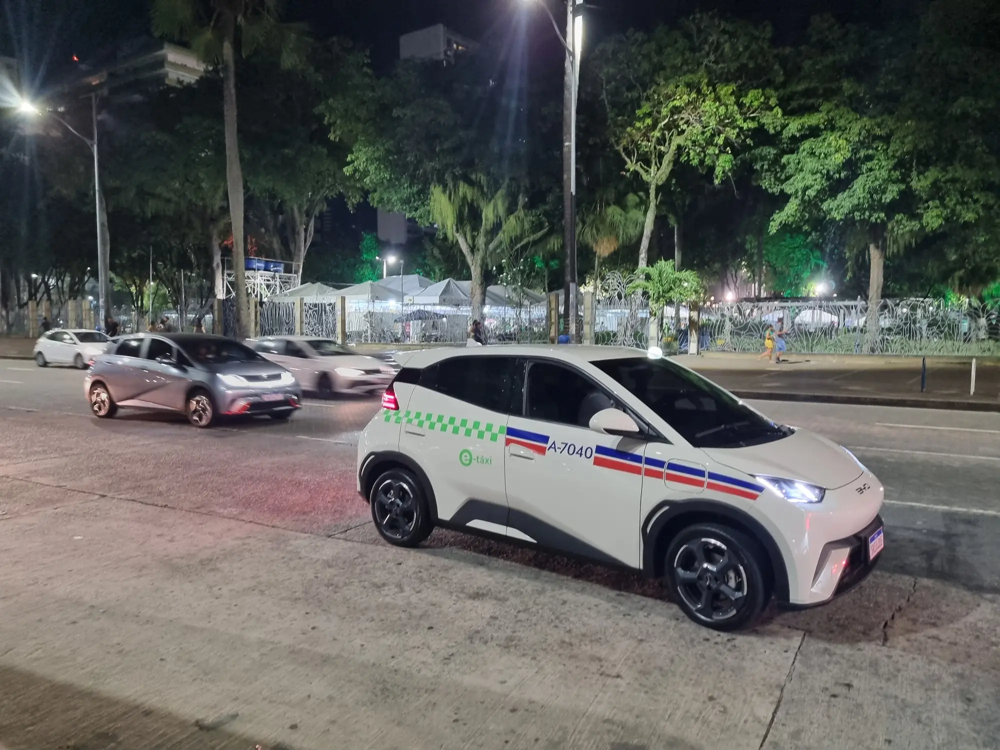

The hatchback is the gateway to electric cars in Latin America. It is the cheapest format, the easiest to park and, with a small battery, the quickest to charge at home. In 2026 one model dominates the category across almost the whole region: the **BYD Dolphin Mini**, sold in Colombia as the **Seagull**.

## The Dolphin Mini, the car that moves the market

In **Brazil**, according to the dealers' association Fenabrave, the Dolphin Mini was the best-selling model in retail in June 2026, with **5,143 units**, ahead of any gasoline car. Two other EVs followed: the BYD Dolphin, with 4,827, and the Geely EX2, with 4,363.

In **Argentina** it takes more than half of the EV market: **495 of the EVs registered in September 2026**, 57.2% of the total, with prices from USD 23,990. In **Mexico**, BYD sold almost four out of ten hybrids and EVs in the first half of 2026, and the Dolphin Mini is its entry hatchback.

In Brazil, the Dolphin Mini has also been assembled locally since 2025, at BYD's plant in Camaçari. The 100,000th car to leave that factory, in July 2026, was a Dolphin Mini.

*A BYD Dolphin used as a taxi in Salvador, Brazil. The Dolphin was the second best-selling car in Brazilian retail in June 2026. Photo: BrasileiroMedio, public domain (CC0), via Wikimedia Commons.*

## The electric hatchbacks sold in Colombia

| Model and trim | Battery | Published range | Trunk |
|---|---|---|---|
| BYD Seagull GL 300 | 30.1 kWh | 300 km (186 miles) NEDC | 230 L |
| BYD Seagull GS 400 | 38 kWh | 380 km (236 miles) NEDC | 230 L |
| Renault Kwid E-Tech Techno | 26.8 kWh | 298 km (185 miles) on the urban cycle | 290 L |
| JMEV 3 | 30.2 kWh | 302 km (188 miles) NEDC | 250 L |
| JAC E10X | 31.4 kWh | Published with no cycle | 140 L |

Figures from each brand's official spec sheets in Colombia. The new BYD Dolphin, larger and priced at COP 89.99 million, has [its own article](/es/notas/nuevo-byd-dolphin-colombia-precio-equipo/).

The table shows the format's great weakness: **the trunk**. With 140 to 290 liters, these cars work for the city and for a trip with little luggage, not for a family traveling with a baby and big suitcases. The Kwid has the largest trunk of the small ones, and the E10X the smallest.

## What changes between them

**Fast charging.** The Kwid E-Tech charges on DC at up to 30 kW, and the Seagulls at between 30 and 40 kW. These are low figures, although with such small batteries the time does not soar: Renault declares 45 minutes from 20% to 80% for the Kwid.

**Safety.** The European version of the Seagull, the Dolphin Surf, earned five Euro NCAP stars, but the Colombian one does not have the same driver assistance equipment. The Kwid's case is the opposite: its European twin, the Dacia Spring, earned one star. We explain this in the articles on the [Seagull](/es/notas/byd-seagull-dolphin-surf-euro-ncap-5-estrellas/) and the [Kwid](/es/notas/renault-kwid-e-tech-dacia-spring-euro-ncap-1-estrella/).

**The connector.** The JAC E10X uses the Chinese GB/T connector, while the others use CCS2, the most common at Colombian charging stations. Before buying, it is worth checking which connector the chargers you would use have. It is explained in [the connector guide](/es/notas/conectores-carga-electricos-colombia-tipo-1-tipo-2-ccs-gbt/).

## Frequently asked questions

### What is the best-selling electric hatchback in Latin America?

The BYD Dolphin Mini. It leads in Brazil and Argentina, and in Colombia it is sold as the Seagull.

### Are the Seagull and the Dolphin Mini the same car?

Yes. BYD calls it the Seagull in China and Colombia, the Dolphin Mini in Mexico, Brazil, Chile and Argentina, and the Dolphin Surf in Europe. Batteries and equipment vary by country.

### Is an electric hatchback good for road trips?

It works for short trips between cities. With ranges of 300 km (186 miles) or less on optimistic cycles, a long trip takes planning charging stops.

---

**Sources:** [Webmotors: best-selling EVs in Brazil in June 2026](https://www.webmotors.com.br/wm1/noticias/3-carros-eletricos-dominam-vendas-varejo) · [Autotest: the Dolphin Mini in Argentina, September 2026](https://autotest.com.ar/noticias/byd-dolphin-mini-cuanto-cuesta-y-que-ofrece-el-auto-electrico-mas-vendido-en-septiembre-2026/) · [El CEO: BYD sells 4 out of 10 electrified cars in Mexico](https://elceo.com/negocios/byd-vende-4-de-cada-10-autos-hibridos-y-electricos-en-mexico/) · [InvestNews: 100,000 cars in Camaçari](https://investnews.com.br/negocios/byd-chega-a-100-mil-carros-em-camacari-mas-ainda-depende-de-kits-chineses-o-que-falta/) · [BYD Colombia: Seagull spec sheet](https://bydauto.com.co/7ff4ca2d229ddd4fd33205ed1f468676.pdf) · [Renault Colombia: Kwid E-Tech](https://cdn-prensa.renault.com.co/wp-content/uploads/2025/10/17152750/EL-KWID-E-TECH-EVOLUCIONA-CON-DISENO-MODERNO-TECNOLOGIA-AVANZADA-Y-SEGURIDAD-SUPERIOR.pdf) · [JMEV Colombia: JMEV 3 spec sheet](https://jmev.com.co/wp-content/uploads/2026/02/Ficha_Tecnica_JMEV3_2_compressed.pdf) · [El Carro Colombiano: JAC E10X](https://www.elcarrocolombiano.com/lanzamientos/jac-e10x-carro-electrico-barato-para-colombia-precio-y-caracteristicas/)
