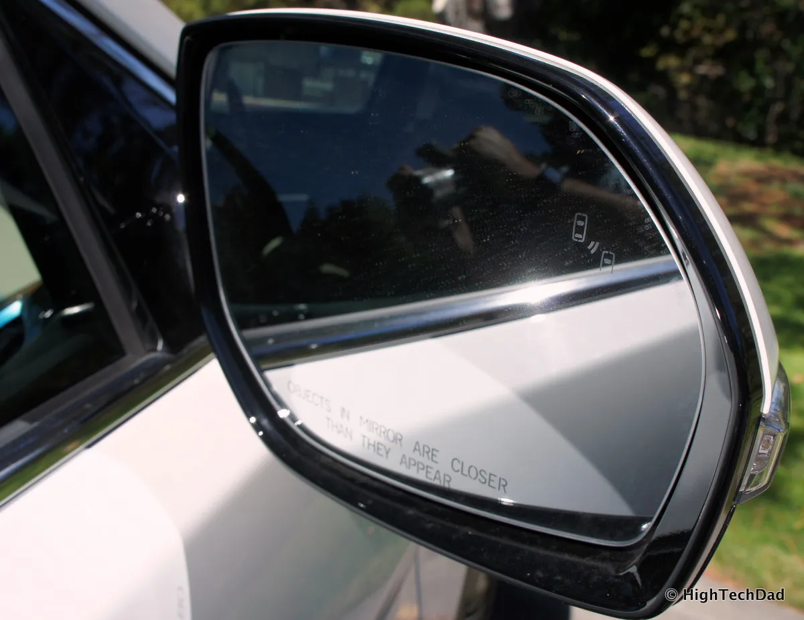

Latin America sells far more electric SUVs than sedans, so the list of electric sedans is short. Among those available, the blind spot monitor does not work the same on all of them. Some light up a lamp in the side mirror, the classic system. Tesla, on the other hand, shows the image from a side camera on the central screen when the driver uses the turn signal.

## What electric sedans offer

| Sedan | How it warns of the blind spot | Where it is sold | Source of the data |
|---|---|---|---|
| BYD Seal | Light in the door mirror, plus lane change alert | Colombia, since 2023 | El Carro Colombiano |
| Tesla Model 3 | Side camera on the screen when signaling, with a red bar if there is a vehicle | Colombia, Mexico and Chile | Tesla manual |
| Arcfox S5 | Unconfirmed: the brand mentions "multiple assists" but gives no detail | Colombia, since August 2026 | El Carro Colombiano |

The **BYD Seal** that reached Colombia in 2023, in its dual-motor 516 hp version, has the most complete system in the table: a blind spot indicator in the mirror, lane change assist, emergency lane keeping, side and rear collision alerts and adaptive cruise, with two radars in front and four behind. It launched at COP 250 million.

The **Tesla Model 3** solves the blind spot with cameras. According to its manual, when the driver activates the turn signal, the screen shows the camera on that side and, if it detects a vehicle in the next lane, draws a vertical red bar over the image. The feature must be turned on in the screen menu. The practical difference is where the driver looks: at the central screen, not the mirror.

The **Arcfox S5**, which reached Colombia in August 2026 from COP 139.99 million, is the case to check. Its SUV sibling, the Arcfox T5, does have a blind spot monitor according to the brand, but for the sedan the published information only speaks of "similar" equipment. Before buying it, ask for the trim's spec sheet.

*The classic system lights up a lamp in the side mirror when a vehicle is in the blind spot. Photo: Michael Sheehan, CC BY 2.0, via Wikimedia Commons.*

## Why not every car has a blind spot monitor

In the European Union, the safety regulation in force since July 2024 requires all new cars to have autonomous braking and emergency lane assist, but the blind spot monitor is only mandatory for buses and trucks. On passenger cars it is up to each brand, and it is not mandatory in Latin America either. That is why it is one of the driver aids that varies most between versions of the same model.

Latin NCAP does take it into account: the blind spot detector is one of the systems it evaluates in its safety assist pillar.

## How to check before buying

On the spec sheet, look for the abbreviations **BSD** or **BSM** (blind spot detection or monitor). If it says "lane change alert" or **LCA**, the system also warns when a vehicle approaches fast from behind. On the test drive, ask the advisor to show it working on a multi-lane road: a light in the mirror and an image on the screen are very different experiences.

If a sedan is not a must, there are more options with blind spot monitors among SUVs and hatchbacks: we gather them in [this list](/es/notas/carros-electricos-pequenos-punto-ciego-asistente-de-carril/).

## Frequently asked questions

### Which electric sedan has a blind spot monitor?

Among those sold in Colombia, the BYD Seal has one with a light in the mirror, and the Tesla Model 3 has a side camera shown on the screen.

### Does the Tesla Model 3 have a blind spot sensor?

It has a blind spot camera feature: when you signal, it shows the camera on that side on the screen and marks a vehicle with a red bar. It does not use the classic light in the mirror.

### What is the difference between blind spot and lane change alert?

Blind spot warns of a vehicle already beside you. Lane change alert also warns of one approaching fast from behind.

---

**Sources:** [El Carro Colombiano: BYD Seal in Colombia](https://www.elcarrocolombiano.com/lanzamientos/byd-seal-colombia-sedan-electrico-deportivo-precio-datos/) · [Tesla: Model 3 manual, blind spot camera](https://www.tesla.com/ownersmanual/2017_2023_model3/en_ae/GUID-682FF4A7-D083-4C95-925A-5EE3752F4865.html) · [El Carro Colombiano: Arcfox in Colombia](https://www.elcarrocolombiano.com/lanzamientos/arcfox-colombia-carros-electricos-premium-t1-s5-t5-precios-datos/) · [Autos de Primera: Arcfox launch](https://autosdeprimera.com/noticias/noticias-nacionales/arcfox-lanzamiento-colombia-2026/) · [SIMI: mandatory systems in the European Union](https://www.simi.ie/en/road-safety/gsr) · [La Tercera: Latin NCAP protocol](https://www.latercera.com/mtonline/noticia/latin-ncap-endurece-el-protocolo-ahora-evaluable-sobre-cuatro-pilares/FWNAESK5J5BOREUBHNK76QFU5E/)
