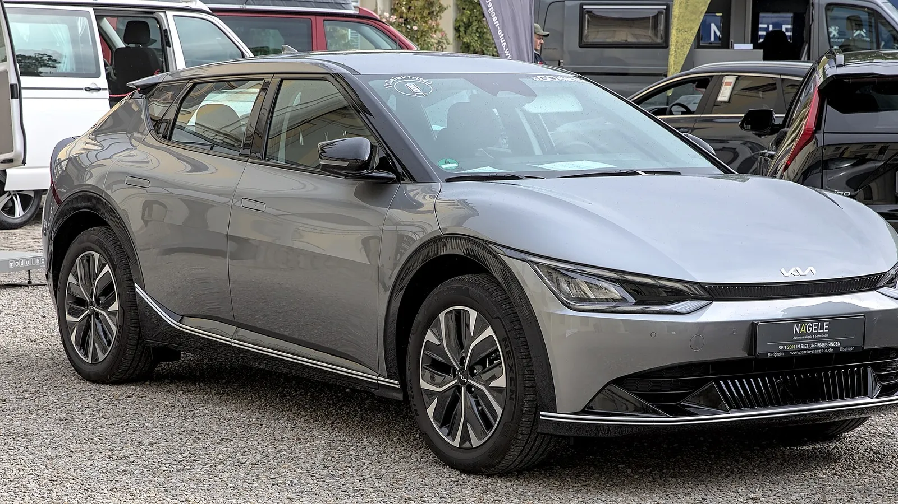

It may sound odd, but an electric car with its main battery at 90% can refuse to start. The culprit is usually the other battery, the small **12-volt** one, the same kind every gasoline car has. According to European roadside assistance figures cited by the magazine ONMOTOR, **12% of breakdown calls** from EVs in the first quarter of 2026 were caused by this battery.

## The essentials

- **An EV has two batteries:** the high-voltage traction battery that moves the car, and an auxiliary 12-volt one.
- **The 12-volt battery** powers the lights, the screens, the door locks and the systems that “wake up” the car.
- **If it runs flat,** the car will not start even if the main battery is full.
- **The fix** is usually cheap: around €80 in Europe, according to ONMOTOR. The real problem is being stranded.

## Why it runs flat

In a gasoline car, the alternator recharges the 12-volt battery while the engine runs. An EV has no alternator: a converter takes energy from the main battery and passes it to the small one. If that converter fails, or if the car sits switched off for a long time while connected systems keep drawing power, the 12-volt battery drains.

EVs also run plenty of systems with the car switched off: internet connectivity, apps, alarms and surveillance cameras. They all draw from the small battery.

*The Kia EV6 shares its platform with the Ioniq 5 and was also included in the recalls over the charging unit. Photo: Alexander Migl, CC BY-SA 4.0, via Wikimedia Commons.*

## The Hyundai and Kia case

The best-known example is the **ICCU**, the integrated charging control unit in Hyundai, Kia and Genesis EVs built on the E-GMP platform, such as the **Ioniq 5**, the **Ioniq 6** and the **EV6**. Among other jobs, that unit keeps the 12-volt battery charged. According to InsideEVs, when a transistor in the ICCU fails, the fuse that feeds the small battery blows, the car shows a **reduced power** warning and gradually loses power until it stops.

Hyundai and Kia issued recalls in the United States covering more than 200,000 cars built between 2022 and 2025. The repair includes a software update and, if the fault is found, replacement of the ICCU. Some owners reported a second failure after the repair.

## Warning signs

A 12-volt battery rarely dies all at once. It usually gives signs first: the car is slow to “wake up”, the screen reboots on its own or the door locks respond late. If a 12-volt battery warning also appears, the margin is already short.

If a reduced power warning comes on while you are driving, get off the road and find service soon. According to the US regulator's report, the driver may have up to 45 minutes before the car stops, but that is not a margin worth betting on.

> If you are going to leave your EV unused for several days, check the owner's manual for how to reduce consumption while the car is off, for example by turning off surveillance mode. And keep the brand's roadside assistance number at hand.

## Frequently asked questions

### Does an electric car have a 12-volt battery?

Yes. Besides the large traction battery, it has an auxiliary 12-volt battery for the lights, screens and start-up systems.

### Why won't my EV start if the battery is charged?

Most likely the 12-volt battery is flat.

### How much does it cost to replace the 12-volt battery?

Far less than the traction battery. In Europe it costs around €80, according to ONMOTOR.

### Is my Ioniq 5 or EV6 part of the recall?

Ask your dealer using the car's VIN. In Colombia, you can also check the recall campaigns published by the Superintendence of Industry and Commerce.

Compare models and warranties in the [Mejor Eléctrico comparator](/es/comparador/?a=hyundai-ioniq-5-84-kwh-rwd-2026-eu&b=kia-ev6-long-range-2wd-2026-eu).

---

**Sources:** [ONMOTOR: real-world EV problems in 2026](https://onmotor.es/problemas-reales-en-los-coches-electricos-en-2026/) · [InsideEVs: what we know about the ICCU failure](https://insideevs.com/features/752768/hyundai-kia-genesis-iccu-failure/) · [InsideEVs: recall of more than 200,000 EVs](https://insideevs.com/news/742007/hyunda-kia-iccu-12-volt-recall/)
