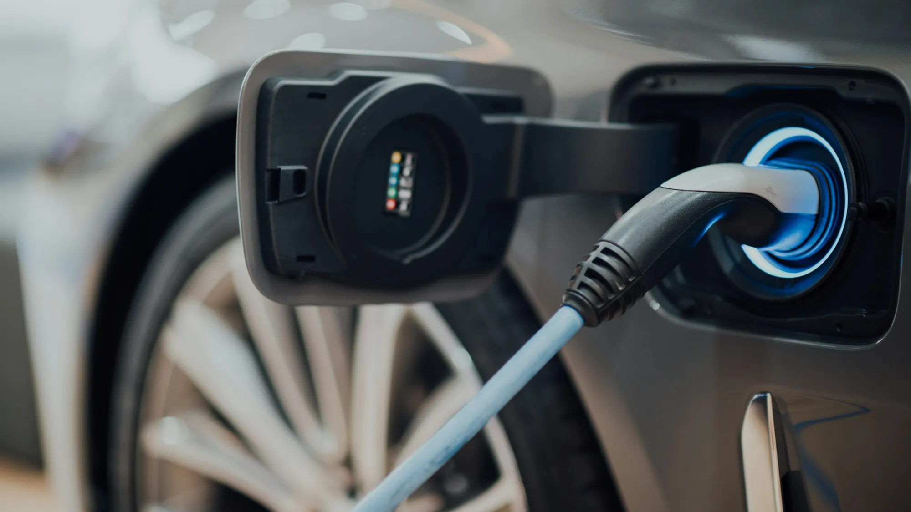

"And when the battery dies, how much will it cost?" It is the objection that shows up most in the comments on any EV video. It is a reasonable doubt: the battery is the most expensive part of the car. But experience from markets where EVs have been on the road for more than ten years shows that **a battery rarely fails all at once**: it loses capacity little by little.

## What happens to a battery over the years

With each charge and discharge cycle, a battery loses a small part of its capacity. In practice, that translates into less distance per charge, not a car that stops starting. Studies of large fleets in Europe and the United States show gradual losses that vary widely by model, chemistry and use.

Two chemistries dominate the Colombian market:

| Chemistry | Where you will find it | Strength | Weakness |
|---|---|---|---|
| **LFP** (lithium iron phosphate) | Most Chinese and entry-level EVs, such as the Chery E5 or the Kia EV2 | Very durable and tolerates charging to 100% well | Less energy per kilo |
| **NMC** (nickel, manganese and cobalt) | Many European, Korean and high-end models | More range with less weight | Best not left at 100% for long |

## What warranty is offered in Colombia

Brands increasingly compete on warranty. Two examples from 2026 launches:

- **Kia EV2:** 8 years or 160,000 km (99,000 miles), whichever comes first.
- **Chery E5:** 8 years or 200,000 km (124,000 miles), whichever comes first.

What matters is in the small print. Before signing, ask:

1. **Is the warranty for the battery or the whole car?** Sometimes the terms differ.
2. **What percentage of capacity is guaranteed?** Many brands cover the battery if it falls below a certain level, for example 70%, within the term.
3. **What voids it?** Using uncertified chargers, skipping dealer maintenance or electrical modifications.
4. **Does it transfer when you sell the car?** Key if you plan to resell it.

*Slow charging at home puts the least stress on the battery. Photo: CHUTTERSNAP on Unsplash.*

## The habits that protect it most

- **Charge at home most of the time.** DC fast charging heats the battery more. Using it on trips is normal; using it every day speeds up wear.
- **Follow the recommendation for your chemistry.** With LFP, many brands suggest charging to 100% from time to time to calibrate the system. With NMC, the usual daily limit is 80%.
- **Do not leave the car empty for long.** A battery that spends weeks below 10% degrades more.
- **Avoid extreme heat when you can.** Parking in the shade in hot cities helps.

> If you buy used, ask the brand's dealer for the battery state of health (SoH) report. It is the most important figure on the car. We explain it in our [guide to buying a used EV](/es/notas/comprar-carro-electrico-usado-que-revisar/).

## Frequently asked questions

### How much does it cost to replace the battery?

It depends heavily on the model and on whether it is replaced whole or by modules. Ask the dealer for a quote before buying, especially if the car is used and near the end of its warranty.

### Can the battery be repaired?

On many models, yes: the damaged modules are replaced rather than the whole battery. Not all brands offer that service in Colombia.

### Does Bogotá's climate affect the battery?

Bogotá's mild climate is favorable. Extreme cold and intense heat affect batteries most, and neither is common in the city.

Check each model's battery capacity and warranty in the [Mejor Eléctrico comparison tool](/es/comparador/).

---

**Sources:** [El Carro Colombiano: Kia EV2 in Colombia](https://www.elcarrocolombiano.com/lanzamientos/kia-ev2-colombia-precio-caracteristicas-suv-electrico/) · [El Carro Colombiano: Chery E5 in Colombia](https://www.elcarrocolombiano.com/resenas/chery-e5-primer-contacto-suv-electrica-precio-colombia/)
