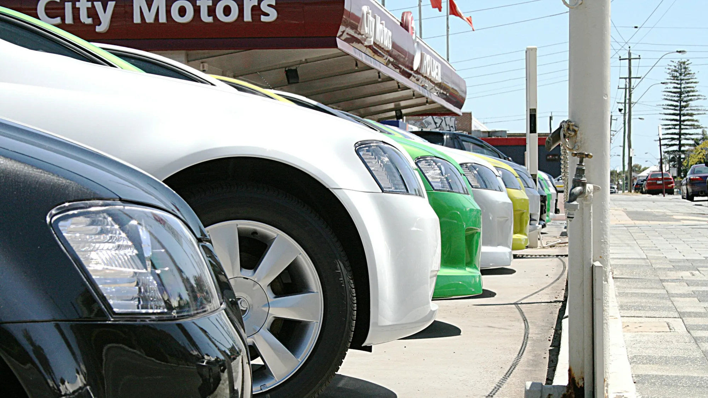

The battery is the part that most worries EV buyers, and with reason: it is the most expensive in the car and the one that defines what it is worth when sold. The good news is that manufacturers estimate a service life of 15 to 20 years. The bad news is that replacing it out of warranty comes with a high bill.

## The essentials

- **Estimated service life:** between 15 and 20 years, according to manufacturers and the Colombian trade group Acomoves.
- **Capacity loss:** about 1.8% a year; after ten years it would keep about 82%.
- **Typical warranty:** 8 years and between 150,000 and 200,000 km (93,000 and 124,000 miles), depending on the brand.
- **Cell prices:** world average of USD 108 per kWh at the end of 2025, according to BloombergNEF.
- **Cost of a full replacement:** between 40% and 45% of the car's value, according to a calculation cited by Noticias Caracol.

## How much does a battery cost?

There are two ways to do the math, and they give very different results:

| Calculation | 60 to 80 kWh battery |
|---|---|
| Cell price only (USD 108 per kWh) | Between USD 6,480 and 8,640, about COP 21 to 29 million |
| Full replacement at a dealer (40% to 45% of the car's value) | For a COP 100 million car, about COP 40 million |

The difference is that the cell price does not include the casing, control electronics, import costs, labor or dealer margin. In practice, the figure you will see on a quote is closer to the second.

And the whole battery does not always have to be replaced. Many faults are fixed by replacing **a module** or a control component, at a much lower cost.

*In the used market, battery condition counts for more than mileage. Photo: Vaughan Willis on Unsplash.*

## How it affects resale

The used EV market in Colombia is still very young, and there is not enough data to know how much they depreciate. In Europe, the magazine ONMOTOR reports models that lost up to **52%** of their price in three years, out of fear of used batteries and because of how fast new generations arrive.

Colombian journalist Juan Pablo Clopatofsky compares it to a cell phone: it keeps working but loses capacity, and that makes it less attractive. That is why, when selling or buying a used EV, the most important figure is the battery's **state of health** (SOH), which the dealer can measure with a diagnostic.

> If you are going to sell your EV, ask for a battery condition report before listing it. A high SOH and a valid warranty are the two arguments that best hold up the price.

## What wears it most

Daily fast charging is the habit that speeds up wear most, because it heats the cells and subjects them to high currents. Leaving the car for several days at 100% or near 0% also stresses them, which is why many manufacturers recommend charging to 80% in daily use. Extreme heat adds to it, something to bear in mind in cities such as Cali or Barranquilla if the car sleeps in the sun.

We explain this in more detail in [our article on battery life and warranty](/es/notas/bateria-carro-electrico-vida-util-garantia/).

## Frequently asked questions

### How much does an EV battery cost in Colombia?

The cells of a 60 to 80 kWh battery would cost COP 21 to 29 million, but a full replacement at a dealer can approach 40% of the car's value.

### How long does an EV battery last?

Between 15 and 20 years, according to manufacturers, although it loses about 1.8% of its capacity a year.

### Does the warranty cover the battery?

Yes, normally for 8 years and between 150,000 and 200,000 km (93,000 and 124,000 miles). Also check the minimum capacity percentage the brand guarantees.

### Is it worth buying a used EV?

It can be, if the battery has a good state of health and the warranty is still valid. Ask for the diagnostic before buying.

Compare each model's battery warranty in the [Mejor Eléctrico comparison tool](/es/comparador/).

---

**Sources:** [Semana: how long batteries last and what they cost](https://www.semana.com/vehiculos/articulo/marcas-revelan-cuando-duran-y-cuanto-valen-las-baterias-de-los-autos-electricos-que-llegan-a-colombia/202637/) · [Pulzo: reselling used EVs](https://www.pulzo.com/carros/venta-carros-electricos-segunda-colombia-clopatofsky-dice-que-pasara-PP5103945) · [ONMOTOR: real problems with EVs in 2026](https://onmotor.es/problemas-reales-en-los-coches-electricos-en-2026/)
