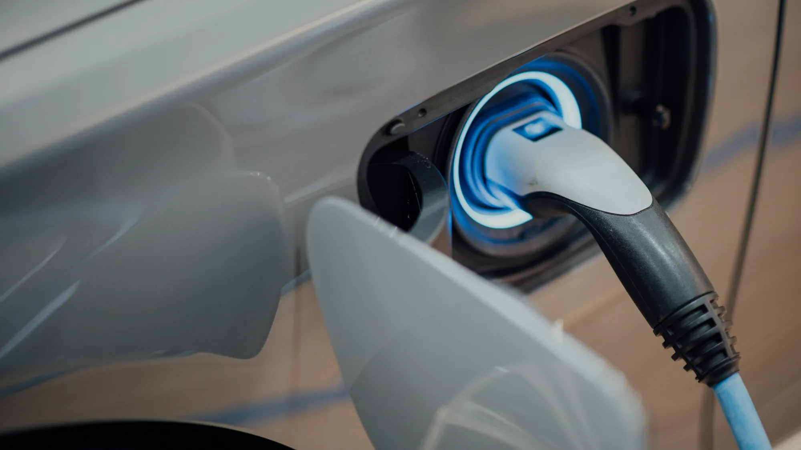

It happens more often than you would think: someone arrives at a highway charging station with the battery at 15% and finds the hose does not fit the car. Colombia has no single charging standard, because EVs arrive from the United States, Europe, Korea and China, and each market brings its own plug.

## The five connectors you will find

| Connector | Charging type | Where it comes from | Where you will see it in Colombia |
|---|---|---|---|
| **Type 1 (J1772)** | AC, slow or semi-fast | United States and Asia | Home chargers and Enel's 7.2 kW stations |
| **Type 2 (Mennekes)** | AC | Europe | Home chargers and public level 2 chargers |
| **CCS1 (Combo 1)** | DC, fast charging | United States and Korea | Fast charging stations |
| **CCS2 (Combo 2)** | DC, fast charging | Europe | Fast charging stations, increasingly common |
| **GB/T** | AC and DC, with two separate sockets | China | High-power fast charging stations |

CCS is the "combo" version of Type 1 and Type 2: it has the AC connector on top and two large DC pins below. That is why a car with a CCS2 socket also takes slow charging with a Type 2 cable.

## Why it matters to you

The same model can come with different connectors depending on where it is imported from. For example, the **Kia EV2** sold in Colombia uses **Type 1 and CCS1** sockets, while in Europe the same car comes with Type 2 and CCS2. Many Chinese EVs arrive with **GB/T**.

That has three practical consequences:

1. **At home**, the wall charger must have your car's connector, or you will need an adapter.
2. **On the street**, not all stations have all hoses. In Bogotá there are stations with 30 kW CCS2, 30 kW CCS1 and 75 kW GB/T at the same point, but many others offer only one option.
3. **On the highway**, the risk is greater, because fast-charging points are further apart.

*Before a trip, check the operator's app to see which connectors each station has. Photo: CHUTTERSNAP on Unsplash.*

## What is coming: the interoperability rule

Colombia's Ministry of Mines and Energy proposed that every charging operator have **at least one Type 2 connector** at its level 2 and 3 stations, and **at least one CCS Combo 2** at level 3 stations, the fast-charging ones. If the rule is adopted as proposed, the European standard would become the common minimum at public stations.

For anyone buying a car with CCS1 or GB/T today, that does not mean being left without charging, but it does mean relying more on adapters or on stations that keep other hoses.

> Key question for the dealer: which socket does the version sold in Colombia have, does it include adapters and does the warranty cover them?

## Frequently asked questions

### Are adapters safe?

Certified adapters for AC charging are in common use. For DC fast charging there are fewer options, and it is best to use only those recommended by the car's manufacturer.

### How do I know which connector my car has?

It is on the spec sheet and on the charging port cover. If there are two separate sockets, it is probably GB/T. If there is a round socket on top and two large pins below, it is CCS.

### What connector does Tesla use in Colombia?

Tesla installs its own Superchargers. Confirm with the brand the socket type of the Colombian version and its compatibility with other operators' stations.

Check each model's connector and charging power in the [Mejor Eléctrico comparison tool](/es/comparador/).

---

**Sources:** [La República: charging points and interoperability](https://www.larepublica.co/economia/solo-hay-un-punto-de-carga-por-cada-337-carros-electricos-en-total-hay-229-electrolineras-4398785) · [Revista Turbo: charging stations in Bogotá](https://www.revistaturbo.com/?p=17223) · [El Carro Colombiano: Kia EV2 in Colombia](https://www.elcarrocolombiano.com/lanzamientos/kia-ev2-colombia-precio-caracteristicas-suv-electrico/) · [Blu Radio: Voltex Terpel stations](https://www.bluradio.com/motor/lista-de-electrolineras-voltex-terpel-en-colombia-so35)
