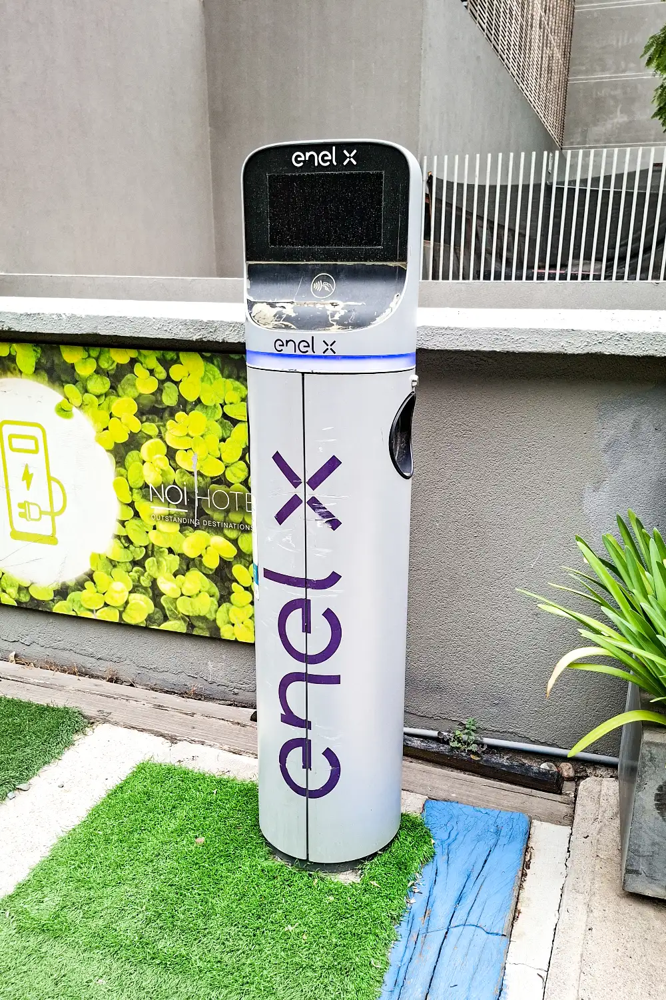

Brazil is by far the country with the most charging stations in Latin America: **25,429 public stations** in mid-2026, according to the Latin American and Caribbean Energy Organization (Olade). Mexico and Chile follow. Colombia, the region's third-largest EV market by sales, has a much smaller network: about **229 public stations with around 520 charging points**, according to its Ministry of Mines and Energy.

## Public stations by country

| Country | Public charging stations | Source and date |
|---|---|---|
| Brazil | 25,429 | Olade, mid-2026 |
| Mexico | 3,212 | Olade, 2025 |
| Chile | 1,133 | Olade, 2025 |
| Colombia | 229 stations, with about 520 points | Ministry of Mines, 2026 |
| Uruguay | 202 | Olade, 2025 |

The figures are not fully comparable. A **station** is a place, and a **charging point** is each connector that can serve a car at the same time. A Tesla station with eight connectors counts as one station and eight points. Some countries report one and others the other, and the cutoff dates do not match either.

## The problem is not the number, but the ratio

What matters is how many cars share each station. Using 2025 sales of electrified cars, which include EVs and plug-in hybrids, the difference between countries is large:

| Country | Electrified cars sold in 2025 | Public stations | Sold per station |
|---|---|---|---|
| Brazil | 278,462 | 14,827 (2025) | About 19 |
| Mexico | 147,110 | 3,212 | About 46 |
| Chile | 37,544 | 1,133 | About 33 |
| Colombia | 87,677 | 300 (2025) | About 292 |
| Uruguay | 20,585 | 202 | About 102 |

Our own calculation with the sales published by Bloomberg Línea and Olade's stations for 2025. It is an approximation: it compares one year's sales with the available network. For Colombia, Olade counted 300 stations and the Ministry of Mines 229; the difference comes from how a station is defined and counted.

Colombia sells far more electrified cars per station than any other country in the table, and the gap opened because sales grew faster than the network: in 2025 they rose 69%. The consequences show in the lines at some Bogotá charging stations, as we report in [Colombia's charging point shortage](/es/notas/electrolineras-colombia-deficit-puntos-de-carga-2026/).

*Chile had 1,133 public charging stations in 2025, according to Olade. Photo: Carlos Figueroa Rojas, CC BY-SA 4.0, via Wikimedia Commons.*

## Mexico, the fastest grower

According to Olade, Mexico went from **2,046 to 4,802 charging points** in a single quarter of 2026. The Electro Movilidad Asociación, which brings together several brands, counted **60,934 charging positions**, public and private, in June 2026, 55% more than a year earlier, but **56,279 of them were private**, in homes and companies. Mexico's public network is growing, but most charging still happens in the garage.

## Brazil: more stations because there are more cars

Brazil accounts for more than half of the region's EVs: more than 580,000 in mid-2026, according to Olade. A fleet that size gives each public station a wide base of potential customers, something small markets do not have yet. In the region as a whole, more than a million EVs and plug-in hybrids are already on the road.

> For anyone buying an EV in a country with little public network, the key question is whether you can charge at home or at work. If not, the nearby network decides whether the purchase makes sense.

## Frequently asked questions

### How many charging stations are there in Colombia?

About 229 public stations with around 520 points, according to the Ministry of Mines and Energy. Four out of ten are in Bogotá.

### Which Latin American country has the most charging stations?

Brazil, with 25,429 public stations in mid-2026.

### How many EVs are there in Latin America?

More than a million EVs and plug-in hybrids as of June 2026, according to Olade.

---

**Sources:** [Forbes Perú: Latin America passes a million EVs, Olade data](https://forbes.pe/negocios/2026-09-22/latinoamerica-supera-el-millon-de-vehiculos-electricos-con-mas-de-la-mitad-en-brasil/) · [Bloomberg Línea: sales and charging stations by country](https://www.bloomberglinea.com/2026/02/11/los-paises-lideres-en-ventas-de-autos-electricos-y-estaciones-de-carga-en-latinoamerica/) · [UnoTV: Mexico's electromobility barometer](https://www.unotv.com/negocios/mexico-rompe-record-en-ventas-de-autos-electricos-en-el-primer-semestre-de-2026/) · [Minuto60: 520 points at 229 stations in Colombia](https://minuto60.com/vida-moderna/esta-preparada-colombia-boom-los-vehiculos-electricos/13487)
