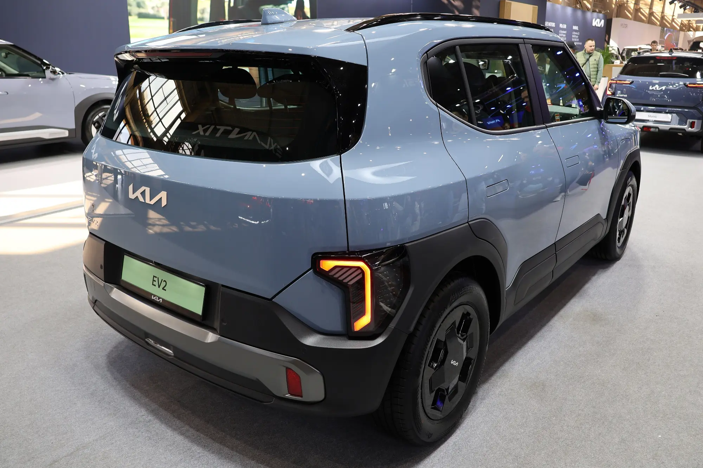

The down payment is the decision that moves the cost of a car loan most, after the rate. Every peso paid up front is a peso on which no interest is charged for years. To show it, we did the math with a **COP 89.99 million** EV, the price of the Kia EV2 or the new BYD Dolphin in Colombia, financed over **60 months** at a green rate of **12.5% effective annual**, the lowest reported in 2026.

## How much it changes with the down payment

| Down payment | Amount up front | Amount financed | Monthly payment | Total interest |
|---|---|---|---|---|
| 10% | COP 8,999,000 | COP 80,991,000 | COP 1,794,907 | COP 26.7 million |
| 20% | COP 17,998,000 | COP 71,992,000 | COP 1,595,473 | COP 23.7 million |
| 30% | COP 26,997,000 | COP 62,993,000 | COP 1,396,039 | COP 20.8 million |
| 50% | COP 44,995,000 | COP 44,995,000 | COP 997,171 | COP 14.8 million |

Our own calculation, with no insurance or other charges.

Going from 10% to 30% down cuts the payment by about **COP 400,000 a month** and saves about **COP 6 million** in interest. With 50%, the saving against 10% rises to almost COP 12 million.

## The term weighs as much as the down payment

With 20% down, these are the numbers by term:

| Term | Monthly payment | Total interest |
|---|---|---|
| 36 months | COP 2,385,540 | COP 13.9 million |
| 48 months | COP 1,890,044 | COP 18.7 million |
| 60 months | COP 1,595,473 | COP 23.7 million |
| 72 months | COP 1,401,336 | COP 28.9 million |
| 84 months | COP 1,264,562 | COP 34.2 million |

Stretching the loan from 60 to 84 months cuts the payment by about COP 330,000, but adds more than COP 10 million in interest. And with an EV there is an extra risk: the car depreciates quickly, and with a long term it is possible to owe more than the car is worth during the first years. We explain this in [new or used](/es/notas/carro-electrico-nuevo-o-usado-que-conviene/).

*With 20% down, a car at this price comes to about COP 1.6 million a month over 60 months at 12.5%, without insurance. Photo: Peżot, CC BY-SA 4.0, via Wikimedia Commons.*

## How much to put down: a practical rule

There is no percentage that is right for everyone, but there are three useful limits:

**Do not leave yourself without a cushion.** Putting all your savings into the down payment and being left without an emergency fund is a common mistake. The car payment keeps coming even if something unexpected happens.

**Look at offer conditions.** Some special rates require a minimum. Tesla's 0% financing, for example, asks for 50% up front. We explain it in [this article](/es/notas/tesla-financiacion-0-por-ciento-colombia/).

**Consider the VAT refund.** If you buy a new EV with a certificate from the UPME, Colombia's energy planning unit, you can ask the DIAN, the tax authority, to refund the VAT paid: on a COP 89.99 million car, about COP 4.3 million. That money arrives months after the purchase and can go toward paying down principal, which reduces the interest over the whole loan. The math is in [how much paying down principal saves](/es/notas/abonar-a-capital-credito-carro-electrico-ley-1555/).

> If you are torn between a bigger down payment and a shorter term, do both calculations. In our example, going from 60 to 48 months saves about COP 5 million in interest, more than raising the down payment from 20% to 30%, which saves about COP 3 million. In exchange, the monthly payment rises by almost COP 300,000.

## Frequently asked questions

### How much down payment is required for an EV?

It depends on the bank and the offer. There are loans with down payments from 10%, and special offers asking for more, such as the 50% for Tesla's 0% financing.

### What is the payment on a COP 90 million car?

With 20% down, 60 months and 12.5% effective annual, about COP 1.6 million a month, without insurance.

### Is an 84-month term a good idea?

It lowers the payment, but in our calculation it adds more than COP 10 million in interest against 60 months. It only makes sense if the 60-month payment does not fit your budget.

---

**Sources:** [La República: EV loan rates in 2026](https://www.larepublica.co/finanzas/los-beneficios-tributarios-y-financieros-por-adquirir-un-carro-electrico-o-uno-hibrido-4387951) · [Portafolio: Tesla's 0% financing](https://www.portafolio.co/negocios/vehiculo/tesla-ofrece-financiacion-al-0-de-interes-en-colombia-para-model-3-y-model-y-asi-puede-acceder-505120) · [Portafolio: term and process of the VAT refund](https://www.portafolio.co/negocios/vehiculo/este-es-el-plazo-y-el-proceso-para-que-le-devuelvan-el-iva-si-compro-un-carro-hibrido-o-electrico-503819)
