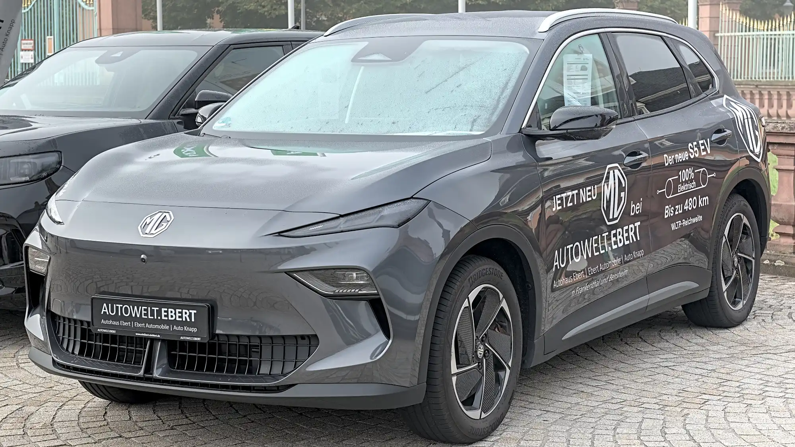

For years, one of the objections to EVs was that they were expensive to insure. A study by **Seguro Canguro**, covering **200,552 quotes** made between January 2025 and September 2026 at the 13 insurers offering comprehensive cover in Colombia, shows that this is no longer true in percentage terms: insuring an EV costs **the same or slightly less** than insuring a gasoline car of the same value. But other problems appear.

## The essentials

- **Rate of the cheapest offer, cars worth COP 90 to 120 million:** 2.07% of the car's value for an EV, 2.13% for gasoline.
- **Cars worth COP 160 to 220 million:** 1.69% for EVs, 1.92% for gasoline.
- **Hybrids** are the cheapest of the three to insure.
- **Offers per quote:** a gasoline car receives offers from 10 insurers on average; an EV, from 8.

## What you pay in pesos

A similar rate does not mean the policy costs the same, because EVs are more expensive: the typical value of a quoted EV was COP 115 million, against COP 52 million for a gasoline car. These were the cheapest annual premiums found for three of the most quoted EVs:

| Model | Annual premium from |
|---|---|
| Tesla Model Y | COP 2,343,700 |
| BYD Yuan Up | COP 2,273,545 |
| MG S5 | COP 1,741,764 |

The **Tesla Model Y** was also the most quoted new car in the country, with five times more quotes than the second, the Kia Picanto.

*The MG S5 had the lowest premium of the study's three most quoted EVs. Photo: Alexander-93, CC BY-SA 4.0, cropped, via Wikimedia Commons.*

## Why the rate stopped being higher

EVs have not become cheaper to insure. The EV rate stayed near **2%** for six quarters, while the rate for gasoline cars **fell from 2.53% to 1.99%**. In other words, they evened out because the gasoline rate came down.

## The small print

The study found two points worth checking before signing:

- **The battery** is only covered if the damage comes from an accident. Normal wear is not covered by the policy, but by the manufacturer's warranty.
- **The home charger** is only covered if declared as an accessory.

There is also less competition: four insurers offer a policy on fewer than a third of EV quotes. With fewer offers per car, comparing pays off more, and the study found that EV buyers get twice as many quotes as average.

> Get quotes from several insurers, ask in writing what happens to the battery in a crash and declare the wall charger as an accessory. Also check that roadside assistance includes towing to the nearest charging station.

## Frequently asked questions

### How much does EV insurance cost in Colombia?

About 2% of the car's value a year on the cheapest offer. For a Tesla Model Y, from about COP 2.34 million a year.

### Is it more expensive to insure an EV than a gasoline car?

In percentage terms, no longer: it costs the same or slightly less. In pesos it does, because EVs are worth more.

### Does insurance cover the battery?

Only if the damage comes from an accident. Wear is covered by the manufacturer's warranty.

### Does insurance cover the home charger?

Only if it is declared as an accessory on the policy.

Compare EVs in the [Mejor Eléctrico comparison tool](/es/comparador/?a=tesla-model-y-rwd-2026-eu&b=mg-mgs5-ev-64-kwh-2026-eu).

---

**Sources:** [La Nota Económica: Seguro Canguro's study on EV insurance](https://lanotaeconomica.com.co/movidas-empresarial/el-carro-nuevo-mas-cotizado-para-asegurar-en-colombia-en-2026-es-un-tesla-y-asegurar-un-electrico-ya-cuesta-lo-mismo-que-uno-a-gasolina/) · [Noticias RCN: how much it costs to insure an EV](https://www.noticiasrcn.com/economia/cuanto-cuesta-seguro-carro-electrico-colombia-1065033)
