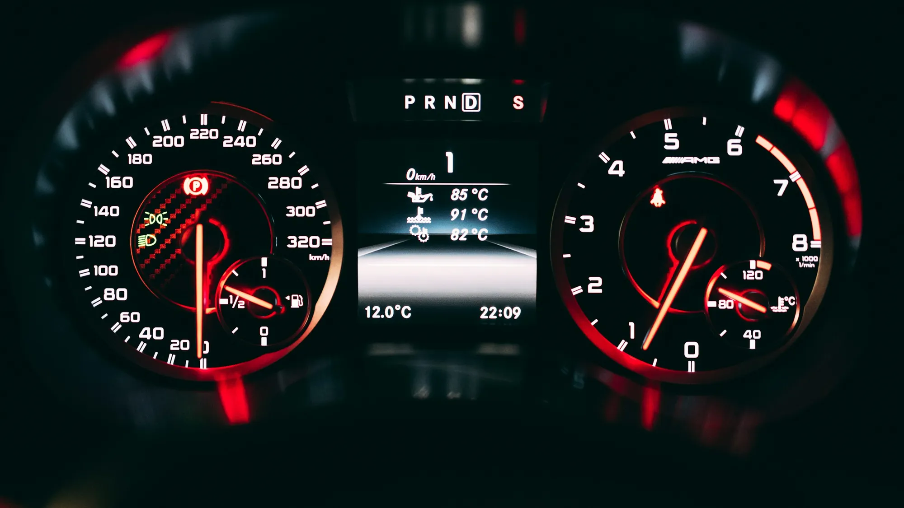

The **Chery E5** sold in Colombia claims **422 km (262 miles)** of range. It also claims **350 km (217 miles)**. Both figures are official, and both belong to the same car with the same battery. The difference is the test cycle, and understanding it keeps you from buying with the wrong expectations.

## What a homologation cycle is

It is a standardized lab test: the car runs on rollers following a fixed pattern of speeds, accelerations and stops. It lets you compare models on equal terms, but each region designed its own, and some are tougher than others.

| Cycle | Origin | How optimistic it is |
|---|---|---|
| **CLTC** | China | The most optimistic: low speeds and lots of stops |
| **NEDC** | Europe, now replaced | Optimistic: designed in the 1980s, with gentle acceleration |
| **WLTP** | Europe and other markets | More realistic: higher speeds, harder acceleration, more time at highway pace |
| **EPA** | United States | The toughest of the four |

## The difference in numbers

These examples use published figures for models sold or announced in Colombia:

| Model | Optimistic cycle | WLTP | Difference |
|---|---|---|---|
| Chery E5 | 422 km (262 miles) NEDC | 350 km (217 miles) | 17% less |
| Geely EX5 SE | 410 km (255 miles) NEDC | 345 km (214 miles) | 16% less |
| Deepal S05 (large battery) | 620 km (385 miles) CLTC | 485 km (301 miles) | 22% less |

The rule of thumb: **the CLTC figure usually sits 20% to 30% above the WLTP one**, and the NEDC figure about 20% above.

*Speed is what hurts range the most: above 100 km/h, consumption climbs sharply because of air resistance. Photo: Claude Gabriel on Unsplash.*

## And in real life, how far does it go?

No cycle replaces daily use, but some patterns repeat:

- **In the city, in traffic jams**, an EV tends to get close to its WLTP figure or even beat it, because it recovers energy every time it brakes and uses almost nothing when stopped.
- **On the highway, at 100 km/h or more**, it is normal to land 20% to 30% below the WLTP figure.
- **Steep climbs** use a lot of energy, although part of it comes back on the way down. A trip from Bogotá down to the warm lowlands uses less energy going than coming back.
- **Air conditioning** weighs more in Barranquilla, on Colombia's hot Caribbean coast, than in Bogotá.

## How to compare without falling into the trap

1. **Always compare on the same cycle.** A CLTC figure next to a WLTP one tells you nothing.
2. **If there is only an NEDC figure**, take off about 16% to get close to WLTP. **If it is CLTC**, take off about 22%.
3. **Look at efficiency, not just range.** A car that uses 14 kWh per 100 km is more efficient than one that uses 18, even if the second has a bigger battery and claims more kilometers.
4. **Plan with a margin.** Plan trips using 70% of the WLTP range and arrive at the charger with at least 15% battery left.

> In the Mejor Eléctrico comparator, every range figure appears with its cycle. When two cars do not share a cycle, the range score comes from an estimated WLTP equivalent using these same discounts, and the table marks it as an estimate.

## Frequently asked questions

### Why do Chinese brands publish CLTC figures?

Because it is the official homologation cycle in their home market. When the car is sold in Europe, they publish the WLTP figure, which is the one worth looking for.

### Does range drop over the years?

Yes, because the battery loses capacity with use. The loss is usually gradual, and battery warranties cover drops below a certain percentage.

### How far does an EV go in Bogotá?

Altitude does not affect an electric motor the way it affects a gasoline engine. What matters most in Bogotá is traffic, which generally favors EVs.

Compare the range of two models on the same cycle in the [Mejor Eléctrico comparator](/es/comparador/).

---

**Sources:** [El Carro Colombiano: Chery E5 in Colombia](https://www.elcarrocolombiano.com/resenas/chery-e5-primer-contacto-suv-electrica-precio-colombia/) · [Portafolio: Geely EX5 SE in Colombia](https://www.portafolio.co/negocios/vehiculo/nueva-suv-electrica-llega-a-colombia-este-es-el-precio-de-lanzamiento-y-las-caracteristicas-de-la-geely-ex5-se-497330) · [Mejor Eléctrico: Deepal S05 with LiDAR](/es/notas/deepal-s05-lidar-2027/)
