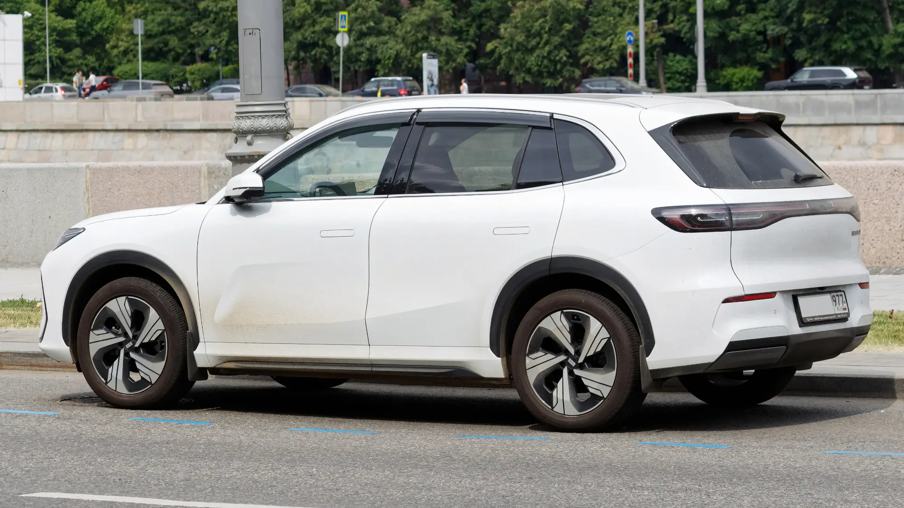

The **Geely EX5** received **five stars** from **Euro NCAP** in April 2025, with high scores in all four areas. But its datasheet carries a note that does not appear in most tests: in the frontal crash, **several welds at the base of the front pillar came apart** and the metal tore. Euro NCAP penalized it for that and still gave it the top rating.

## Key facts

- **Rating:** 5 stars, published in April 2025.
- **Tested version:** EX5 Pro, front-wheel drive, 1,715 kg.
- **Adult occupant protection:** 86%.
- **Child occupant protection:** 87%.
- **Vulnerable road users:** 83%.
- **Safety assist:** 83%, tied with the Polestar 3 as the highest of its round.

## What happened with the welds

In the frontal crash against a mobile barrier, which simulates another car, welds around the base of the **A-pillar** came loose. The A-pillar is the column that holds up the roof on each side of the windshield. It is part of the safety cage that protects the occupants, and a broken joint there is a sign the structure was working at its limit.

Euro NCAP applied a **penalty** to the adult score. Geely submitted information showing that, in a more severe crash, the structure would not have suffered much greater damage, and Euro NCAP accepted it. Knee and leg protection for the front occupants was good and the airbags worked well.

> The rating is still five stars, but the weld issue is the kind of detail that only shows up when you read the full datasheet, not the headline.

## The other crash tests

| Test | Result |
|---|---|
| Frontal, full-width rigid wall | Weak chest protection for the rear passenger |
| Side impact against another vehicle and against a pole | Good or adequate protection |
| Far-side occupant movement | Well controlled, with a center airbag between the seats |
| Whiplash | Good front and rear |
| Rescue | 2.7 out of 4. Doors and windows open after submersion |

*From the side you can see the front pillar, the area where the welds came loose in the frontal test. Photo: Retired electrician, public domain (CC0), via Wikimedia Commons.*

## Driver assistance: among the best of its round

Autonomous emergency braking avoided most collisions with other cars (7.4 out of 9) and worked almost perfectly with cyclists (7.8 out of 8) and motorcyclists (6 out of 6). With pedestrians it was good head-on, but **weak with pedestrians behind the car** when reversing. Lane keeping and the driver monitor also scored high.

One detail: the EX5 has a standard child presence detection system, but it **did not meet Euro NCAP's requirements** and earned no points for it.

## The EX5 SE in Colombia

In Colombia, Geely sells the **EX5 SE** for **COP 92.9 million**, online only. It has six airbags, autonomous emergency braking, lane keeping assist and a 360° camera, the same type of equipment that scored in the European test. The body is the same, so the rating is a good indicator, though not a test of the Colombian version. We covered it in our [story on the EX5 SE](/es/notas/geely-ex5-se-colombia-precio-autonomia-ficha/).

## Frequently asked questions

### How many Euro NCAP stars does the Geely EX5 have?

Five stars, published in April 2025.

### What problem did Euro NCAP find?

Several welds at the base of the front pillar came apart in the frontal crash. Euro NCAP penalized it, but kept the five stars.

### Does it have a Latin NCAP rating?

No. Latin NCAP has not published a test of the EX5.

Compare the EX5 with the Chery E5 in the [Mejor Eléctrico comparison tool](/es/comparador/?a=geely-ex5-se-2026-co&b=chery-e5-luxury-2026-co).

---

**Sources:** [Euro NCAP: Geely EX5 test datasheet](https://cdn.euroncap.com/media/86298/euroncap-2025-geely-ex5-datasheet.pdf) · [Repairer Driven News: April 2025 results and concerns](https://www.repairerdrivennews.com/2025/04/15/euro-safety-test-gives-chinese-models-top-scores-but-notes-concerns/)
