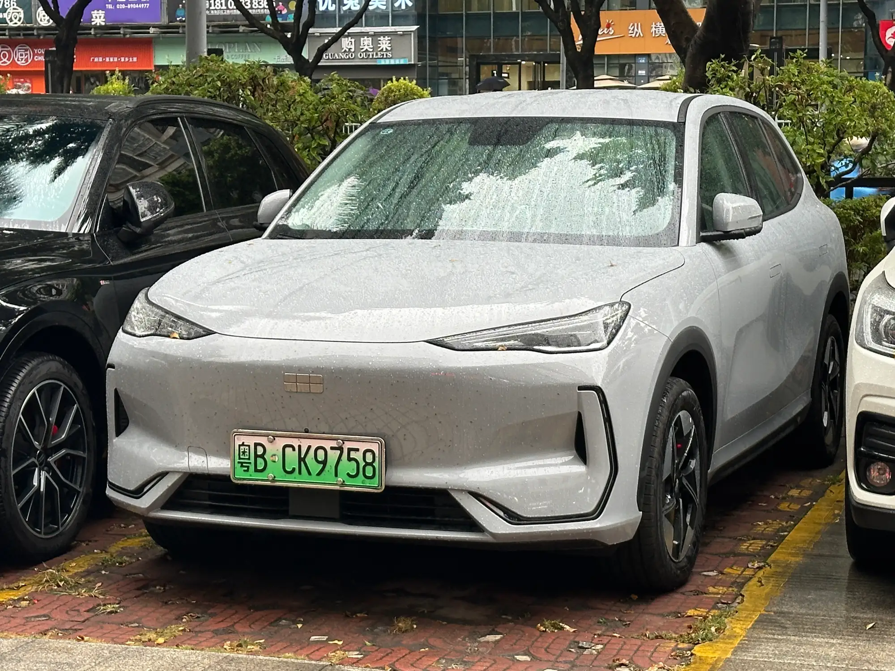

The **Geely EX5 Max** is the best-equipped version of Geely's electric SUV, known in China as the Galaxy E5. It shares its mechanicals with the Pro trim and adds the full driver-assistance and comfort package. The big difference from the **EX5 SE**, the cheapest trim, is the battery: 60.2 kWh versus 49.5 kWh, which buys 80 km (50 miles) more WLTP range.

## Geely EX5 Max specs

| Spec | EX5 Max |
|---|---|
| Motor | 215 hp (160 kW) and 320 Nm, front-wheel drive |
| 0 to 100 km/h | 6.9 s according to El Carro Colombiano; Geely's spec sheet says 6.1 s |
| Top speed | 175 km/h |
| Battery | 60.2 kWh, LFP |
| Range | 425 km (264 miles) WLTP, 490 km (304 miles) NEDC |
| DC fast charging | Up to 110 kW, 30% to 80% in 20 minutes |
| Length, width and height | 4,615, 1,901 and 1,670 mm |
| Wheelbase | 2,750 mm |
| Cargo space | 461 L, up to 1,877 L with the second row folded |
| Ground clearance | 173 mm unladen |
| Airbags | 6 |

Figures from Geely Colombia's spec sheet and from El Carro Colombiano. The spec sheet lists two values for range and consumption, probably because of wheel size, without saying which applies to each trim; the lower figures are used here.

## What the Max adds

According to the information published for Colombia, the Max comes with **automatic emergency braking, adaptive cruise control, lane-keeping assist, blind-spot monitoring and a 360-degree camera**. On the comfort side it adds a **panoramic roof, ventilated front seats, a wireless phone charger and V2L**, the feature that lets you use the car as a power source for external devices.

In Uruguay, where the same trim is sold, the specialist press also lists a 16-speaker Flyme sound system with speakers in the headrests, a head-up display projected onto the windshield and a 15.4-inch center screen. Check with the dealer whether the Colombian version comes with exactly the same equipment.

*Over the SE, the Max adds adaptive cruise control, blind-spot monitoring, a panoramic roof and V2L, among other things. Pictured, the Chinese Galaxy E5. Photo: JustAnotherCarDesigner, CC0, via Wikimedia Commons.*

## Max vs SE

| Spec | EX5 SE | EX5 Max |
|---|---|---|
| Battery | 49.5 kWh | 60.2 kWh |
| WLTP range | 345 km (214 miles) | 425 km (264 miles) |
| Automatic emergency braking and lane assist | Yes | Yes |
| Adaptive cruise and blind-spot monitoring | Not confirmed in the sources | Yes |
| Panoramic roof | Yes | Yes |
| Ventilated seats | No data in the sources | Yes |
| Starting price | COP 92.9 million, online only | Not published in the sources consulted |

The SE already covers the safety essentials: automatic emergency braking, lane assist and a 360-degree camera, the same kind of equipment that was scored in the Euro NCAP test. That is why the choice between the two comes down to range and comfort more than basic safety.

## Who the Max is for

If you take frequent highway trips, the extra 80 km (50 miles) of WLTP range and 110 kW charging justify the difference. Adaptive cruise control also reduces fatigue on long drives. If you drive mostly in the city, the SE covers what you need for less money.

The EX5 has five stars from Euro NCAP, with a caveat about welds that came loose in the frontal test, as we explained in [our safety story](/es/notas/geely-ex5-euro-ncap-5-estrellas/). And if you are torn between the EX5 and the Kia EV3, the comparison is in [this story](/es/notas/geely-ex5-vs-kia-ev3-comparativa/).

## Frequently asked questions

### What does the Geely EX5 Max come with?

A 60.2 kWh battery, 425 km (264 miles) WLTP, 110 kW charging, automatic emergency braking, adaptive cruise control, lane assist, blind-spot monitoring, a 360-degree camera, a panoramic roof, ventilated seats, a wireless charger and V2L.

### What is the range of the Geely EX5 Max?

425 km (264 miles) WLTP and 490 km (304 miles) NEDC, according to the information published in Colombia.

### Does the Geely EX5 Max have V2L?

Yes. It lets you plug external devices into the car's battery.

---

**Sources:** [Geely Colombia: EX5 spec sheet](https://geely.com.co/wp-content/uploads/2026/03/EX5_Bajav4.pdf) · [El Carro Colombiano: Geely EX5 in Colombia](https://www.elcarrocolombiano.com/lanzamientos/geely-ex5-colombia-precios-datos-suv-electrica-mas-completa-por-su-precio/) · [El Carro Colombiano: Geely EX5 SE](https://www.elcarrocolombiano.com/novedades/geely-ex5-se-suv-electrica-barata-precio-colombia/) · [Portafolio: Geely EX5 SE](https://www.portafolio.co/negocios/vehiculo/nueva-suv-electrica-llega-a-colombia-este-es-el-precio-de-lanzamiento-y-las-caracteristicas-de-la-geely-ex5-se-497330) · [Autoblog Uruguay: EX5 Max test drive](https://www.autoblog.com.uy/2025/07/prueba-geely-ex5-max-6022-kwh.html)
