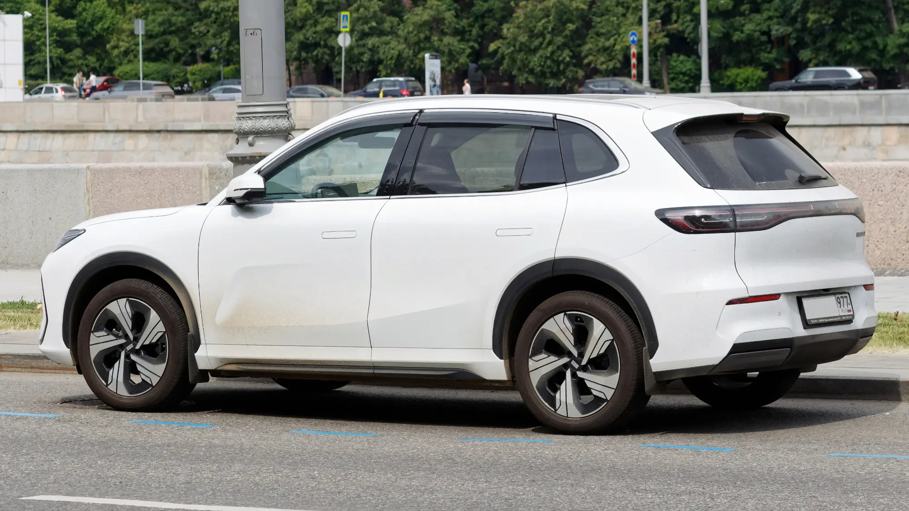

In July 2026, Geely launched the **EX5 SE** (Special Edition) in Colombia, a midsize electric SUV priced at **COP 92,990,000** for the **first 200 units**, sold exclusively on the Geely Colombia website. It is a family-sized SUV with plenty of power and a high safety rating, in the price range where the Chery E5, MG S5 and BYD Yuan Up compete.

## The essentials

- **Price:** COP 92,990,000 for the first 200 units, online only.
- **Battery:** 49.52 kWh.
- **Range:** 345 km (214 miles) WLTP, 410 km (255 miles) NEDC.
- **Motor:** 215 hp (160 kW) and 320 Nm.
- **Safety:** five stars from Euro NCAP and ANCAP.

## A different way to sell

With the EX5 SE, Geely is one of the first Chinese brands to copy Tesla's strategy: **direct online sales** at a fixed price, with limited units. The advantage for buyers is price transparency. The drawback is having to confirm carefully where the car is delivered, where maintenance is done and how the warranty works.

## Safety and technology

The EX5 has full equipment for its price:

- **Six airbags**, stability control, ABS and EBD.
- **Autonomous emergency braking**, lane keeping assist and a **360° camera**.
- **Tire pressure monitor**.
- **15.4-inch** touchscreen and 10.2-inch digital cluster, with the Flyme Auto system, **Apple CarPlay and Android Auto**.
- Wireless phone charger and **over-the-air** software updates.

The **five stars from Euro NCAP and ANCAP** are one of its strong cards, because few EVs at its price in Colombia have such a rating.

*From the side you can see the 2,750 mm wheelbase, which explains the good rear space. Photo: Retired electrician, public domain (CC0), via Wikimedia Commons.*

## Specs

| Item | Value |
|---|---|
| Trim | EX5 SE (Special Edition) |
| Power | 215 hp (160 kW) |
| Torque | 320 Nm |
| Battery | 49.52 kWh |
| Range | 345 km (214 miles) WLTP / 410 km (255 miles) NEDC |
| Wheelbase | 2,750 mm |
| Trunk | 461 liters; 1,877 with the seats folded |
| Central screen | 15.4 inches |
| Instrument cluster | 10.2 inches |
| Safety | Five stars from Euro NCAP and ANCAP |

At launch, Geely did not publish fast charging power, charging times or warranty terms. Those are the first details to ask for before buying.

## How it compares

Against the **Chery E5**, the EX5 SE costs about COP 13 million more, has more power (215 hp against 208) and a bigger trunk (461 liters against 442), with almost the same WLTP range (345 km against 350 km, or 214 against 217 miles). The difference is in safety: the EX5 includes advanced driver aids and a 360° camera from this version.

> Before buying online, confirm in writing the workshop network in your city, the delivery time and the battery warranty.

## Frequently asked questions

### How much does the Geely EX5 cost in Colombia?

The EX5 SE launched at COP 92,990,000 for the first 200 units sold on the brand's website.

### How much range does it have?

345 km (214 miles) on the WLTP cycle and 410 km (255 miles) on the NEDC cycle.

### Where is it sold?

On the official Geely Colombia website, during the launch.

Compare it with the Chery E5 in the [Mejor Eléctrico comparison tool](/es/comparador/).

---

**Sources:** [Portafolio: the Geely EX5 SE reaches Colombia](https://www.portafolio.co/negocios/vehiculo/nueva-suv-electrica-llega-a-colombia-este-es-el-precio-de-lanzamiento-y-las-caracteristicas-de-la-geely-ex5-se-497330) · [El Carro Colombiano: Chery E5](https://www.elcarrocolombiano.com/resenas/chery-e5-primer-contacto-suv-electrica-precio-colombia/)
