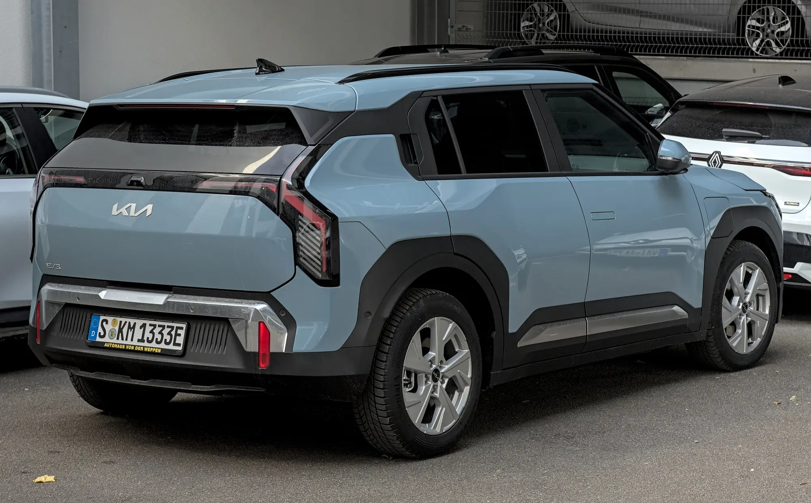

The **Geely EX5** and the **Kia EV3** are two electric SUVs that cross paths in searches, but they play in different price leagues in Colombia. The EX5 is bigger and cheaper. The EV3 is more compact, has the version with the most range and Kia's dealer network, in exchange for a price that started at COP 164.99 million. The figure-by-figure comparison shows where the difference lies.

## Head to head

| Item | Geely EX5 | Kia EV3 |
|---|---|---|
| Trims in Colombia | SE, Pro and Max | Light and Light+ |
| Entry price | COP 92.9 million (SE) | COP 164.99 million (launch, April 2025) |
| Power and torque | 215 hp and 320 Nm | 201 hp and 283 Nm |
| 0 to 100 km/h | 6.9 s (Pro and Max) | 7.5 s |
| Battery | 49.5 kWh (SE) or 60.2 kWh (Pro and Max) | 58.3 kWh (Light) or 81.4 kWh (Light+) |
| WLTP range | 345 km, or 214 miles (SE) and 425 km, or 264 miles (Pro and Max) | Up to 605 km, or 376 miles (Light+) |
| Fast charging | 110 kW, from 30% to 80% in 20 min (Pro and Max) | From 10% to 80% in about 31 min |
| Length | 4,615 mm | 4,300 mm |
| Trunk | 461 L | 460 L |
| V2L | Yes on the Max; 3.3 kW on the New Zealand version | 3.6 kW on the New Zealand version |
| Euro NCAP | 5 stars, 86% adult | 4 stars as standard, 5 with package; 83% adult |

Data from the brands in Colombia, from tests by El Carro Colombiano and Valora Analitik, and from Euro NCAP. V2L comes from New Zealand's EV Database and may vary by trim.

*The Kia EV3 Light+ is rated at 605 km (376 miles) WLTP, about 180 km (112 miles) more than the EX5 Pro or Max. Photo: Alexander Migl, CC BY-SA 4.0, via Wikimedia Commons.*

## Where each one wins

**Range: Kia EV3.** The EV3 Light+, with 81.4 kWh, is rated at 605 km (376 miles) WLTP, about 180 km (112 miles) more than the EX5 Pro or Max. It is the biggest difference in the table and the main reason to pay more for the Kia, especially for people who travel often by road.

**Price: Geely EX5.** With the EX5 SE at COP 92.9 million, the gap against the EV3's launch price exceeds COP 70 million. Even the Geely's Pro and Max versions sit far below it.

**Space: a tie on the trunk, the EX5 on the rest.** Both have about 460 liters of trunk space, but the EX5 is 31.5 cm longer. To find out how much of that translates into rear space, it is worth sitting in the second row of both on the test drive.

**Safety: the EX5 on stars, with a caveat.** The EX5 has five Euro NCAP stars, although the test recorded welds coming loose in the frontal crash, as we explain in [its article](/es/notas/geely-ex5-euro-ncap-5-estrellas/). The EV3 stays at four stars with standard European equipment and only reaches five with the assistance package, according to [its test](/es/notas/kia-ev3-euro-ncap-4-o-5-estrellas/). In the crash tests, the EV3 scored 83% for adults and the EX5, 86%.

**Fast charging: it depends on the starting point.** The EX5 declares 20 minutes from 30% to 80% and the EV3 31 minutes from 10% to 80%. Since the starting point differs, the two figures cannot be compared directly.

## Which to choose

The **Geely EX5** is the rational buy for a family that drives mainly in the city and wants maximum space for the lowest price. The **Kia EV3 Light+** is justified for people who make long trips often and value Kia's dealer network. If your budget is closer to the EX5, the EV3's natural rival within Kia is the [EV2](/es/notas/kia-ev2-colombia-precio-autonomia-ficha/).

> Before deciding, compare them side by side in the [comparison tool](/es/comparador/), with range figures from the same cycle.

## Frequently asked questions

### Which is better, the Geely EX5 or the Kia EV3?

It depends on use. The EX5 wins on price and size; the EV3 Light+ wins on range, with 605 km (376 miles) WLTP against 425 km (264 miles).

### Which one is safer?

In Euro NCAP, the EX5 has five stars and the EV3 four with its standard equipment, or five with the assistance package.

### Which has the bigger trunk?

Almost equal: 461 liters for the EX5 and 460 for the EV3.

---

**Sources:** [Portafolio: Geely EX5 SE](https://www.portafolio.co/negocios/vehiculo/nueva-suv-electrica-llega-a-colombia-este-es-el-precio-de-lanzamiento-y-las-caracteristicas-de-la-geely-ex5-se-497330) · [Geely Colombia: EX5 spec sheet](https://geely.com.co/wp-content/uploads/2026/03/EX5_Bajav4.pdf) · [El Carro Colombiano: Geely EX5 in Colombia](https://www.elcarrocolombiano.com/lanzamientos/geely-ex5-colombia-precios-datos-suv-electrica-mas-completa-por-su-precio/) · [Valora Analitik: Kia EV3 in Colombia](https://www.valoraanalitik.com/kia-presento-en-colombia-el-electrico-ev3/) · [EV Database: Kia EV3 Long Range](https://ev-database.org/car/3638/Kia-EV3-Long-Range) · [EVDB New Zealand: V2L power figures](https://evdb.nz/v2l) · [Euro NCAP: Geely EX5 test data sheet](https://cdn.euroncap.com/media/86298/euroncap-2025-geely-ex5-datasheet.pdf) · [Euro NCAP: Kia EV3](https://www.euroncap.com/en/results/kia/ev3/54845)
