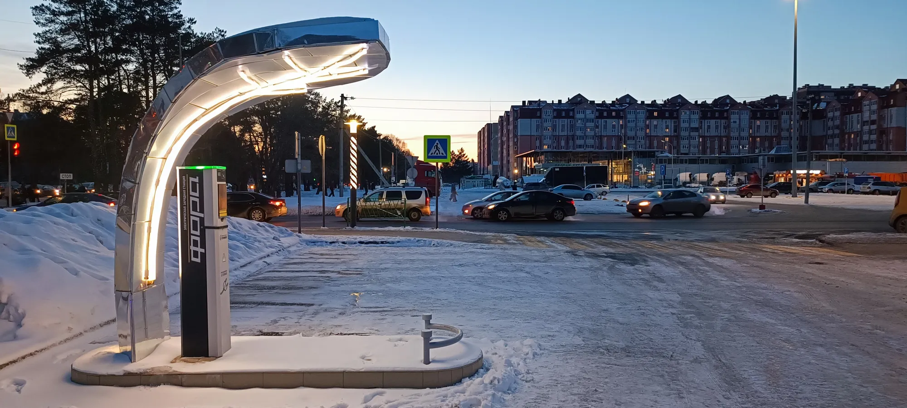

A gasoline car heats its cabin with the engine's waste heat. An electric car has no spare heat: its motor is so efficient that it barely produces any. To warm the cabin and the battery it has two options. The simplest is an **electric resistance heater**, like the one in a space heater, which uses a lot of energy. The other is a **heat pump**, which works like an air conditioner in reverse: it moves heat from the outside air to the inside and uses considerably less energy to achieve the same effect.

## How much range it saves

The company Recurrent analyzed real-world data from more than 18,000 EVs in the United States over the winter of 2024 and 2025. At **0 °C**, these were the results:

| Type of car | Range kept at 0 °C |
|---|---|
| EVs with a heat pump | 83% |
| EVs without a heat pump | 75% |
| 2025 Tesla Model 3 with a heat pump | 87% |
| Tesla Model 3 without a heat pump | 79% |

Source: Recurrent, cited by The Car Guide in January 2025.

In the cold, the heat pump wins back about 8 percentage points of range. In a car rated at 400 km (249 miles), that means roughly 30 km (19 miles) more on a winter day.

*Where it freezes, the heat pump wins back about 8 points of range. In most of Latin America the benefit is much smaller. Photo: RG72, CC BY 4.0, via Wikimedia Commons.*

## And in Latin America?

Many Latin American cities rarely see temperatures below freezing, and plenty of them sit between 20 °C and 30 °C for much of the year. There, the problem is not heating the cabin but cooling it, and an EV's air conditioning already runs on an efficient compressor, heat pump or not. That is why on the Colombian coast, in Mexico City or in São Paulo, a heat pump adds little.

There are exceptions. In high-altitude cities with cold mornings, such as Bogotá, Quito or La Paz, the heater and the defogger get used every day, and the heat pump helps somewhat in the mornings. In southern Chile and Argentina, with winters that drop below freezing, the benefit comes closer to what the Recurrent study found.

| Situation | Is a heat pump worth it? |
|---|---|
| Warm climate all year | Barely: the energy goes into air conditioning |
| High-altitude city with cold mornings | Somewhat, in the mornings and when it rains |
| Winters with sub-zero temperatures | Yes: it can add tens of kilometers per charge |

## What a heat pump does not solve

The battery also suffers in extreme cold: it charges more slowly and delivers less energy, with or without a heat pump. And in intense heat, the work falls on the battery cooling system, which does not depend on the heat pump. In Latin America, highway speed and terrain weigh more on range than temperature does. We explain it in [real-world range in Colombia](/es/notas/autonomia-real-carro-electrico-colombia-montana-autopista/).

> If you live in a mild or warm climate, do not pay for a more expensive trim just for the heat pump. If you live where it freezes, put it on your list of must-haves.

## Frequently asked questions

### What is a heat pump in an electric car?

A system that heats the cabin by moving heat from the outside air, like an air conditioner in reverse, using less energy than an electric resistance heater.

### How much range does a heat pump save?

At 0 °C, EVs with a heat pump kept 83% of their range on average, against 75% for those without one, according to Recurrent.

### Do you need a heat pump in Colombia?

In most of the country, no. It can help somewhat in cold high-altitude cities, but in Colombia most of the energy goes into air conditioning and climbing mountains.

---

**Sources:** [The Car Guide: Recurrent study on heat pumps in winter](https://www.guideautoweb.com/en/articles/77130/this-key-feature-will-boost-your-ev-s-range-in-winter-study-shows) · [Driven: cold weather cuts EV range by 20% on average](https://www.drivencarguide.co.nz/news/cold-weather-slashes-ev-range-by-20-on-average-study)
