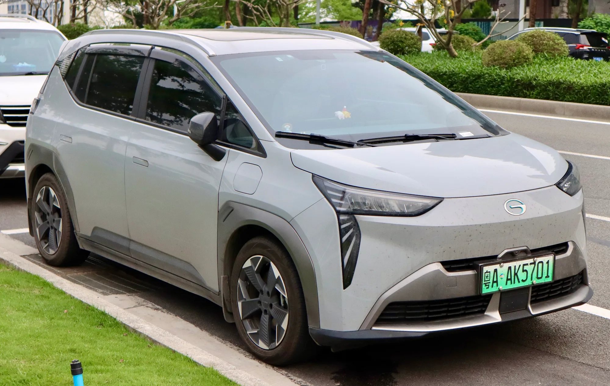

An EV has, in practice, two warranties: one for the **battery and electric system**, which lasts **eight years** at almost every brand, and another for **the rest of the car**, which runs from three to eight years depending on the brand. The second is the one that varies most, and the one most often forgotten when comparing prices.

## What each brand publishes

| Brand and model | Car warranty | Battery warranty | Market |
|---|---|---|---|
| Chery E5 | 8 years or 200,000 km (124,000 miles) | Included in the general warranty | Colombia |
| GAC AION Y Plus | 8 years or 160,000 km (99,000 miles) | 8 years or 200,000 km (124,000 miles) | Colombia |
| Kia EV2 | 8 years or 160,000 km (99,000 miles) | No separate figure in the source | Colombia |
| BYD (European range) | 6 years or 150,000 km (93,000 miles) | 8 years or 250,000 km (155,000 miles) | Europe |
| BYD Seagull | 6 years or 150,000 km (93,000 miles) | 8 years or 500,000 km (311,000 miles) | Colombia, 2024 test |
| Chevrolet Spark EUV | 5 years or 100,000 km (62,000 miles) | 8 years or 160,000 km (99,000 miles) | Colombia |
| JAC E10X | 5 years or 100,000 km (62,000 miles) | 5 years or 100,000 km (62,000 miles) | Colombia |
| Tesla Model 3 and Model Y | 4 years or 80,000 km (50,000 miles) | 8 years and 160,000 or 192,000 km (99,000 or 119,000 miles), depending on the version | Mexico |
| Chevrolet Equinox EV | 3 years or 50,000 km (31,000 miles) | 8 years or 160,000 km (99,000 miles) | Colombia |

Figures published by each brand or reported by the specialist press. Conditions may change with the model year and country, so the one that counts is what appears in the purchase contract.

The table shows two extremes. Chery covers the whole car for eight years, like the battery. Chevrolet, on the Equinox EV, gives the battery eight years but the rest just three, which from the fourth year leaves out parts such as the suspension, screen or cabin electronics.

*In Colombia, the GAC AION Y Plus has an eight-year warranty for both the car and the battery, with different mileage caps. Photo: User3204, CC BY-SA 4.0, via Wikimedia Commons.*

## What the battery warranty covers, and what it does not

A battery warranty **does not promise the battery will stay like new**. It promises it will not fall below a certain percentage of its original capacity. Tesla sets the minimum at **70% for the eight years**, and BYD also uses 70% in Europe. If capacity falls below that threshold within the term, the brand must repair or replace the battery. A battery that has lost 20% in six years gives no right to claim, because it is still above the threshold.

The mileage limit matters too. Eight years or 160,000 km (99,000 miles) is equivalent to 20,000 km (12,400 miles) a year. A ride-hailing driver or a salesperson covering 40,000 km (24,900 miles) a year uses up the warranty in four. For that use, BYD's 250,000 km (155,000 miles) in Europe or GAC and Chery's 200,000 km (124,000 miles) count for more than the years.

## What can void it

Each brand sets its conditions in the warranty manual, and it is worth reading before signing. The condition that defeats the most claims is maintenance: almost all contracts require it to be done on time and within the authorized network, and one skipped service can be enough for the brand to refuse a repair. Damage from crashes, flooding or unauthorized modifications, including a charger installed outside the manufacturer's specifications, is usually left out.

If you buy used, ask whether the warranty passes to the new owner and on what terms. The maintenance history recorded at the dealer is the first thing they will ask for. We explain this in [what to check when buying a used EV](/es/notas/comprar-carro-electrico-usado-que-revisar/).

> The useful question at the dealer is not "how many years of warranty does it have", but "what does the general warranty cover, what does the battery warranty cover and with what minimum capacity percentage?"

## Frequently asked questions

### How long does an EV warranty last?

The battery, almost always eight years, with a cap ranging from 100,000 to 500,000 km (62,000 to 311,000 miles) depending on the brand. The rest of the car, between three and eight years.

### What happens if the battery fails out of warranty?

The owner pays for the repair. In some cases it does not have to be replaced whole; modules can be swapped. The costs are in [how much it costs to replace the battery](/es/notas/bateria-carro-electrico-cuanto-cuesta-cambiarla-reventa/).

### Does the battery warranty cover the 12-volt battery?

Normally not. The small 12-volt battery that powers lights and computers is treated like any car battery. It is also the one that strands the most cars, as we report in [this article](/es/notas/bateria-12-voltios-carro-electrico-varado/).

---

**Sources:** [Tesla Mexico: vehicle warranty](https://www.tesla.com/es_MX/support/vehicle-warranty) · [Electrive: BYD extends its battery warranty in Europe](https://www.electrive.com/es/2026/01/19/byd-amplia-la-garantia-de-las-baterias-a-250000-kilometros/) · [El Carro Colombiano: BYD Seagull test](https://www.elcarrocolombiano.com/pruebas/byd-seagull-primer-contacto-en-colombia-test-drive-opiniones/) · [Chery Colombia: E5 spec sheet](https://www.chery.com.co/wp-content/uploads/2026/04/FICHATECNICA_E5_2026_v3.pdf) · [El Carro Colombiano: GAC AION Y Plus test](https://www.elcarrocolombiano.com/pruebas/gac-aion-y-plus-lo-manejamos-el-carro-electrico-que-si-cumplio-con-su-autonomia-video/) · [El Carro Colombiano: Kia EV2 in Colombia](https://www.elcarrocolombiano.com/lanzamientos/kia-ev2-colombia-precio-caracteristicas-suv-electrico/) · [Portafolio: Chevrolet Spark EUV](https://www.portafolio.co/negocios/vehiculo/el-viejo-spark-ahora-electrico-se-vuelve-a-instalar-en-el-pais-639650) · [El Carro Colombiano: Chevrolet Equinox EV](https://www.elcarrocolombiano.com/lanzamientos/chevrolet-equinox-ev-colombia-precio-datos-respuesta-americana-a-byd/) · [El Carro Colombiano: JAC E10X test](https://www.elcarrocolombiano.com/pruebas/jac-e10x-electrico-autonomia-real-y-costos-de-uso-prueba-definitiva-auteco-video/)
