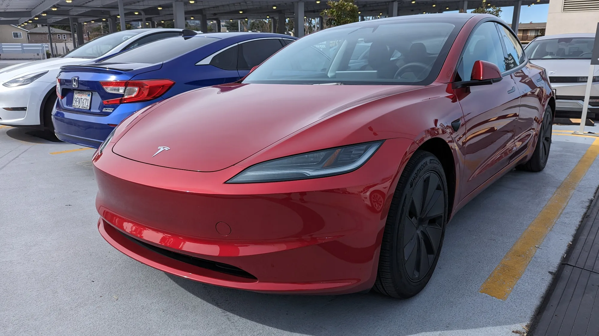

The short answer: between January and September 2026, **16,542 Teslas** were registered in Colombia, according to the bulletin from the trade groups Fenalco and Andi with data from RUNT, the national vehicle registry. Adding the 28 registered in 2025, the total exceeds **16,500 cars** in less than a year of official operation.

## The essentials

- **Official arrival:** November 20, 2025.
- **Registrations in 2025:** 28, mostly imports before the first official deliveries.
- **Registrations from January to September 2026:** 16,542.
- **Share among EVs:** 41.6%.
- **Share of the whole market:** 6.7%, the country's sixth brand for the year.
- **Model Y:** 14,381 units in 2026. **Model 3:** 2,161.

## What the figures show month by month

Tesla opened its first stores in Bogotá and Medellín in late 2025, and volume deliveries began in the first quarter of 2026. The Superintendence of Industry and Commerce (SIC), Colombia's consumer protection authority, reported that the brand received about **24,000 orders** between November 2025 and March 2026. The gap between that figure and registrations through September suggests that not all orders became sales, or that some deliveries were delayed, as the SIC itself acknowledged.

In **September 2026** it registered 2,435 cars, 7.2% of the total market, and was the **fifth best-selling brand in the country**, behind Kia, Toyota, Renault and Chevrolet. None of those four depends on a single model the way Tesla depends on the Model Y. That month, the **Model Y was the best-selling car in Colombia** across all technologies, with 2,220 units.

| Item | Figure |
|---|---|
| Teslas registered in 2025 | 28 |
| Teslas registered from January to September 2026 | 16,542 |
| Model Y in 2026 | 14,381 |
| Model 3 in 2026 | 2,161 |
| Tesla in September 2026 | 2,435 |
| Model Y in September 2026 | 2,220 |

*The Model 3 adds up to 2,161 registrations in 2026, far behind the Model Y. Photo: Mliu92, CC BY-SA 4.0, cropped, via Wikimedia Commons.*

## Where the Teslas are

The EV market is concentrated in three cities. So far in 2026, **Bogotá** has registered 20,707 EVs, **Medellín** 10,380 and **Cali** 3,246, according to the same bulletin. It does not break the data down by brand and city, so there is no official figure for how many Teslas are on the road in each. With its first stores in Bogotá and Medellín, most are probably there.

## What has not gone so well

The growth came with problems. In April, the SIC reported that more than **1,800 cars** due for delivery between February and March were still pending. Tesla also raised its entry prices after the launch: the Model 3 went to COP 114.9 million and the Model Y to COP 119.99 million.

> A brand holding four out of ten of the country's EVs is a strength for Tesla, but a risk for the market: any change in price or imports at a single company moves all the sector's figures.

## Frequently asked questions

### How many Teslas have been sold in Colombia?

16,542 between January and September 2026, plus 28 registered in 2025.

### What is the best-selling Tesla in Colombia?

The Model Y, with 14,381 units in 2026. In September it was the best-selling car in the country.

### What is Tesla's market share?

41.6% of EVs and 6.7% of all new cars registered in 2026.

### How many orders did Tesla receive when it arrived?

About 24,000 between November 2025 and March 2026, according to the SIC.

Compare the Model Y with its rivals in the [Mejor Eléctrico comparison tool](/es/comparador/?a=tesla-model-y-rwd-2026-eu&b=chery-icar-03-2wd-2025-co).

---

**Sources:** [Infobae: EVs in Colombia from January to September 2026](https://www.infobae.com/colombia/2026/10/10/crece-la-venta-de-vehiculos-electricos-en-colombia-cerca-de-40000-automotores-en-lo-corrido-del-2026/) · [ColombiNews: Tesla in September 2026](https://colombinews.com.co/tesla-se-posiciona-entre-las-cinco-marcas-mas-vendidas-en-colombia-en-septiembre-de-2026/) · [Semana: Tesla registrations in 2025](https://www.semana.com/vehiculos/articulo/cuantos-carros-vendio-tesla-en-colombia-durante-noviembre-la-cifra-dejo-algunas-dudas/202528/) · [La República: Tesla prices in Colombia](https://www.larepublica.co/empresas/tesla-eleva-sus-precios-de-entrada-despues-de-su-lanzamiento-a-114-9-millones-4276858) · [Blu Radio: orders and pending deliveries according to the SIC](https://www.bluradio.com/motor/tesla-vendio-en-cuatro-meses-lo-que-todo-el-mercado-colombiano-matricula-en-un-mes-segun-la-sic-so35)
