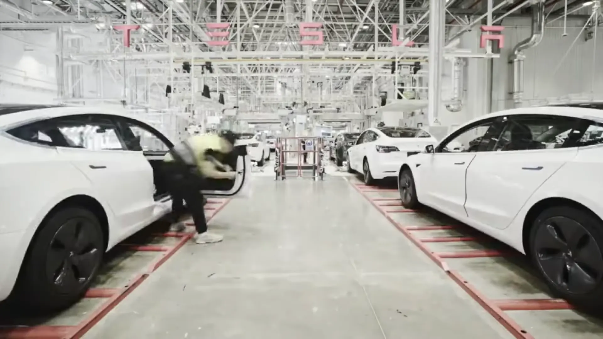

Tesla currently sells between 1.6 and 1.8 million cars a year worldwide. In **2025 it delivered 1,636,129**, according to its fourth-quarter report, and from January through September **2026 it has delivered 1,324,681**, up 8.8% on the same period a year earlier.

To put the figure in perspective: what Tesla delivered worldwide between January and September 2026 is about 80 times what it registered in Colombia over the same period.

## Deliveries year by year

| Year | Deliveries | Change from previous year |
|---|---|---|
| 2015 | 50,658 | |
| 2016 | 76,285 | +51% |
| 2017 | 103,181 | +35% |
| 2018 | 245,240 | +138% |
| 2019 | 367,500 | +50% |
| 2020 | 499,550 | +36% |
| 2021 | About 936,000 | +87% |
| 2022 | About 1.31 million | +40% |
| 2023 | 1,808,581 | +38% |
| 2024 | 1,789,226 | −1% |
| 2025 | 1,636,129 | −8.6% |
| 2026 (January to September) | 1,324,681 | +8.8% vs the same period of 2025 |

For 2021 and 2022, public compilations disagree on the final digits, so those figures are rounded.

The curve has two clear phases. Until 2023, Tesla grew at double digits almost every year, driven by the Shanghai factory, which began deliveries in late 2019, and by the Berlin and Texas plants, which opened in 2022. Since 2024 the brand has stopped growing: it had the installed capacity but no new lineup to sell. The Model Y and Model 3 are still almost everything it sells.

*The Shanghai factory began deliveries in late 2019 and drove Tesla's growth through 2023. Photo: China News Service, CC BY 3.0, via Wikimedia Commons.*

## Why deliveries fell in 2024 and 2025

The 2025 decline has several causes, and not all of them are Tesla's doing. In the United States, the US$7,500 federal EV tax credit ended on September 30, 2025. That pulled purchases forward into the third quarter and left a weak fourth quarter: **418,227 deliveries**, 16% fewer than a year earlier.

Competition also tightened. **BYD closed 2025 with 2.26 million sales** and overtook Tesla as the world's largest EV maker, although press reports of that figure don't always separate pure EVs from plug-in hybrids. Elon Musk's image weighed on the brand too: his political role and his support for Germany's AfD party sparked protests against the brand, such as "Tesla Takedown".

## 2026 so far

The year started weak, with **358,023 deliveries** in the first quarter, and then recovered: **480,126** in the second and **486,532** in the third. If the fourth quarter matches the third, Tesla would close 2026 with just over 1.8 million cars. That would beat 2025 and leave it practically tied with its 2023 record.

Part of the growth comes from new markets. Colombia, where Tesla opened stores in November 2025, added 16,542 registrations between January and September 2026. That is small next to the global total, but it makes the country one of the brand's fastest-growing markets. The details are in [how many Teslas have been sold in Colombia](/es/notas/cuantos-tesla-se-han-vendido-en-colombia/).

## Deliveries and production are not the same

Tesla reports two figures every quarter. **Deliveries** are cars that reached the customer; **production** is cars that left the factories. In 2025 it produced 1,654,667 cars and delivered 1,636,129, leaving about 18,500 in inventory. When production far outstrips deliveries, a round of discounts to clear inventory usually follows, as happened in the 2023 price war.

## Frequently asked questions

### How many Teslas are sold per year?

Between 1.6 and 1.8 million in each of the last three full years. The record is 2023, with 1,808,581 deliveries.

### How many Teslas were sold in 2025?

1,636,129, down 8.6% from 2024.

### What is the best-selling Tesla?

The Model Y. Together with the Model 3, it accounted for 98% of third-quarter 2026 deliveries; the Cybertruck, Model S and Model X split the rest.

---

**Sources:** [Electrek: Q4 and full-year 2025 deliveries](https://electrek.co/2026/01/02/tesla-tsla-releases-q4-delivery-results/) · [CBT News: second consecutive annual decline](https://www.cbtnews.com/tesla-posts-second-consecutive-annual-delivery-decline-in-2025/) · [Not a Tesla App: Q2 2026 deliveries](https://www.notateslaapp.com/news/4389/tesla-smashes-q2-2026-delivery-estimates) · [Electrek: Q3 2026 deliveries](https://electrek.co/2026/10/02/tesla-q3-2026-deliveries-486532/) · [Tridens Technology: sales by year compilation](https://tridenstechnology.com/tesla-sales-statistics)
